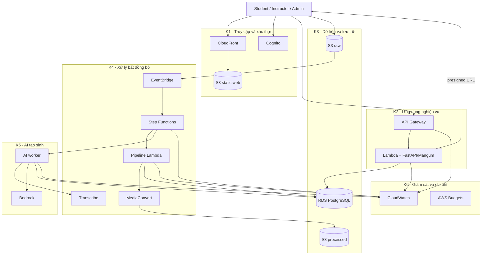

# LearnCloud

LearnCloud là hệ thống quản lý học tập lấy video làm trung tâm, hỗ trợ giảng viên biến video bài giảng thành transcript, tóm tắt, khái niệm, flashcard và checkpoint để duyệt trước khi công bố. Học viên học theo section, làm checkpoint và ôn tập có ngữ cảnh qua AI Tutor; quản trị viên quản lý tài khoản và theo dõi job.


## Giá trị và phạm vi MVP

- **Instructor:** quản lý course/section/lesson, upload video trực tiếp lên S3, theo dõi xử lý, duyệt nội dung AI, publish và xem báo cáo học tập.
- **Student:** đăng ký course đã publish, xem video cùng transcript, học flashcard, lưu tiến độ, làm checkpoint và remediation/Tutor.
- **Admin:** quản lý user, role/trạng thái tài khoản và xem danh sách job giám sát trong ứng dụng.
- MVP **không có thanh toán**, livestream, DRM, mobile app hay adaptive learning hoàn chỉnh.

## Kiến trúc tóm tắt



Thiết kế AWS trong báo cáo gồm K1–K6; repository có template/worker cho luồng này nhưng các cờ video/AI mặc định tắt. Xem [kiến trúc AWS](docs/02-architecture/aws-architecture.md) và [trạng thái chức năng](docs/03-implementation/feature-results.md).

## Công nghệ

| Lớp | Công nghệ có trong repository |
|---|---|
| Giao diện | React 19, Vite 8, React Router, AWS Amplify |
| API | FastAPI, Pydantic, SQLAlchemy, Mangum |
| Dữ liệu | PostgreSQL 16; SQLite cho test/local cô lập |
| AWS | Cognito, API Gateway, Lambda, RDS, S3, CloudFront, EventBridge, Step Functions, MediaConvert, Transcribe, Bedrock, CloudWatch, AWS Budgets |
| Kiểm thử | Python `unittest`/`pytest`, Node test runner, PostgreSQL integration gates |

## Khởi động nhanh

Yêu cầu Python 3.11+, Node.js/npm và PowerShell. Luồng dưới đây chỉ khởi động backend cô lập với SQLite và frontend; không gọi AWS.

```powershell
python -m venv .venv
.\.venv\Scripts\python.exe -m pip install -r .\backend\requirements.txt
$env:DATABASE_URL = 'sqlite:///./backend/tests.db'
.\.venv\Scripts\python.exe -m uvicorn app.main:app --app-dir backend --host 127.0.0.1 --port 8000
```

Mở terminal thứ hai:

```powershell
Set-Location .\frontend
npm.cmd ci
npm.cmd run dev
```

Kiểm tra `http://127.0.0.1:8000/health`, `http://127.0.0.1:8000/docs` và `http://localhost:5173`. Cấu hình local auth/PostgreSQL và các giới hạn an toàn được trình bày trong [hướng dẫn local](docs/03-implementation/local-setup.md).

## Tài liệu

- [Mục lục tài liệu](docs/README.md)
- [Tổng quan dự án](docs/01-overview/project-overview.md)
- [Luồng người dùng](docs/01-overview/user-workflows.md)
- [Kiến trúc chức năng M1–M8](docs/02-architecture/functional-architecture.md)
- [Hợp đồng API - 80 operations](docs/02-architecture/api-contract.md)
- [Cài đặt local](docs/03-implementation/local-setup.md)
- [Kiểm thử](docs/04-evaluation/testing.md)
- [Kịch bản demo](docs/05-demo/demo-guide.md)

## Nhóm thực hiện: MentorCloud - Nhóm 2:


| Thành viên | Trách nhiệm|
|---|---|
| Vương Xuân Dũng (nhóm trưởng) | M1, M8, Lambda/API Gateway/JWT authorizer, điều phối và review |
| Nguyễn Minh Hùng | Frontend ba vai trò, tích hợp API, tiến độ học, S3/CloudFront frontend |
| Bùi Công Huy | M2, M3, phần video M4, PostgreSQL/RDS, S3/EventBridge/Step Functions/MediaConvert |
| Đào Minh Tuấn | AI pipeline M4, M5, quiz/unlock M6, M7, schema AI và test |
