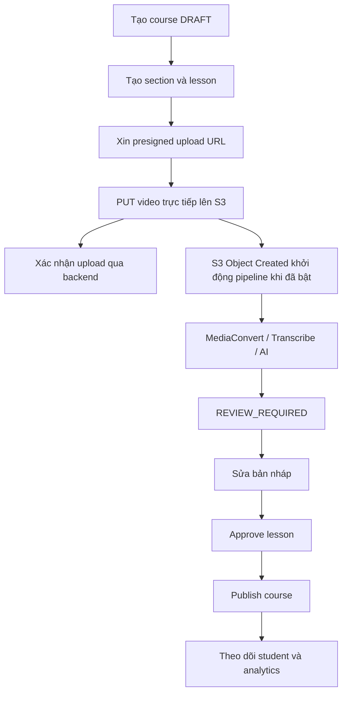

# Luồng người dùng

Tài liệu này mô tả quy trình Instructor, Student và Admin.

## Instructor: từ course đến publish

1. Instructor tạo course `DRAFT`, section, lesson và thứ tự học.
2. `POST /lessons/{lesson_id}/upload-url` khóa course/lesson, kiểm tra ownership, loại tệp, kích thước tối đa 500 MiB và ledger `video_uploads`, rồi trả presigned PUT cho key bất biến.
3. Browser PUT tệp trực tiếp lên S3 với `If-None-Match: *`; không gửi bearer token tới S3.
4. Source hiện tại bắt buộc frontend gọi `POST /lessons/{lesson_id}/confirm-upload`. Endpoint HEAD object, đối chiếu size/type/ETag/thời gian và gắn raw key; **không khởi động workflow**. Khi pipeline bật, S3 EventBridge vẫn là dispatcher ban đầu duy nhất.
5. Instructor theo dõi `processing-status`; retry chỉ hợp lệ từ `FAILED` và phụ thuộc feature flag/adapter.
6. Khi có học liệu, Instructor lấy/sửa bản nháp, approve lesson và publish course. Source có hai bề mặt review (`review-draft*` và `ai-content`/`approve`) để tương thích luồng hiện tại/lịch sử.

### Trạng thái lesson

| Giá trị source | Ý nghĩa | Ai ghi |
|---|---|---|
| `DRAFT` | Lesson mới; chưa có video được chấp nhận | Backend |
| `UPLOADED` | Đã ghi nhận upload trong chế độ không chạy pipeline | Backend/luồng upload |
| `PROCESSING` | Xử lý video | Pipeline |
| `TRANSCRIBING` | Tạo transcript | AI worker/pipeline |
| `AI_PROCESSING` | Sinh học liệu | AI worker/pipeline |
| `REVIEW_REQUIRED` | Bản nháp hợp lệ chờ giảng viên | Pipeline |
| `PUBLISHED` | Lesson đã được duyệt/công bố theo contract hiện tại | Review service |
| `FAILED` | Hết retry hoặc lỗi dừng; có thể yêu cầu retry | Workflow/backend |

Báo cáo không có `APPROVED` trong bảy trạng thái hiển thị; repository còn các migration lịch sử thêm/rút `APPROVED`. Không chạy nhánh migration đó nếu chưa đối soát registry/database đích.

## Student: học, checkpoint và remediation

1. Student xem catalog course đã publish và enroll; enrollment không có thanh toán.
2. Student chỉ truy cập lesson khi course/lesson ở trạng thái cho phép, đã enroll và section đã unlock. Backend kiểm tra các gate này.
3. Trang học lấy metadata/nội dung và URL video tạm thời; transcript có thể dùng mốc thời gian để tua video. Source lưu watched ranges/session/request id để giảm ghi trùng.
4. Student xem flashcard và làm checkpoint. Câu trả lời đúng không được trả trước submit; backend tự chấm và lưu attempt/answer.
5. Section đầu tiên mở. Section sau chỉ mở khi có attempt `passed=true` và score tối thiểu 80 cho checkpoint trước; section không có quiz không chặn chuỗi.

### Quy tắc checkpoint

| Điểm backend | Kết quả | Retry |
|---:|---|---|
| `>= 80` | Đạt và mở section kế tiếp | Không cần remediation |
| `>= 50` và `< 80` | Chưa đạt, gợi ý ôn/Tutor | Được retry ngay |
| `< 50` | Chưa đạt | Phải hoàn thành explanation, review và practice được backend ghi nhận |

Source hiện tại dùng `PASS_SCORE=80`, `REMEDIATION_SCORE=50`. Practice được coi là đạt khi đúng ít nhất 2/3 số câu trong luồng remediation ba bước; luồng Tutor cũ yêu cầu đúng toàn bộ nếu không có workflow state. Eligibility được lưu trong `checkpoint_remediation`, không tin cờ do frontend gửi.

### Khác biệt cần biết

- Báo cáo mô tả tiến độ học theo ngữ cảnh sản phẩm. Source hiện tại đặt `COMPLETION_THRESHOLD=0.1` cho completion video; đây là ngưỡng quick-test, không nên coi là quy tắc sư phạm đã chốt.
- Báo cáo dùng `POST /tutor/sessions`; source còn có luồng `/student/remediation*` chi tiết hơn và endpoint remediate từng câu. Xem [API contract](../02-architecture/api-contract.md).

## Admin: tài khoản và giám sát

1. Admin đăng nhập bằng danh tính có role `ADMIN`.
2. UI/API cho phép liệt kê, tạo, sửa và bật/tắt tài khoản. Backend từ chối user `INACTIVE`.
3. `/admin/monitoring/jobs` cung cấp danh sách job ở mức ứng dụng. Báo cáo còn mô tả Admin theo dõi Cognito/CloudWatch; quyền truy cập Console và trạng thái dashboard AWS không được xác minh trong lần này.

Admin không mặc định được làm thay các thao tác Instructor/Student; mỗi route dùng dependency vai trò riêng.
