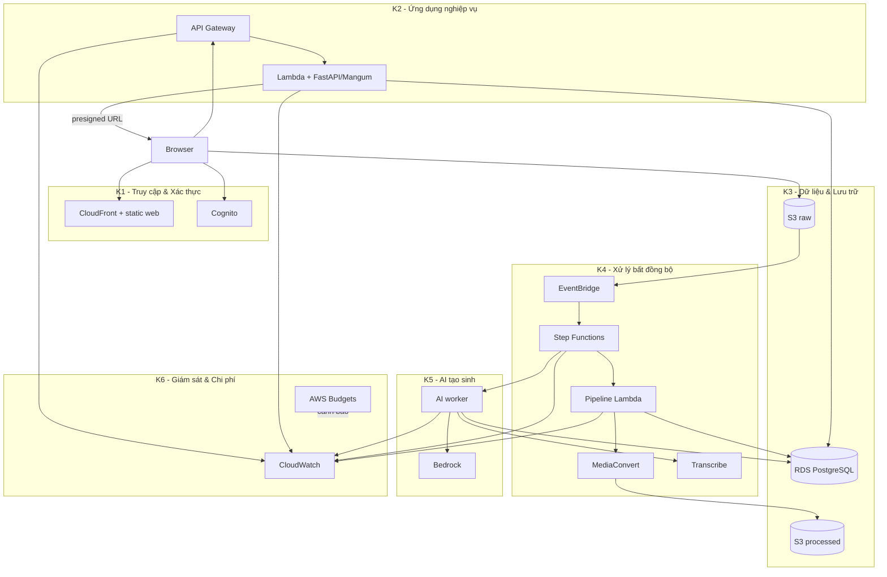

# Kiến trúc AWS K1–K6

Tài liệu này chuyển sáu khối triển khai trong báo cáo thành một kiến trúc có thể đối chiếu với repository. Đây là **kiến trúc thiết kế và artifact có trong source**, không phải inventory AWS hiện hành.

## Sơ đồ

## Sáu khối

| Khối | Dịch vụ thiết kế | Vai trò | Bằng chứng repository | Trạng thái hiện hành |
|---|---|---|---|---|
| K1 | S3 static hosting, CloudFront, Cognito | Giao diện, CDN, danh tính/JWT | Amplify auth, frontend build, docs/runbook CORS/CloudFront | Báo cáo ghi đã triển khai; chưa kiểm tra lại AWS |
| K2 | API Gateway, Lambda, FastAPI, Mangum | API đồng bộ và authorization nghiệp vụ | `backend/app/main.py`, `lambda_function.py`, API docs | Source có; route/authorizer/deployed version chưa xác minh |
| K3 | RDS PostgreSQL, S3 raw/processed | Dữ liệu LMS, ledger và object video | SQL/models/migrations, S3 adapters/policies | Schema RDS, bucket policy/object hiện tại chưa xác minh |
| K4 | EventBridge, Step Functions, MediaConvert, Transcribe, Lambda | Luồng video/AI bất đồng bộ | Event pattern, ASL, K4/K5 handlers, IAM templates | Cờ mặc định tắt; deployment/E2E hiện hành chưa xác minh |
| K5 | Bedrock | Sinh học liệu và Tutor | Bedrock adapters, prompt/schema, AI worker | Source/fallback có; invocation/quota/Guardrails runtime chưa xác minh |
| K6 | CloudWatch, AWS Budgets | Log, metric, alarm, cảnh báo chi phí | Runbook/logging, CloudWatch/IAM templates | Báo cáo có screenshot; alarm/budget hiện tại chưa kiểm tra |

## Hai tuyến xử lý

**Đồng bộ:** browser → API Gateway → Lambda/FastAPI → RDS/S3/Bedrock → response. Request cần token được gateway/backend xác minh theo cấu hình; authorization theo tài nguyên luôn ở backend.

**Bất đồng bộ:** browser PUT S3 → Object Created → EventBridge → Step Functions → K4/K5 workers. UI poll trạng thái; không giữ request upload mở. Source ASL có `Claim`, ledger, duplicate ignore, bounded polling, retry/catch và failure recording; `SubmitMediaConvert` cố ý không auto-retry vì timeout có thể xảy ra sau khi job đã được nhận.

## Mạng và dữ liệu

Theo thiết kế, RDS và các Lambda cần DB ở private subnet; RDS chỉ nhận TCP/5432 từ security group được phép. S3, API Gateway, Cognito, Step Functions, MediaConvert, Transcribe và Bedrock là managed services nằm ngoài subnet. Lambda trong VPC cần egress có chủ ý (VPC endpoint hoặc NAT) tới dịch vụ mà nó thực sự gọi.

Repository hiện đọc `DATABASE_URL` được inject; ứng dụng không tự lấy secret từ Secrets Manager/SSM. Vì vậy cần phân biệt giữa **thiết kế lưu secret** trong báo cáo và **cách runtime source hiện tại nhận cấu hình**.

## Quyết định và đánh đổi

| Quyết định | Lợi ích | Chi phí/giới hạn |
|---|---|---|
| Presigned PUT | Video không qua API/Lambda | Phải xác minh owner/metadata; URL là bearer capability có hạn |
| Step Functions | Trạng thái, retry, timeout, Catch rõ | Thêm cấu hình/chi phí; ranh giới idempotency phải review |
| MediaConvert | Xử lý video dài ngoài giới hạn Lambda | Chi phí theo job; chỉ nên bật sau canary/budget |
| Adapter local/AWS | Phát triển offline và thay implementation | Mock/fallback không chứng minh dịch vụ AWS đã chạy |
| Human review | Giảm rủi ro AI sai | Cần thời gian giảng viên và UI/locking/revision |
| Unlock suy từ attempt | Tránh bản ghi unlock bị lệch | Truy vấn attempt cho mỗi lần kiểm tra |
| VPC endpoints thay NAT khi phù hợp | Tránh NAT hourly/data cost | Interface endpoint vẫn tính phí; cần đếm đúng dịch vụ |

