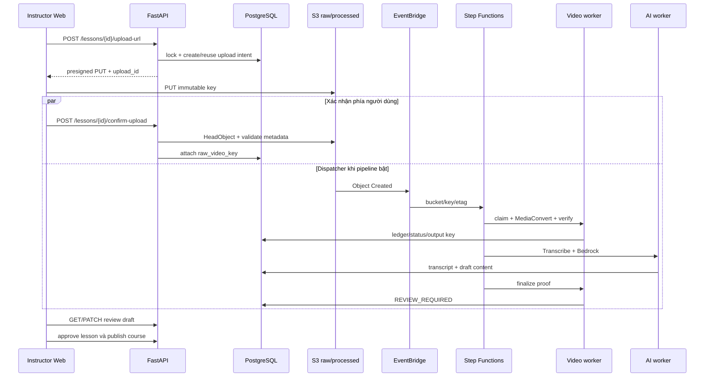
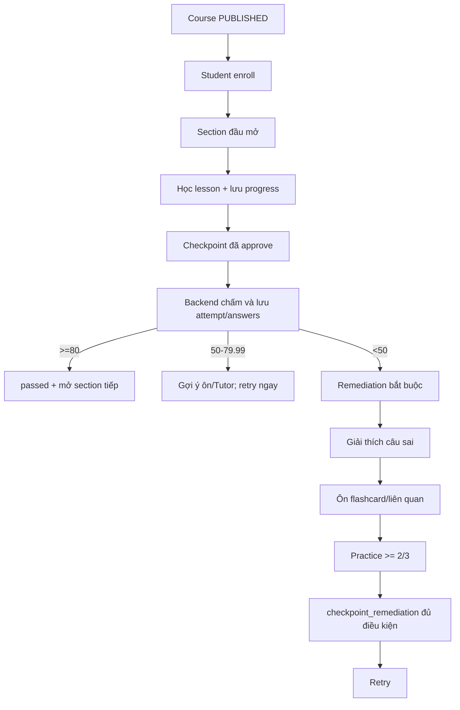

# Luồng dữ liệu

Tài liệu này theo dõi dữ liệu qua hai luồng cốt lõi: video → học liệu và enrollment → checkpoint → remediation. Luồng được ghi theo source hiện tại, kèm khác biệt so với báo cáo.

## Video đến học liệu

### Hợp đồng upload

- Chỉ Instructor sở hữu lesson trống trong course `DRAFT` được xin URL.
- Loại tệp cho phép: `.mp4`, `.webm`, `.mov` với Content-Type tương ứng; giới hạn 500 MiB trong service.
- Key có dạng `lessons/{lesson_id}/raw/{upload_id}.{ext}`; không dùng tên file người dùng làm identity.
- Intent được ghi trước khi trả URL; re-sign dùng lại cùng key. PUT dùng `If-None-Match: *` để không ghi đè.
- `confirm-upload` chỉ xác minh và gắn metadata. Comment/source ghi EventBridge là dispatcher initial duy nhất khi pipeline bật; điều này ngăn workflow chạy hai lần từ confirm và S3 event.

Báo cáo mô tả không dùng confirm-upload để kích hoạt. Source hiện tại vẫn giữ nguyên nguyên tắc đó, nhưng bổ sung endpoint xác nhận bền vững và frontend coi xác nhận là bước bắt buộc trước khi báo upload thành công.

### Tin cậy, retry và lỗi

| Tình huống | Cơ chế source | Kết quả an toàn |
|---|---|---|
| Event giao trùng | Claim + ledger/run identity theo upload/attempt | `IGNORE`, không tạo job mới |
| Metadata không khớp | HEAD đối chiếu key, size, type, ETag, time | Từ chối claim/confirm |
| MediaConvert submit timeout | Không auto-retry submit | Điều tra ledger/job trước khi redrive |
| Poll tạm thời lỗi | Retry hữu hạn + backoff | Tiếp tục hoặc `RecordFailure` |
| Transcribe/AI timeout | Poll bound, Catch | `FAILED`, log/ledger safe code |
| Callback run cũ | Owner/generation/raw identity check | Không ghi đè output mới |
| AI tắt | Workflow dừng ở `VIDEO_READY`, lesson còn processing | Không giả mạo approval |
| AI output sai schema/proof | Validate trước finalize | Không chuyển `REVIEW_REQUIRED` |

## Học viên, checkpoint và Tutor

### Gate dữ liệu

1. Identity phải là Student `ACTIVE`.
2. Course/lesson phải có trạng thái phù hợp và Student đã enroll.
3. Các section trước có quiz phải có attempt đạt tối thiểu 80; quiz/lesson hiện tại phải được duyệt/công bố.
4. Progress được lưu với session, sequence, request id và watched ranges. Completion trong source dùng threshold 10% hiện tại; đây là giới hạn cần cấu hình lại trước production.
5. Quiz submit có request id/hash để replay cùng payload được idempotent và payload khác bị từ chối.
6. Dưới 50, retry chỉ mở khi server tìm thấy bằng chứng remediation của đúng attempt.

## Đồng bộ danh tính

Cognito token được ánh xạ theo `sub` sang `users.cognito_sub`; local auth có các bảng identity/OTP/session riêng. Role nội bộ trong `users` là ranh giới authorization; source cố tình không tự nâng `INSTRUCTOR`/`ADMIN` chỉ từ email hoặc group không được đối soát. Quy trình có thể thất bại một phần giữa Cognito và RDS, nên cần reconciliation thay vì liên kết mù theo email.
