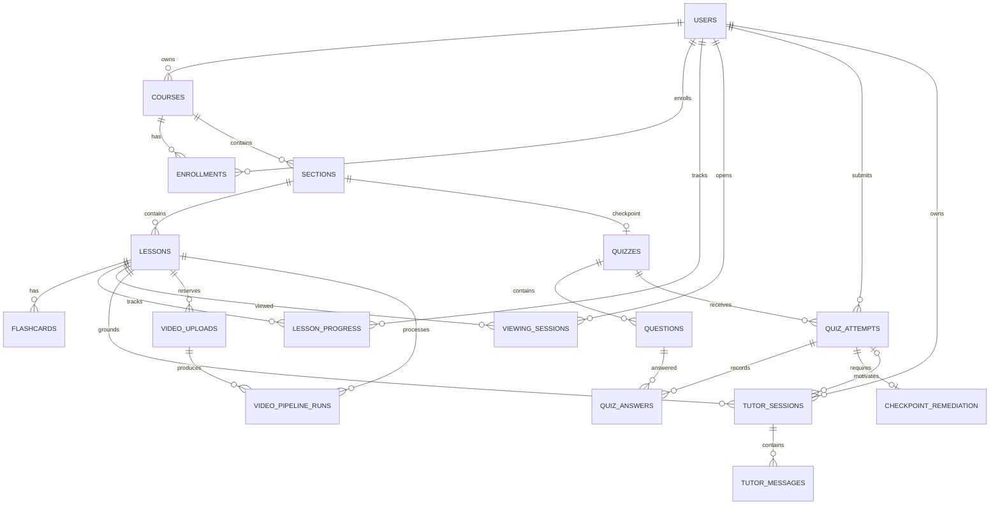

# Thiết kế database

Tài liệu này mô tả mô hình PostgreSQL từ `database/schema.sql`, SQLAlchemy models và migrations. Vì migration history có nhiều nhánh trùng version, không thể khẳng định schema RDS hiện tại chỉ bằng cách đọc repository.

## Nhóm bảng

| Nhóm | Bảng | Vai trò |
|---|---|---|
| Danh tính | `users` | Hồ sơ, `cognito_sub`, email, role, status, password hash tùy auth path |
| Local auth bổ sung | `local_auth_identities`, `local_auth_otps`, `local_auth_sessions` | Danh tính local, OTP và session; chỉ development/test |
| Cấu trúc học | `courses`, `sections`, `lessons`, `enrollments` | Ownership, thứ tự course/section/lesson và ghi danh |
| Tiến độ | `lesson_progress`, `viewing_sessions`, `progress_updates` | Watched ranges, sequence, request idempotency và completion |
| Quiz | `quizzes`, `questions`, `quiz_attempts`, `quiz_answers` | Checkpoint, đáp án server-side, lịch sử attempt |
| Remediation/Tutor | `checkpoint_remediation`, `tutor_sessions`, `tutor_messages` | Bằng chứng retry, workflow state/practice và hội thoại |
| Học liệu | `flashcards` | Thẻ theo lesson, thứ tự và approval |
| Video pipeline | `video_uploads`, `video_pipeline_runs` | Upload intent bất biến, run/attempt/owner, outbox/ledger |
| Vận hành schema | `schema_migrations` | Registry version/description đã áp dụng |

`schema.sql` đã có `viewing_sessions` và `progress_updates`, còn local auth, checkpoint remediation và video ledger đến từ migrations/models. Không giả định bảng có trong model đã tồn tại trên mọi database.

## ERD rút gọn

## Ràng buộc quan trọng

- Role: `users.role` thuộc `STUDENT`, `INSTRUCTOR`, `ADMIN`; status thuộc `ACTIVE`, `INACTIVE`.
- Course status là `DRAFT`/`PUBLISHED`; lesson source enum gồm `DRAFT`, `UPLOADED`, `PROCESSING`, `TRANSCRIBING`, `AI_PROCESSING`, `REVIEW_REQUIRED`, `PUBLISHED`, `FAILED`.
- Unique: email/Cognito subject, `(course_id, position)`, `(section_id, position)`, enrollment student-course, progress student-lesson, quiz section, question position, attempt number, answer attempt-question.
- Quiz answer đúng được lưu ở server; `questions.options_json` phải có ít nhất hai lựa chọn và chứa `correct_answer`.
- Transcript source range phải có cả start/end, không âm và end không nhỏ hơn start.
- Trigger bootstrap kiểm tra course owner là Instructor/Admin, các bản ghi học tập thuộc Student và Tutor session khớp Student/section/attempt.
- Video ledger có composite relationship upload–lesson, attempt/generation và state guards để chống callback cũ ghi đè.
- Progress completion có migration trigger đồng bộ khi duration thay đổi; quyền runtime trigger được siết trong migration `0014`.

## Bản ghi không nên tách riêng

Unlock được suy ra từ attempt đạt; không có bảng `section_unlocks`. Bản nháp review tái sử dụng nội dung lesson/quiz/flashcard và revision logic; không có bảng `review_drafts` trong models. Các lựa chọn này giảm hai nguồn sự thật nhưng tăng chi phí truy vấn/khóa/validation.

## Lịch sử migration và an toàn

`database/migrations/` có nhiều file `0004_*` và cả dãy `V1__`/`V2__`/`V3__` lịch sử. Không chạy theo thứ tự tên một cách máy móc.

Quy trình an toàn:

1. Xác nhận account/host/database/user và maintenance window; không dùng RDS URL production cho test.
2. Đọc registry, columns, constraints, indexes và description version bằng truy vấn read-only/preflight.
3. Tạo snapshot/backup được phép và thử restore trên database cô lập.
4. Chỉ áp migration được review phù hợp với state thực; không tự sửa registry để hợp thức hóa schema.
5. Chạy postflight và integration test trên database test; giữ feature flag tắt cho tới khi gate đạt.
6. Ưu tiên forward-fix được review hoặc restore có kế hoạch; không drop table/xóa version vội.

Chi tiết lịch sử và guard nằm trong [migration README](../../database/migrations/README.md). Hai snapshot review cũ được lưu tại [migration phê duyệt Lesson](../archive/database/lesson-approval-migration.md) và [migration ledger video 0005](../archive/database/video-pipeline-migration-0005.md); chúng không phản ánh trạng thái database hiện tại.
