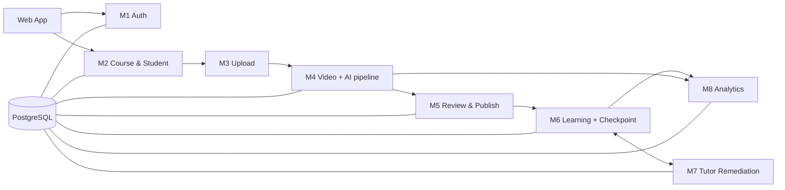

# Kiến trúc chức năng M1–M8

Tài liệu này giải thích ranh giới tám module nghiệp vụ trong báo cáo và cách chúng được hiện thực trong frontend, FastAPI, AI pipeline và database. M1–M8 là module chức năng, không đồng nghĩa với tám dịch vụ triển khai độc lập.

## Sơ đồ tổng quát

Frontend gửi JSON qua REST API; video đi thẳng từ browser lên storage bằng presigned URL. Route xác thực/validate request, service giữ quy tắc nghiệp vụ, repository thao tác dữ liệu và adapter bao dịch vụ ngoài.

## Ma trận module

| Module | Trách nhiệm thiết kế | Hiện thực trong repository | Ranh giới quan trọng |
|---|---|---|---|
| **M1 Authentication** | Danh tính, role Student/Instructor/Admin | `auth.py`, `local_auth.py`, `auth_service.py`, dependencies role, Amplify/local auth UI | Token hợp lệ không thay ownership/enrollment check; user `INACTIVE` bị chặn |
| **M2 Course & Student Management** | Course, section, lesson, enrollment, ownership | Course/section/lesson/enrollment routers, services, repositories và models | Nguồn vòng đời course/lesson; không cho client tự publish |
| **M3 Video Storage & Upload** | Cấp quyền upload tạm thời, không proxy video | `uploads.py`, `UploadService`, S3/local storage adapters, upload ledger | Instructor sở hữu lesson; key bất biến; size/type/overwrite được kiểm tra |
| **M4 AI Content Pipeline** | Chuẩn hóa video, transcript, summary/concept/quiz/flashcard nháp | Video pipeline/AI worker Lambda, Step Functions ASL, `ai_pipeline/`, MediaConvert/Transcribe/Bedrock adapters | Bất đồng bộ; ledger/idempotency; schema validation; chỉ tạo bản nháp |
| **M5 Review & Publishing** | Giảng viên sửa, duyệt, publish | Review router/service/repository, review UI, approval/publish service | Chỉ owner; revision/lock; nội dung chưa duyệt không đến Student |
| **M6 Learning, Flashcard & Checkpoint** | Phát nội dung, tiến độ, flashcard, chấm điểm, unlock | Lesson content/video, progress, flashcard, quizzes, unlock service và các trang Student | Đáp án/score/unlock do server; idempotency request; 80 là ngưỡng pass |
| **M7 AI Tutor Remediation** | Giải thích câu sai, ôn thẻ và practice | Tutor/remediation routers, services, context builder, Bedrock adapter có cờ bật | Gắn student + attempt; dưới 50 phải hoàn thành server-owned remediation |
| **M8 Analytics & Monitoring** | KPI học tập và quan sát job | Analytics/screen workflows/admin monitoring, dashboard/report UI, CloudWatch templates | Instructor chỉ xem course mình; monitoring AWS thực tế chưa xác minh |

## Giao diện giữa các module

| Từ → đến | Dữ liệu | Cơ chế bảo vệ |
|---|---|---|
| Web → M1 | Credential/OTP hoặc Cognito token | HTTPS, local auth chỉ development/test; Cognito JWT theo cấu hình |
| Web → M2/M5/M6/M7/M8 | JSON request/response | Bearer token, role, ownership, enrollment, publish/unlock |
| M2 → M3 | `lesson_id`, metadata tệp | Course/lesson lock và owner check |
| M3 → M4 | S3 event gồm bucket/key/ETag | EventBridge filter; ledger đối chiếu upload/lesson |
| M4 → M5 | Transcript/học liệu qua schema | AI worker proof, validation và trạng thái `REVIEW_REQUIRED` |
| M5 → M6 | Nội dung được approve/publish | Trạng thái database và truy vấn được bảo vệ |
| M6 ↔ M7 | Attempt, câu sai, transcript, practice result | Ownership và `checkpoint_remediation`/session state |
| M6/M4 → M8 | Tiến độ, attempt, job/status | Phân tách analytics người học với log vận hành |

## Quyền quyết định

- **Danh tính:** token/identity provider, sau đó ánh xạ sang `users` nội bộ.
- **Authorization:** backend dependency/service; frontend chỉ điều hướng UI.
- **Course/lesson state:** backend và pipeline theo transition được phép.
- **Upload/pipeline ownership:** upload/pipeline ledger và row lock; không dựa vào S3 delivery exactly-once.
- **Approval:** Instructor owner thông qua review service; AI không tự publish.
- **Score/unlock/remediation:** quiz/remediation service và database; không tin score/cờ từ client.

## Tích hợp FE–BE–AI–DB

Frontend có route riêng theo vai trò nhưng mọi thao tác thực đều đi qua API client. FastAPI đăng ký 80 operations; một số response chưa có Pydantic response model cụ thể, được ghi rõ trong [API contract](api-contract.md). AI pipeline sinh dữ liệu theo JSON schema và source hiện có cả mock/fallback lẫn adapter Bedrock; do đó “có output AI trong test” không đồng nghĩa “đã gọi Bedrock”. PostgreSQL lưu dữ liệu nghiệp vụ/ledger; tệp lớn và object AI được thiết kế để đặt trên S3.
