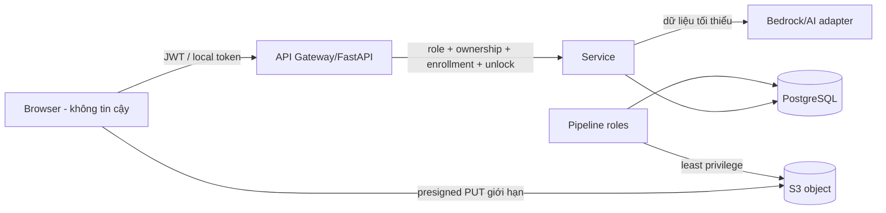

# Bảo mật và rủi ro

Tài liệu này tổng hợp ranh giới xác thực, phân quyền, dữ liệu và rủi ro của LearnCloud. Cấu hình AWS trong source là template; policy, network và secret runtime phải được xác minh độc lập.

## Mô hình tin cậy

Frontend không phải security boundary. Route guard UI chỉ cải thiện trải nghiệm; backend và database phải từ chối request trái quyền.

## Xác thực và RBAC

- Cognito path: browser đăng nhập qua Amplify, gửi access token; API Gateway authorizer có thể xác minh JWT trước Lambda, backend ánh xạ `sub` sang user nội bộ.
- Local auth path: chỉ hoạt động khi `LOCAL_AUTH_ENABLED=true` và `APP_ENV` là `development` hoặc `test`; OTP/session/password hash nằm trong database. Không dùng cho production.
- `get_current_user` từ chối token thiếu/sai/hết hạn và user `INACTIVE`. `require_student`, `require_instructor`, `require_admin` thực thi role chính xác.
- Service tiếp tục kiểm tra Instructor ownership; Student enrollment, publish và unlock; attempt/session ownership. Token hợp lệ không đủ để thao tác tài nguyên.
- Role `users.role` là nguồn phân quyền ứng dụng; không tự cấp Instructor/Admin từ email hay Cognito group không được đối soát.

Quy trình đối soát các trường hợp Cognito và RDS lệch nhau được giữ trong [Runbook Cognito/RDS](../../infrastructure/cognito/cognito-rds-reconciliation.md). Runbook này không cho phép liên kết tài khoản chỉ theo email hoặc tự suy ra role đặc quyền.

## Video và S3

- Bucket phải private, bật Block Public Access và chỉ cho role/prefix cần thiết.
- Presigned upload URL chỉ cho một object/action, hết hạn ngắn, có Content-Type và chống overwrite. Presigned/signed playback URL chỉ được cấp sau gate nghiệp vụ.
- URL đã ký là bearer capability: không ghi log, commit, screenshot, issue hay analytics.
- Tên file gốc không dùng làm key; key gắn lesson/upload id để tránh trùng và giảm lộ PII.
- Source hiện có raw playback chỉ khi cả `APP_ENV=development` và `ALLOW_RAW_VIDEO_PLAYBACK=true`; production mặc định chặn raw.

## IAM, network và database

| Thành phần | Quyền tối thiểu mong muốn |
|---|---|
| API/backend | Đọc/ghi đúng prefix S3 và API dịch vụ thực sự dùng; không có `s3:*`/IAM management |
| EventBridge | Chỉ `states:StartExecution` trên state machine đích |
| Step Functions | Chỉ invoke K4/K5 Lambda được duyệt |
| MediaConvert | Đọc raw, ghi processed; PassRole bị giới hạn theo service/role |
| AI worker | Transcribe, Bedrock model/profile, S3 transcript/output và DB cần thiết |
| RDS runtime role | Chỉ table/operation cần cho app/worker; không DDL/admin |

RDS phải private, inbound 5432 chỉ từ security group ứng dụng/worker cần thiết. Source đọc `DATABASE_URL`; quy trình deploy phải inject secret an toàn và không đưa DSN vào ZIP, template hay log. Mọi migration cần target check, backup, preflight, postflight và rollback/forward-fix được duyệt.

## AI và dữ liệu

- Pipeline phải validate JSON schema; nội dung AI luôn là nháp chờ Instructor.
- Timestamp lấy từ transcript, không để mô hình bịa mốc.
- Tutor chỉ nhận transcript/học liệu có liên quan và câu sai của chính Student; không cần tên/email trong prompt.
- Source có cờ `TUTOR_USE_BEDROCK`; fallback local có thể trả trích đoạn. Không gắn nhãn “AI thật” cho output fallback.
- Guardrails được mô tả trong thiết kế báo cáo nhưng cấu hình/runtime chưa được kiểm tra trong lần này.

## Rủi ro và biện pháp

| Rủi ro | Biện pháp có trong thiết kế/source | Khoảng còn lại |
|---|---|---|
| Lộ secret/token/URL | `.gitignore`, placeholder, role, log redaction, URL ngắn hạn | Cần secret scan CI và rotation/quy trình incident |
| Truy cập trái phép | JWT/local token + role + ownership/enrollment/unlock | Cần route × role regression đầy đủ và xác minh API Gateway |
| Tài khoản Cognito/RDS lệch | Exact `sub`, fail closed khi email conflict, reconciliation docs | Hai hệ thống không có transaction phân tán |
| Video bị công khai | Private bucket, presigned/signed URL, backend gate | Không có DRM; URL có thể bị chia sẻ khi còn hạn |
| AI sai/không hợp schema | Validate, draft, review, source timestamps | Chất lượng phụ thuộc audio/model; rubric còn nhỏ |
| Event/job trùng | Immutable upload, ledger, row lock, run identity, stale callback guard | Cần PostgreSQL/AWS E2E thường xuyên |
| Vượt chi phí | Flags mặc định tắt, budget, canary, concurrency/quota | Budget/alarm hiện tại chưa xác minh |
| Dữ liệu/migration sai target | Guard loopback cho test, preflight, registry, backup | Lịch sử migration trùng `0004` tăng rủi ro operator |
| Log lộ PII/nội dung | Log safe identifiers/codes, không transcript/prompt/URL | Execution history AWS có thể lưu payload; cần giới hạn quyền/retention |

## Quy tắc công bố

Không đưa credential, password, OTP, session/access/refresh token, private key, DSN, presigned URL, tài khoản demo hoặc screenshot chứa các giá trị đó vào GitHub. App Client ID/User Pool ID có thể là public identifiers cho SPA nhưng vẫn nên dùng placeholder trong tài liệu chung. Khi nghi ngờ secret đã lộ, không chỉ xóa Git history: phải revoke/rotate và đánh giá truy cập.
