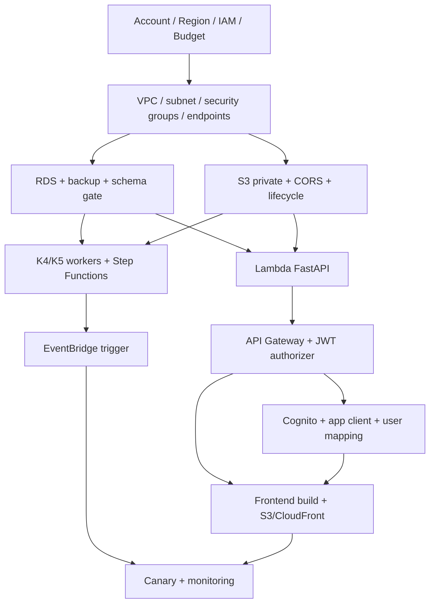

# Triển khai AWS

Tài liệu này là checklist triển khai/rollback an toàn cho kiến trúc K1–K6.

## Trước khi thao tác

1. Xác nhận AWS account, Region, environment, operator, change ticket và maintenance window. Thiết kế/báo cáo dùng Singapore (`ap-southeast-1`), nhưng không suy ra target hiện tại.
2. Ghi commit SHA, working tree và artifact hash. Không đóng gói `.env`, `.aws`, cache, test handler, tài liệu đầu vào hay database dump.
3. Lấy inventory từ nguồn được duyệt: VPC/subnet/SG, RDS, S3, Lambda version/alias, API Gateway routes/authorizer, Cognito pool/client, CloudFront, EventBridge rules/targets, state machine, MediaConvert, Transcribe, Bedrock, CloudWatch và Budgets.
4. Đối chiếu OpenAPI source với API Gateway và frontend base URL/CORS. Không dùng route trong báo cáo thay cho [OpenAPI 80 operations hiện tại](../02-architecture/api-contract.md).
5. Review IAM least privilege, PassRole, bucket public-access block/encryption, RDS private/TLS, VPC egress/endpoints, log retention/redaction, quota và budget.
6. Giữ `VIDEO_PIPELINE_ENABLED`, `VIDEO_AI_ENABLED`, `AI_WORKER_ENABLED` tắt cho tới khi database/network/IAM/non-production E2E đạt.

## Thứ tự phụ thuộc

## K1 - Frontend, CloudFront và Cognito

- Build frontend từ lockfile; chỉ nhúng API URL, Region và public Cognito identifiers. Mọi `VITE_*` đều có thể xuất hiện trong browser bundle.
- Static bucket private, CloudFront dùng OAC/OAI theo cấu hình được duyệt. Cấu hình SPA fallback, HTTPS và cache invalidation có chủ ý.
- SPA Cognito app client không có client secret; issuer/audience/Region phải khớp API authorizer/backend. CORS chỉ cho origin frontend được duyệt.
- Kiểm tra đăng nhập, token expiry, logout, account disabled và route theo ba role mà không chụp token/OTP.

## K2 - API Gateway và Lambda

- Backend là FastAPI qua Mangum; handler source là `lambda_function.lambda_handler` trong các gói hiện có, nhưng phải đối chiếu artifact/runtime thực.
- `package_lambda.py` hỗ trợ tạo ZIP; nó không deploy/rollback toàn hệ thống và không thay dependency layer review.
- Inject `DATABASE_URL` và cấu hình nhạy cảm qua quy trình secret được duyệt. Source hiện không tự đọc Secrets Manager/SSM.
- API Gateway JWT authorizer xác minh token; backend vẫn kiểm tra role/ownership/enrollment/unlock. OPTIONS/preflight không được bị authorizer chặn.
- Sau deploy, kiểm tra `/health`, auth và một read-only business flow; ghi request id/version/alias, không ghi token hay response nhạy cảm.

## K3 - RDS và S3

- RDS private, inbound 5432 chỉ từ SG ứng dụng/worker. Dùng application role tối thiểu và TLS theo policy.
- Trước migration: registry/schema diff, read-only preflight, snapshot/backup và restore rehearsal trên bản sao. Migration history có nhiều `0004`; không chạy theo glob/tên file.
- S3 raw/processed chặn public access; CORS chỉ origin/method/header cần thiết. Review encryption/KMS, lifecycle, versioning và object prefix.
- Không dùng DB chung/production để test seed, integration gate hoặc demo retry.

## K4/K5 - Video và AI

Repository có `video_pipeline.asl.json`, K4/K5 handlers, function examples, IAM templates và script render. ASL cần thay ARN placeholder và validate; function examples để cờ AI `false` theo mặc định.

Thứ tự rollout khuyến nghị:

1. Xác minh migration/ledger và DB runtime grants trên non-production.
2. Tạo log groups/retention/alarm trước; tạo role/SG theo least privilege.
3. Deploy K4/K5 Lambda với flags AI tắt, sau đó state machine version/alias và EventBridge target.
4. Chứng minh chỉ có **một** initial upload dispatcher; không thêm S3 notification/API start path song song.
5. Chạy canary video nhỏ trong database/bucket test cô lập. Kiểm tra duplicate event, timeout, failure, stale callback, output HEAD và `REVIEW_REQUIRED`.
6. Bật K5/AI theo cửa sổ có kiểm soát; không tắt `VIDEO_AI_ENABLED` giữa execution đang cần finalize.
7. Review học liệu thực và chi phí trước khi mở rộng.

Không redrive mù qua `SubmitMediaConvert`: timeout có thể xảy ra sau khi job đã được tạo. Dùng ledger/job id/execution id để reconciliation.

## K6 - Giám sát và chi phí

- Alarm: API/Lambda error/throttle/duration; Step Functions failed/timed-out/throttled; MediaConvert/Transcribe failed/long-running; Bedrock error/throttle; backlog/lesson stuck.
- Dashboard phân biệt `VIDEO_READY`, `REVIEW_REQUIRED`, `FAILED` và business analytics.
- Log chỉ safe identifier/code. Không log transcript, prompt/output, quiz answer, PII, DSN, credential, JWT hay presigned URL.
- Budget/cost anomaly monitor theo MediaConvert minutes, Transcribe seconds, Bedrock tokens, Lambda duration, Step Functions transitions, S3 growth và endpoint/NAT hourly cost.

## Xác minh sau deploy

| Gate | Bằng chứng cần giữ |
|---|---|
| Artifact | Commit, ZIP/build hash, Lambda version/alias, ASL revision |
| Auth | Issuer/audience, route authorizer, role/ownership negative tests |
| Database | Target identity, backup id, registry/constraint postflight, integration test |
| Upload | URL không log, immutable key, HEAD metadata, confirm-upload |
| Pipeline | Execution/run/job ids đã làm sạch, output key/status, duplicate/failure test |
| AI review | Schema validation, Instructor review và không auto-publish |
| Monitoring | Alarm action, retention, dashboard, budget và owner |

## Rollback

- **Frontend:** giữ artifact trước; khôi phục object/version và invalidate cache, sau đó smoke test.
- **API:** chuyển alias/traffic về Lambda version tốt; xác minh health/auth/DB trước khi mở traffic.
- **Pipeline:** tắt AI/initial trigger theo thứ tự có kiểm soát, để execution an toàn hoàn tất hoặc reconcile; không xóa ledger/log.
- **Database:** không có rollback SQL mặc định. Ưu tiên forward-fix được review; restore snapshot chỉ khi đánh giá mất dữ liệu sau backup.

## Runbook vận hành và tài liệu lịch sử

Runbook đang giữ vai trò vận hành riêng:

- [Đối soát Cognito/RDS](../../infrastructure/cognito/cognito-rds-reconciliation.md)

Các snapshot dưới đây được lưu để tra cứu quyết định, migration, rollback và kết quả theo thời điểm; chúng **không** phản ánh trạng thái hiện tại:

- [API Gateway/Lambda](../archive/aws/api-gateway-lambda.md)
- [S3 video playback](../archive/aws/s3-video-playback.md)
- [Video pipeline Console](../archive/aws/video-pipeline-console-setup.md)
- [K4/K5 production rollout](../archive/aws/k4-k5-production-rollout.md)
- [K4/K5 E2E test](../archive/operations/k4-k5-e2e-test-runbook.md)

Trước khi dùng bất kỳ lệnh lịch sử nào, thay identifier bằng inventory đã duyệt và loại bỏ credential/endpoint nhạy cảm khỏi log hoặc ticket.
