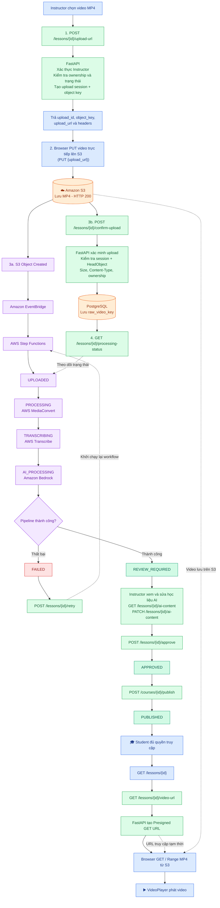

# LearnCloud — API Contract Draft v5

**Phiên bản:** Draft v5 — 30/10/2026  
**Trọng tâm:** Video Upload → S3 → Processing → Review → Approve → Publish → Playback  
**Trạng thái:** DỰ THẢO; cần A (kiến trúc), B (frontend), C (AI/review) và D (backend/cloud) thống nhất trước khi khóa.  
**Đối tượng:** React/Vite, FastAPI, PostgreSQL, Amazon S3, EventBridge, Step Functions, MediaConvert, Transcribe và AI adapter.


## 1. Phạm vi và nguyên tắc

LearnCloud cho phép Instructor tạo Course/Section/Lesson, tải video từ trình duyệt **trực tiếp** lên S3 bằng Presigned PUT URL; hệ thống xác nhận object hợp lệ, xử lý video và tạo học liệu nháp, cho Instructor review/approve, sau đó publish Course cho Student. Backend chỉ cấp URL tạm thời, kiểm tra quyền và quản lý trạng thái; **không nhận byte MP4 qua FastAPI**.

- **Frontend route** `/courses/:courseId/lessons/:lessonId` là route React, không phải endpoint backend.
- **Lesson object key** (`raw_video_key`, `processed_video_key`) nằm trong PostgreSQL; byte video nằm trên S3. Không lưu Presigned URL có hạn trong DB.
- **Local authentication:** `X-Demo-User` đang dùng để thử nghiệm, chỉ cho local. **Mục tiêu triển khai:** Cognito/OIDC/JWT hoặc lựa chọn auth đã được nhóm chốt; không dùng header demo để public.
- **Tên trường JSON:** `snake_case`; ID của Course/Section/Lesson dùng số nguyên theo DB hiện có.
- **Lỗi:** JSON thống nhất khuyến nghị `{ "detail": "...", "code": "MACHINE_READABLE_CODE", "request_id": "..." }`; không trả AWS exception, credentials, query string Presigned URL hoặc stacktrace cho frontend.
- **Mốc trạng thái:** `DRAFT`, `UPLOADED`, `PROCESSING`, `TRANSCRIBING`, `AI_PROCESSING`, `REVIEW_REQUIRED`, `APPROVED`, `PUBLISHED`, `FAILED`. Cần migration `0004` được áp dụng trên DB thực tế trước khi dùng `APPROVED`.
- **Giới hạn upload hiện tại:** tối đa **500 MiB** khi xin URL (dựa trên client `file_size`). Chỉ `HeadObject.ContentLength` trong xác nhận mới kiểm tra kích thước object **thực tế**; `Content-Type` không chứng minh nội dung MP4 hợp lệ.
- **Bảo mật:** S3 private, Block Public Access; ký SigV4, thời hạn tham khảo 900 giây; không log hoặc chia sẻ Presigned URL.

## 2. Danh mục API tổng quan

### 2.1. Nhóm 24 API MVP gốc

| # | Method + path | Vai trò | Tình trạng theo thông tin triển khai đã cung cấp |
|---:|---|---|---|
| 1 | `GET /health` | All | Có |
| 2 | `GET /courses` | Student/catalog | Có |
| 3 | `POST /courses` | Instructor | Có |
| 4 | `GET /courses/{id}` | Student/Instructor | Có |
| 5 | `PATCH /courses/{id}` | Instructor | Có |
| 6 | `POST /courses/{id}/publish` | Instructor | Đã có code và test; chờ xác minh migration APPROVED trên DB |
| 7 | `POST /courses/{id}/sections` | Instructor | Có |
| 8 | `POST /sections/{id}/lessons` | Instructor | Có |
| 9 | `GET /lessons/{id}` | Student/Instructor | Có; response phải đối chiếu Swagger để khóa schema |
| 10 | `POST /lessons/{id}/upload-url` | Instructor | **Đã thử HTTP + PUT S3 thật thành công** |
| 11 | `GET /lessons/{id}/processing-status` | Instructor | **Đã có code, test và HTTP 200 local** |
| 12 | `POST /lessons/{id}/retry` | Instructor/Admin theo policy | Đã có code/test; AWS dispatcher chưa triển khai |
| 13 | `GET /lessons/{id}/ai-content` | Instructor | Thuộc C; cần rà soát integration |
| 14 | `PATCH /lessons/{id}/ai-content` | Instructor | Thuộc C; cần rà soát integration |
| 15 | `POST /lessons/{id}/approve` | Instructor | Đã có code tối thiểu; chờ migration + E2E |
| 16 | `POST /courses/{id}/enroll` | Student | Có theo tiến độ; cần đối chiếu |
| 17 | `PUT /lessons/{id}/progress` | Student | Codex báo đã triển khai backend; FE cần đối chiếu |
| 18 | `GET /courses/{id}/progress` | Student | Codex báo đã triển khai backend; FE cần đối chiếu |
| 19 | `GET /sections/{id}/quiz` | Student | Thuộc C; cần đối chiếu |
| 20 | `POST /quizzes/{id}/attempts` | Student | Thuộc C; cần đối chiếu |
| 21 | `GET /students/me/quiz-history` | Student | Thuộc C; cần đối chiếu |
| 22 | `POST /tutor/sessions` | Student | Thuộc C; dự kiến |
| 23 | `POST /tutor/sessions/{id}/messages` | Student | Thuộc C; dự kiến |
| 24 | `GET /instructor/courses/{id}/analytics` | Instructor | Thuộc C; dự kiến |

### 2.2. API bổ sung cần lưu trong Contract

| Mã | Method + path | Mục đích | Trạng thái / mức ưu tiên |
|---|---|---|---|
| N01 | `GET /courses/{id}/sections` | Danh sách Section | Có theo source, giữ tương thích frontend |
| N02 | `GET /sections/{id}/lessons` | Danh sách Lesson | Có theo source, giữ `skip/limit` nếu đã dùng |
| N03 | `GET /instructor/courses` | Course của Instructor | Cần đối chiếu / P0 cho UI giảng viên |
| N04 | `GET /students/me/courses` | Course Student đã đăng ký | Cần đối chiếu / P0 |
| N05 | `GET /lessons/{id}/flashcards` | Flashcards đã duyệt | Đề xuất / P1, cần B/C chốt |
| **N06** | **`POST /lessons/{id}/confirm-upload`** | **Xác nhận S3 object và cập nhật DB** | **Đề xuất / P0 / chưa xác nhận có code** |
| N07/N08/N12 | `/auth/login`, `/auth/me`, `/auth/register` | Auth | Có route theo source nhưng luồng auth cần thống nhất Cognito/JWT |
| N09–N11 | Admin APIs | Quản trị/monitoring | P2 |
| **X01** | **`GET /lessons/{id}/video-url`** | **Presigned GET để phát MP4 private** | **Đã chạy và phát video S3 thật; đề nghị nhóm duyệt chính thức** |

**Không cần thêm** `POST /lessons/{id}/upload-video` để nhận file MP4 qua FastAPI. HTTP PUT lên Presigned S3 URL **không** phải API FastAPI.

## 3. Luồng upload video chi tiết (trọng tâm v5)

### 3.1. Quy trình nghiệp vụ mục tiêu



**Phân biệt hai thời điểm:**
1. S3 trả `200` cho PUT nghĩa là byte video **đã được lưu trên S3** (không phải chờ approve mới upload).
2. `confirm-upload` xác nhận và ghi nhận object vào **LearnCloud/PostgreSQL**, **không** truyền video lần nữa.
3. `approve` là Instructor duyệt **học liệu AI**, hoàn toàn khác `confirm-upload`.
4. `publish` mở quyền xem cho Student theo nghiệp vụ đã chốt.

### 3.2. Bảng API theo từng thời điểm

| # | Bên gọi → Bên nhận | Phương thức | Kết quả quan trọng |
|---:|---|---|---|
| 0 | Instructor → FastAPI | `POST /sections/{section_id}/lessons` | Có `lesson_id` mới |
| 1 | Frontend → FastAPI | `POST /lessons/{lesson_id}/upload-url` | URL PUT và object key phiên upload |
| 2 | Frontend → Amazon S3 | `PUT {upload_url}` | `200 OK`, object đã được lưu |
| 3 | Frontend → FastAPI | `POST /lessons/{lesson_id}/confirm-upload` | DB liên kết key, trạng thái UPLOADED |
| 4 | Frontend → FastAPI | `GET /lessons/{lesson_id}/processing-status` | Theo dõi pipeline/status/error/retry |
| 5 | Frontend → FastAPI | `POST /lessons/{lesson_id}/retry` nếu FAILED | Tiếp nhận xử lý lại, không upload lại |
| 6 | Instructor → FastAPI | `GET/PATCH /lessons/{lesson_id}/ai-content` | Xem, sửa bản nháp |
| 7 | Instructor → FastAPI | `POST /lessons/{lesson_id}/approve` | APPROVED |
| 8 | Instructor → FastAPI | `POST /courses/{course_id}/publish` | PUBLISHED nếu đủ điều kiện |
| 9 | Student/Instructor → FastAPI | `GET /lessons/{lesson_id}/video-url` | Presigned GET phát video private |

### 3.3. C01 — `POST /lessons/{lesson_id}/upload-url` (đã có)

**Vai trò:** Instructor sở hữu Course chứa Lesson. **Mục tiêu:** tạo URL tạm cho **một** lần PUT tới **một** object key, không upload video tại bước này.

Request hiện có:

```http
POST /lessons/6/upload-url
Content-Type: application/json
X-Demo-User: <instructor_id>   # chỉ local
```

```json
{
  "filename": "sample.mp4",
  "content_type": "video/mp4",
  "file_size": 1895438
}
```

**Response tương thích hiện tại** (các giá trị là minh họa, URL không có chữ ký thật):

```json
{
  "upload_url": "<presigned-put-url>",
  "object_key": "lessons/6/raw/<random-id>.mp4",
  "expires_in": 900,
  "method": "PUT",
  "content_type": "video/mp4"
}
```

**Đề xuất mở rộng trước khi triển khai confirm-upload:** thêm `upload_id` (UUID) và `required_headers` (ví dụ `Content-Type`) vào response, **không bỏ các field hiện có**, đảm bảo FE tương thích. Ví dụ:

```json
{
  "upload_id": "<uuid-v4>",
  "upload_url": "<presigned-put-url>",
  "object_key": "lessons/6/raw/<random-id>.mp4",
  "expires_in": 900,
  "method": "PUT",
  "content_type": "video/mp4",
  "required_headers": { "Content-Type": "video/mp4" }
}
```

**Xử lý:**
- Xác minh Instructor/ownership và trạng thái Lesson cho phép nộp/đổi video (không ghi đè lesson đã PUBLISHED một cách âm thầm).
- Chỉ nhận MP4, kiểm tra extension/MIME và `0 < file_size <= 500 MiB` ở lớp request. Đây là giới hạn **khai báo**, không phải khóa kỹ thuật mức byte trên S3.
- Tạo `object_key = lessons/{lesson_id}/raw/{random_id}.mp4` để tránh tên trùng/lộ tên file.
- Lưu metadata của **upload session** trước khi cấp URL nếu chọn thiết kế N06 an toàn (xem mục 4).
- Phát URL SigV4, thời hạn ngắn; không lưu/ghi log Presigned URL.

**HTTP:** `200` cấp URL; `401` chưa xác thực; `403` không sở hữu; `404` Lesson không tồn tại; `409` trạng thái không cho thay video; `413/422` size hoặc request không hợp lệ; `502/503` lỗi tạo URL/cấu hình storage.

### 3.4. C02 — `PUT {upload_url}` tới S3 (không phải FastAPI)

```http
PUT https://<bucket>.s3.<region>.amazonaws.com/<object-key>?<signature>
Content-Type: video/mp4

<raw MP4 bytes>
```

**Header phải đúng với header được ký.** Response S3 thông thường `200 OK`, khi đó object đã tồn tại. Nếu không thành công: `403 SignatureDoesNotMatch/AccessDenied`, hết hạn, sai header/region hoặc lỗi mạng. URL ký là bearer capability tạm thời; không đưa vào báo cáo hoặc log.

**Browser:** dùng `fetch(upload_url, { method:'PUT', headers:required_headers, body:file })`; S3 bucket cần CORS cho frontend origin và method/header thực tế. Với multipart và file rất lớn, cần thiết kế riêng; hiện MVP dùng Presigned PUT cho file giới hạn 500 MiB.

### 3.5. C03 — `POST /lessons/{lesson_id}/confirm-upload` (đề xuất P0, CHƯA có code được xác nhận)

**Kích hoạt:** frontend gọi **ngay khi PUT trả 200**. Đây không phải nút **Approve**; không cần Instructor phải xem AI để xác nhận upload.

**Khuyến nghị request v5 mới:**

```http
POST /lessons/6/confirm-upload
Content-Type: application/json
```

```json
{ "upload_id": "<uuid-v4-do-upload-url-tra-ve>" }
```

Backend **tra object key từ upload session do server lưu**, không tin key bất kỳ do client gửi. Nếu muốn giữ tương thích với request N06 v4 `{ "object_key": "..." }`, phải chốt cách ánh xạ tới phiên cấp URL; **chỉ kiểm tra tiền tố `lessons/6/` là không đủ**.

**Xử lý bắt buộc theo thứ tự:**
1. Xác thực Instructor, quyền sở hữu Lesson, trạng thái cho phép upload.
2. Lấy upload session (`upload_id`, `lesson_id`, `object_key`, người tạo, status, expiry) đã được tạo ở C01. Từ chối session thuộc Lesson khác, đã hủy hoặc không hợp lệ.
3. `HeadObject` S3 tới đúng key, xác nhận object tồn tại, kích thước thực tế >0 và ≤500 MiB; MIME metadata được kiểm tra nhưng không thay thế kiểm tra nội dung/codec ở processing.
4. Transaction DB: gắn `lessons.raw_video_key`, cập nhật session `CONFIRMED`, `lessons.status=UPLOADED` theo state machine; bảo vệ concurrent confirmations.
5. Retry confirm cùng `upload_id` là **idempotent**, không tạo hai processing job; một upload session mới cho cùng lesson cần chính sách thay thế rõ ràng.
6. Không upload/copy byte MP4; không tự tạo pipeline thứ hai nếu EventBridge là nguồn kích hoạt đã chọn.

**Response đề xuất:**

```json
{
  "lesson_id": 6,
  "object_key": "lessons/6/raw/<random-id>.mp4",
  "status": "UPLOADED",
  "size_bytes": 1895438,
  "content_type": "video/mp4",
  "confirmed_at": "2026-10-30T08:00:00Z"
}
```

**HTTP:** `200` xác nhận/đã xác nhận; `401/403` sai quyền; `404` lesson/session/object không tồn tại theo policy; `409` key/phiên/trạng thái xung đột, upload khác đang được xử lý; `413` actual size vượt giới hạn; `422` body; `502/503` S3 hay DB dependency lỗi.

### 3.6. C04 — `GET /lessons/{lesson_id}/processing-status` (đã có code)

```http
GET /lessons/6/processing-status
```

**Response đã có ví dụ thực tế từ Lesson 8:**

```json
{
  "lesson_id": 8,
  "status": "PUBLISHED",
  "retry_count": 0,
  "error_message": null,
  "updated_at": "2026-10-28T07:48:12.355749Z"
}
```

**Quyền:** Instructor sở hữu Lesson; Admin theo policy nếu mở rộng. **Nguồn sự thật:** `lessons.status` trong PostgreSQL. API đọc DB; không tự động khởi chạy MediaConvert. Có thể frontend polling 3–5 giây khi đang xử lý và dừng ở `FAILED`, `REVIEW_REQUIRED`, `APPROVED`, `PUBLISHED`. `error_message` nên là thông báo đã làm sạch, không phải exception AWS nguyên gốc.

**HTTP:** `200`, `401/403/404`, `503` nếu DB/service không khả dụng.

### 3.7. C05 — `POST /lessons/{lesson_id}/retry` (đã có code, AWS dispatch chưa có)

```http
POST /lessons/6/retry
```

- Chỉ cho phép Instructor owner/Admin theo policy khi `status=FAILED`.
- Kiểm tra video nguồn trên S3 còn tồn tại, ngăn retry đồng thời bằng khóa DB/unique job attempt.
- Chỉ khi dispatcher **tiếp nhận thật**: chuyển `PROCESSING`, tăng `retry_count`, làm sạch lỗi cũ.
- Nếu dispatcher hoặc workflow chưa bật: `503`, **giữ** trạng thái `FAILED` và dữ liệu cũ.
- Không upload lại video; retry lần xử lý mới từ key đã xác nhận. Chiến lược xử lý lại từ đầu hay từ bước thất bại phải được nhóm thống nhất; MVP khuyến nghị từ đầu cho đơn giản.

**Response minh họa:**

```json
{ "lesson_id": 6, "status": "PROCESSING", "retry_count": 1, "error_message": null }
```

**HTTP:** `200/202` (chốt một chuẩn; `202` phù hợp job bất đồng bộ), `401/403/404`, `409` không FAILED / duplicate, `502/503` dispatcher lỗi.

### 3.8. C06 — `GET /lessons/{lesson_id}/video-url` (đã chạy S3 thật)

```http
GET /lessons/6/video-url
```

**Response:**

```json
{ "lesson_id": 6, "video_url": "<presigned-get-url>", "expires_in": 900, "content_type": "video/mp4" }
```

- Backend kiểm tra Instructor ownership hoặc Student enrollment + lesson/course PUBLISHED + unlock.
- **Production:** dùng `processed_video_key` sau khi nội dung được công bố; **development:** có thể cho phép `raw_video_key` bằng `APP_ENV=development` và `ALLOW_RAW_VIDEO_PLAYBACK=true` khi user đủ quyền.
- Kiểm tra S3 `HeadObject`, cấp Presigned GET; frontend `<video>` phát trực tiếp từ S3, có thể nhận HTTP `206 Partial Content` khi tua.
- Presigned URL hết hạn thì frontend xin URL mới; không lưu URL vào DB/log.

**HTTP:** `200`, `401/403/404`, `502/503` nếu S3/storage lỗi.

### 3.9. C07 — AI Review, Approve, Publish (khác confirm-upload)

| API | Khi nào gọi | Điều kiện/hiệu ứng mong muốn |
|---|---|---|
| `GET /lessons/{id}/ai-content` | Lesson `REVIEW_REQUIRED` | Instructor xem bản nháp AI |
| `PATCH /lessons/{id}/ai-content` | Instructor chỉnh sửa | Validate schema, lưu bản nháp, không tự publish |
| `POST /lessons/{id}/approve` | Instructor bấm **Approve** | Kiểm tra nội dung/processed video; `REVIEW_REQUIRED → APPROVED` |
| `POST /courses/{id}/publish` | Instructor bấm **Publish** | Chỉ khi toàn bộ lesson cần thiết `APPROVED` và nội dung đủ; chuyển course + lesson sang `PUBLISHED` |

**Quan trọng:** PDF tham khảo có phương án **Approve lesson → PUBLISHED ngay**, trong khi code/migration đang theo **Approve → APPROVED, sau đó Publish Course**. v5 **đề xuất** phương án hai bước để phù hợp code mới; đây là **quyết định cần A/C/D xác nhận**, sau đó chỉnh nhất quán báo cáo/ERD/contract.

## 4. Thiết kế upload session và EventBridge

### 4.1. Upload session — không thể chỉ kiểm tra prefix

Hiện bảng `lessons` chỉ lưu key đã liên kết. Muốn `confirm-upload` an toàn, hệ thống phải nhớ key nào thực sự được cấp, ai xin, hết hạn lúc nào và đã confirm chưa.

**Đề xuất bảng `lesson_upload_sessions`** (chưa tồn tại, cần migration được nhóm duyệt):

| Trường | Ý nghĩa |
|---|---|
| `id UUID PRIMARY KEY` | `upload_id` |
| `lesson_id` FK | Lesson đích |
| `instructor_id` FK | Người được cấp URL |
| `object_key TEXT UNIQUE` | Key server sinh ra |
| `declared_size_bytes`, `content_type` | Metadata ở upload-url |
| `status` (`ISSUED`, `CONFIRMED`, `CANCELLED`, `EXPIRED`) | Trạng thái phiên upload; không dùng thay `lessons.status` |
| `expires_at`, `confirmed_at`, `created_at` | Mốc thời gian |

**Nếu chưa muốn migration mới:** có thể dùng cơ chế tin cậy khác (signed upload token do backend tạo, ràng buộc lesson/key/instructor/expiry và kiểm tra replay), nhưng cần thiết kế kỹ idempotency và quyền; không nên xác nhận chỉ bằng `object_key` do client gửi.

### 4.2. Quyết định trigger: Một nguồn duy nhất

**Hướng kiến trúc tham khảo theo báo cáo:** S3 `Object Created` → EventBridge → Step Functions. `confirm-upload` **không** trực tiếp khởi chạy một workflow thứ hai.

Có **race condition**: S3 phát sự kiện ngay sau PUT, trong khi frontend có thể chưa gọi `confirm-upload`. Do đó workflow phải có bước **kiểm tra cổng xác nhận**: tương quan event với upload session, chờ/nghe đến khi session `CONFIRMED` trong khoảng thời gian hữu hạn; nếu không xác nhận, đánh dấu job bị bỏ qua/timeout phù hợp, không xử lý file tùy ý. Cần cơ chế lưu trạng thái event/job hoặc retry có giới hạn để không mất sự kiện.

**Chống trùng:** S3/EventBridge có thể giao lại cùng một sự kiện; phải idempotent theo object/lesson/attempt (ví dụ unique `(lesson_id, object_key, version_id/etag, attempt)` tùy bật versioning). Job retry thủ công sinh attempt mới có kiểm soát, không bị gộp nhầm với event ban đầu.

**Phương án thay thế (phải quyết định lại nếu chọn):** bỏ S3 trigger và chỉ dispatch sau `confirm-upload` bằng outbox. Dễ tránh race hơn, nhưng **khác** sơ đồ yêu cầu EventBridge từ S3 của báo cáo. Không vận hành cả hai đồng thời nếu không có cơ chế chung chống dispatch trùng.

### 4.3. Trạng thái Lesson / lỗi

| Từ trạng thái | Tác nhân/sự kiện | Sang trạng thái | Ghi chú |
|---|---|---|---|
| `DRAFT` | Confirm object hợp lệ | `UPLOADED` | Backend lưu `raw_video_key` |
| `UPLOADED` | Workflow nhận job hợp lệ | `PROCESSING` | MediaConvert |
| `PROCESSING` | Chuyển mã video thành công | `TRANSCRIBING` | Ghi `processed_video_key` |
| `TRANSCRIBING` | Transcribe thành công | `AI_PROCESSING` | Transcript có timestamp |
| `AI_PROCESSING` | AI output hợp lệ, lưu nháp | `REVIEW_REQUIRED` | C tạo summary/concepts/quiz/flashcard |
| `REVIEW_REQUIRED` | Instructor approve | `APPROVED` | Không mở cho Student ngay |
| `APPROVED` | Course publish đủ điều kiện | `PUBLISHED` | Course cũng `PUBLISHED` |
| Các bước processing | Lỗi sau retry/catch | `FAILED` | Lưu lỗi an toàn, tham chiếu execution/job |
| `FAILED` | Retry được dispatcher nhận | `PROCESSING` | `retry_count + 1` |

**Chính sách thay thế video cho Lesson đã `PUBLISHED` cần thiết kế riêng.** Không cho thao tác PUT/confirm ghi đè nội dung đang phục vụ học viên mà không có phiên bản và re-review.

### 4.4. Dọn object không được xác nhận

S3 có thể chứa file đã PUT thành công nhưng frontend đóng tab trước `confirm-upload`. Đó là orphan object. Đề xuất job cleanup định kỳ tra upload sessions chưa confirm và kiểm tra key không có Lesson/job nào tham chiếu; chỉ xóa sau thời gian chờ hợp lý. **Không** bật S3 Lifecycle xóa toàn bộ `lessons/*/raw/*` vì sẽ xóa nhầm video hợp lệ.

## 5. Contract dữ liệu, tương thích và phân quyền

### 5.1. Tương thích frontend/backend

- Không đổi method/path của 24 API gốc.
- Giữ `GET /courses/{id}/sections`, `GET /sections/{id}/lessons` đang được frontend sử dụng; không phá schema trả mảng.
- Với Lesson page: `GET /lessons/{id}` trả metadata/nội dung đủ quyền; `GET /lessons/{id}/video-url` riêng cho Presigned GET. Transcript không có thì FE coi `segments=[]`, summary `null` và không crash.
- Với `processing-status`: **dùng `error_message` và `retry_count` như code báo đang trả**, không tự đổi thành `last_error` trong contract.
- Progress: cần B chốt `watched_seconds` là thời lượng đã xem hay vị trí resume, không coi hai khái niệm là một.
- Quiz/flashcard: cần C chốt `selected_option_id` tương thích định dạng `options_json`/`correct_answer` trong DB; không lộ đáp án đúng trước khi nộp.
- Auth: chưa đồng thời khẳng định Cognito production và Local JWT đều hoàn chỉnh; ghi hai mốc riêng và kế hoạch loại bỏ `X-Demo-User` khi public.

### 5.2. Phân quyền upload

| Thao tác | Guest | Student | Instructor không sở hữu | Instructor sở hữu |
|---|---|---|---|---|
| Xin Presigned PUT URL | Không | Không | Không | Có, khi Lesson cho phép upload |
| Confirm upload | Không | Không | Không | Có, phiên hợp lệ |
| Xem processing-status | Không | Không mặc định | Không | Có |
| Retry FAILED | Không | Không | Không | Có; Admin tùy policy |
| Xem raw qua video-url ở development | Không | Theo policy, không bypass publish | Không | Có, nếu bật flag |
| Approve/Publish | Không | Không | Không | Có, đủ điều kiện |

## 6. Test cases và tiêu chí nghiệm thu

| ID | Kiểm thử | Kết quả mong muốn |
|---|---|---|
| U01 | Instructor owner xin upload-url MP4 nhỏ | `200`, Object Key riêng, URL có hạn |
| U02 | Student hoặc Instructor khác xin URL | `403` / che tài nguyên theo policy |
| U03 | Kích thước khai báo >500 MiB | Từ chối trước khi ký URL |
| U04 | PUT đúng URL + signed Content-Type | S3 `200` và object có thật |
| U05 | PUT sai Content-Type đã ký | S3 từ chối chữ ký |
| U06 | PUT quá thời hạn | S3 từ chối |
| U07 | Confirm trước khi object tồn tại | `404/409` theo policy, DB chưa gắn key |
| U08 | Confirm đúng upload session + HeadObject | `200`, `raw_video_key` lưu, status `UPLOADED` |
| U09 | Client cố confirm key/lesson của người khác | Từ chối, không sửa DB |
| U10 | PUT thực tế >500 MiB dù khai báo nhỏ | Confirm từ chối bằng ContentLength thực |
| U11 | Confirm lặp cùng session | Idempotent, không tạo hai job |
| U12 | S3 event được giao hai lần | Chỉ một execution tương ứng attempt |
| U13 | Event đến trước confirm | Workflow chờ/đồng bộ; không xử lý object chưa xác nhận |
| U14 | Processing-status đang chạy | `200`, status đúng dữ liệu DB |
| U15 | FAILED → retry với dispatcher sẵn sàng | Một attempt mới, counter +1 |
| U16 | Retry khi không FAILED hoặc dispatcher tắt | `409` hoặc `503`, không sửa sai DB |
| U17 | Approve khi chưa REVIEW_REQUIRED/thiếu AI/processed | `409`, không tự publish |
| U18 | Course publish khi có Lesson chưa APPROVED | `409` |
| U19 | Course publish đủ điều kiện | Course/Lesson `PUBLISHED`, idempotency hợp lệ |
| U20 | GET video-url bằng Student chưa enroll/unlock | `403/404` |
| U21 | GET video-url bằng user hợp lệ | `200`, Presigned GET, phát/tua S3 thật |
| U22 | CORS frontend + Range playback | Không CORS error; GET/206 hợp lệ |
| U23 | PostgreSQL migration APPROVED chưa chạy | API báo cấu hình/schema chưa sẵn sàng, không ghi sai dữ liệu |
| U24 | API/log không lộ Presigned URL và credentials | Không có secret/query chữ ký trong log/response lỗi |

**Bằng chứng hiện có:** PUT MP4 lên S3 thật và xem video Lesson qua Presigned GET đã thành công; status/retry/publish đã có unit/integration tests theo báo cáo Codex; chưa có bằng chứng E2E của `confirm-upload` và AWS MediaConvert/Step Functions.

## 7. Các quyết định phải chốt trước khi khóa v5

| Mã | Quyết định | Đề xuất |
|---|---|---|
| D01 | Có bổ sung `upload_id` và bảng upload sessions? | Có, trước khi hoàn thiện N06 |
| D02 | N06 dùng `{upload_id}` hay `{object_key}`? | Ưu tiên `{upload_id}`, giữ tương thích nếu cần |
| D03 | Nguồn trigger pipeline? | S3 EventBridge theo báo cáo; có gate xác nhận và chống race |
| D04 | Approve chuyển tới đâu? | `APPROVED`, Publish Course mới `PUBLISHED` |
| D05 | Migration 0004 đã áp dụng DB thực tế? | Chưa theo báo cáo gần nhất; thực thi/kiểm chứng riêng |
| D06 | Job tracking/outbox/dedup ở đâu? | Thiết kế bảng/job store trước AWS E2E |
| D07 | Thay video đã PUBLISHED? | Hoãn hoặc xây revision workflow riêng, không ghi đè âm thầm |
| D08 | Auth sản phẩm dùng Cognito hay local JWT? | A/B/D thống nhất; bỏ X-Demo-User khi public |
| D09 | Video production trả S3 Presigned GET hay CloudFront Signed URL? | MVP S3 GET; có thể chuyển CDN khi triển khai thật, version contract nếu đổi schema |
| D10 | Ai ownership của approve AI và workflow dispatch? | C: AI/Review; D: trạng thái/course/cloud; thống nhất giao diện |

## 8. Lộ trình triển khai khuyến nghị

1. **Nền tảng đã kiểm thử:** S3 Presigned PUT/GET, Lesson API, các endpoint status/retry/publish đã có code.
2. **Ưu tiên kế tiếp:** chốt `upload_id`/session, bổ sung `confirm-upload` và FE upload form; test idempotency/ownership/HEAD thật. Nếu cần migration mới phải review/backup trước.
3. **Chuẩn bị AWS:** MediaConvert adapter, thử job MP4 thật và kiểm tra output.
4. **Luồng EventBridge–Step Functions:** lọc event, xử lý race confirm, idempotency, retry/catch/log CloudWatch.
5. **Kết hợp C/B:** transcript, AI content, review/approve, flashcard/quiz, upload UI, status UI.
6. **Nghiệm thu:** upload → review → publish → Student học → test AWS failure/retry và theo dõi metrics. Không đánh dấu hoàn tất trước khi có bằng chứng thật.
