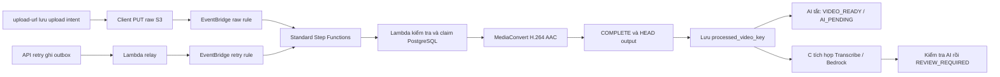

# LearnCloud — triển khai Video Processing Pipeline bằng AWS Console

> Runbook được giữ lại từ một snapshot cũ. Các câu khẳng định về endpoint (gồm confirm-upload), trạng thái migration, source, AWS deployment và test là ghi nhận tại thời điểm viết, không phải trạng thái hiện tại. Đối chiếu [API contract hiện tại](../api-contract.md), [source infrastructure](../../infrastructure/) và inventory trước khi dùng. Không có AWS production state nào được xác minh trong lần dọn docs này.

Ghi nhận lúc tài liệu được soạn: tác giả đánh dấu source **CODE READY**, **LOCAL TESTED**,
**AWS NOT DEPLOYED**; các nhãn này không được kiểm tra lại. Tài liệu cũng ghi phiên làm
việc khi đó không đăng nhập/gọi AWS, deploy hoặc chạy migration. Không dùng các dòng trên
làm trạng thái hiện tại. Nội dung test dưới đây là lịch sử và không chứng minh AWS E2E.

Các mục ghi **MANUAL AWS CONSOLE STEP** là việc **bạn tự thao tác** trong Console.
Lệnh đóng gói dưới đây chỉ tạo file local. Không có lệnh AWS CLI/provisioning.

## Phần 1 — Chuẩn bị

### 1.1. Hiểu luồng và giới hạn



Dispatch duy nhất qua EventBridge: S3 cho upload đầu tiên; outbox relay cho retry chủ động.
Không cấu hình thêm S3→Lambda transcode hoặc backend→StartExecution.
Snapshot lúc viết tài liệu này cho rằng chưa có `confirm-upload` route. Source hiện tại
đã đăng ký `POST /lessons/{lesson_id}/confirm-upload`; xem [API contract](../api-contract.md).
Route tồn tại không tự xác minh AWS dispatch/claim behavior; đối chiếu implementation
hiện tại trước khi chọn cơ chế xác nhận và giữ một đường dispatch duy nhất.

`LocalProcessor` là hàng đợi dispatch-only development, không có FFmpeg worker.
Không tạo output giả, không tạo AI giả, không tự chuyển REVIEW_REQUIRED.

### 1.2. Tài khoản, region, services

**MANUAL AWS CONSOLE STEP:** mở AWS Console bằng tài khoản/lab được cấp. Chọn góc
trên phải **Asia Pacific (Singapore), ap-southeast-1** cho S3/Lambda/MediaConvert/
Step Functions/EventBridge/CloudWatch. IAM là dịch vụ toàn cục.

| Dịch vụ | Mục đích | Có thể phát sinh phí |
| --- | --- | --- |
| S3 private `learncloud-videos-mentorcloud` | raw và processed | dung lượng, requests, download/data transfer |
| AWS Elemental MediaConvert | H.264/AAC MP4 tối đa 720p | thời lượng/loại output và tier |
| Step Functions Standard | điều phối và chờ/poll | state transitions, kể cả retry/poll |
| Lambda | gate, submit/get job, DB, relay/recovery | request, duration, memory |
| EventBridge | S3 và retry routing | theo loại event và dịch vụ liên quan |
| CloudWatch Logs/Alarms | logs, điều tra, alarms | ingest/storage/query/alarms |
| PostgreSQL có thể truy cập từ Lambda | trạng thái/ledger | RDS/EC2 nếu chọn chạy trên AWS |
| VPC/NAT/endpoints, SQS DLQ, SNS | mạng và vận hành tùy chọn | NAT/endpoints, requests và notifications |
| Transcribe/Bedrock | giai đoạn C, tắt mặc định | phút âm thanh, model inference/tokens |

Không giả định Free Tier bao phủ pipeline. Xem trang giá của
[MediaConvert](https://aws.amazon.com/mediaconvert/pricing/),
[Step Functions](https://aws.amazon.com/step-functions/pricing/),
[Lambda](https://aws.amazon.com/lambda/pricing/) và
[CloudWatch](https://aws.amazon.com/cloudwatch/pricing/) trước test nhiều video.
**MANUAL AWS CONSOLE STEP:** Billing and Cost Management → Budgets → tạo cost budget
nhỏ phù hợp lab, email cảnh báo của bạn. Budget là cảnh báo, không tự chặn mọi phí.

AWS Academy: kiểm tra mục **Readme/Supported services/Restrictions** trong lab của
bạn trước. Tùy khóa học, lab có thể giới hạn region, không cho tạo IAM role/policy,
không cho PassRole, chỉ cho dùng role sẵn có như LabRole, giới hạn service/model/quota
và thời gian session. Không mặc định LabRole được MediaConvert/Step Functions assume.
Nếu region ap-southeast-1 hay MediaConvert bị chặn, nhờ giảng viên xác nhận môi trường
phù hợp; không đổi region rời rạc hoặc xin AdministratorAccess để né giới hạn.

### 1.3. Điều kiện tiên quyết về DB và ứng dụng

1. Đã có Lesson DRAFT thuộc Section/Course DRAFT và Instructor sở hữu; migration 0004
   APPROVED đã áp dụng theo thông tin dự án. Không chạy lại 0004 chỉ để test pipeline.
2. Chủ DB xem xét, backup và **tự quyết định áp dụng**
   [0005_video_pipeline_ledger.sql](../../database/migrations/0005_video_pipeline_ledger.sql).
   Đây là migration mới **chỉ được chuẩn bị file**, chưa chạy. Nó tạo hai bảng ledger,
   không update Lesson/Course, không tạo sample data. Không có auto-migrate khi khởi động.
   Đọc [review 0005 và lệnh PowerShell backup/apply/verify](../database/video-pipeline-migration-0005.md),
   chạy `database/checks/video_pipeline_preflight.sql` chỉ đọc trước/sau. Bản đã review
   ghi registry 0005 và composite FK upload/lesson; không tự thêm confirmed_at.
3. Chỉ bật VIDEO_PIPELINE_ENABLED sau khi hai bảng đã tồn tại và app DB user có
   SELECT/INSERT/UPDATE trên chúng. Chủ DB thực hiện ngoài phiên agent; không dùng
   user có CREATE/DROP trong Lambda runtime. Ledger cần giữ lại để bảo vệ dedupe.
4. Backend và cả ba Lambda phải trỏ **cùng một database chứa cùng Lesson**.
   Docker `localhost:5434` hoặc hostname `db` trên laptop **không truy cập được từ Lambda**.
   Không mở PostgreSQL development ra `0.0.0.0/0` để thử cho nhanh.
5. Nhờ người phụ trách mạng chuẩn bị PostgreSQL private có đường kết nối đã duyệt:
   RDS/EC2 trong VPC, hoặc VPN tới DB của nhóm. Nếu cần môi trường AWS riêng:
   **MANUAL AWS CONSOLE STEP:** RDS → Databases → Create database → PostgreSQL →
   template Dev/Test → VPC/subnet group của nhóm → Public access **No** → security
   group riêng. Chọn instance/storage theo ngân sách, kiểm tra chi phí trước Create.
   Chủ DB chuẩn bị schema của môi trường mới bằng quy trình đã duyệt; không tự copy
   hay sửa dữ liệu development. RDS creation một mình chưa tạo schema LearnCloud.
6. S3 giữ Block Public Access bật; backend hiện đã có Presigned PUT/GET hoạt động.
   CORS cho frontend phải cho PUT, Content-Type và If-None-Match. Upload client phải
   đọc `required_headers` khi pipeline bật. Giữ luồng phát video private hiện có.
7. Upload raw phải bất biến: bật điều kiện create-only ở mục 3.3, không cấp DeleteObject
   raw cho runtime. Không xóa rồi PUT lại cùng key trong lúc job chạy.

Nếu chưa có đường Lambda→PostgreSQL, dừng phần E2E tại đây. Bạn vẫn đọc/import/validate
cấu hình nhưng chưa thể tuyên bố workflow chạy hoàn chỉnh với DB Docker local.

### 1.4. Quyền người thao tác và bảng file

Người thao tác cần quyền đọc/tạo/cấu hình **đúng tài nguyên LearnCloud** cho IAM
roles/policies/trust và PassRole, Lambda Create/Update/Get/Invoke/AddPermission,
Step Functions Create/Update/Start/Describe/GetExecutionHistory, EventBridge rules/
targets, S3 bucket notification/policy/CORS, CloudWatch groups/retention/alarms và
SNS/SQS nếu dùng. Những quyền này là của người triển khai, tách khỏi runtime roles.
Nhờ quản trị cấp tập quyền theo tên/ARN tài nguyên cần dùng; không gắn AdministratorAccess.

| File trong repository | Service/thành phần |
| --- | --- |
| `backend/app/adapters/video/local_processor.py` | local dispatch-only |
| `backend/app/adapters/video/mediaconvert.py` | payload H.264/AAC, injected client, SDK timeout/error |
| `backend/app/adapters/storage/s3_storage.py` | Presigned PUT có If-None-Match khi opt-in |
| `backend/app/config.py`, `.env.example` | feature flags và cấu hình |
| `backend/app/services/upload_service.py` | giữ response cũ; thêm intent/header khi opt-in |
| `backend/app/services/processing_service.py` | retry lựa chọn local/outbox |
| `backend/app/models/video_pipeline.py` | models hai bảng ledger |
| `backend/app/repositories/video_pipeline_repo.py` | ledger queries/outbox |
| `backend/app/services/video_pipeline_service.py` | claim/fencing/verify/DB/retry/AI gate |
| `database/migrations/0005_video_pipeline_ledger.sql` | schema mới, người quản trị DB tự áp dụng sau duyệt |
| `infrastructure/lambda/video_pipeline_handler.py` | ba Lambda entrypoints |
| `backend/scripts/build_video_pipeline_package.py` | tạo ZIP offline |
| `infrastructure/lambda/README.md` | contract và giới hạn Lambda/C |
| `infrastructure/step-functions/video_pipeline.asl.json` | State Machine Standard |
| `infrastructure/step-functions/sample-upload-input.json`, `README.md` | input mẫu và giải thích workflow |
| `infrastructure/eventbridge/s3-object-created.pattern.json` | raw S3 rule |
| `infrastructure/eventbridge/s3-input-transformer.json` | input paths và template |
| `infrastructure/eventbridge/retry.pattern.json` | custom retry event rule |
| `infrastructure/eventbridge/execution-failure.pattern.json` | terminal execution recovery rule |
| `infrastructure/eventbridge/sample-s3-event.json`, `README.md` | kiểm tra pattern/routing |
| `infrastructure/iam/*-trust.json`, `*-permissions.json`, `README.md` | xem bảng role mục 2 |
| `infrastructure/s3/raw-immutable-policy.json` | yêu cầu create-only trên prefix raw |
| `infrastructure/cloudwatch/README.md` | logs/alarms/điều tra |
| `backend/tests/unit/test_video_pipeline.py` | adapter, ledger, workflow guard tests |
| `backend/tests/run_unit_offline.py` | chạy toàn bộ unit suite chặn network |
| `.gitignore` | bỏ build artifacts khỏi source control |

Tạo bản sao các JSON dùng triển khai trong thư mục local không commit. Thay các giá trị:

| Placeholder | Cách lấy / ví dụ không phải cấu hình thật |
| --- | --- |
| `${ACCOUNT_ID}` | Console góc trên phải → Account ID, 12 chữ số |
| `${MEDIACONVERT_QUEUE_NAME}` | MediaConvert → Queues → tên queue on-demand, thường `Default` |
| `${MEDIACONVERT_ROLE_ARN}` | IAM → role MediaConvert → Summary → ARN |
| `${PIPELINE_LAMBDA_ARN}` | Lambda pipeline → Function overview → Function ARN |
| `${AI_WORKER_ARN}` | Lambda C sau tích hợp; AI tắt có thể tạm dùng pipeline ARN hợp lệ |
| `${STATE_MACHINE_ARN}` | Step Functions → state machine → Details → ARN |

Không dùng AWS account ID/ARN ví dụ để chạy. Không sửa `.env` hiện có bằng secret mẫu.

<a id="phan-2--iam-roles-va-policies"></a>

## Phần 2 — IAM role và policy

### 2.1. Cách tạo policy và role trên Console

**MANUAL AWS CONSOLE STEP:** trên thanh tìm kiếm dịch vụ nhập **IAM** → IAM →
**Policies → Create policy → JSON**. Dán nội dung file permissions đã thay placeholder,
chọn Next, xem validation warnings, đặt tên policy có tiền tố LearnCloudVideo, Create.
Không dán trust policy vào ô permission policy.

IAM → **Roles → Create role → Custom trust policy**, dán file `*-trust.json` đã thay
placeholder → Next → chọn policy vừa tạo → Next → nhập role name → Create role.
Nếu dùng màn hình AWS service, vẫn kiểm tra tab **Trust relationships → Edit trust policy**
và cập nhật đúng JSON sau tạo. Tab **Permissions** phải có policy đúng service.

| Role gợi ý | Trusted service / trust file | Policy permissions cần gắn |
| --- | --- | --- |
| LearnCloudVideoMediaConvertRole | mediaconvert.amazonaws.com / `mediaconvert-trust.json` | `mediaconvert-permissions.json`: raw GetObject, processed PutObject, bucket location/list có prefix |
| LearnCloudVideoPipelineLambdaRole | lambda.amazonaws.com / `lambda-trust.json` | `lambda-pipeline-permissions.json`: logs, raw/processed HEAD qua GetObject, MC CreateJob/GetJob, PassRole đúng role MC |
| LearnCloudVideoRelayLambdaRole | lambda.amazonaws.com / `lambda-trust.json` | `lambda-relay-permissions.json`: logs, PutEvents đúng bus/source/detail-type |
| LearnCloudVideoRecoveryLambdaRole | lambda.amazonaws.com / `lambda-trust.json` | `lambda-recovery-permissions.json`: logs; DB auth dùng DB user riêng |
| LearnCloudVideoStateMachineRole | states.amazonaws.com / `step-functions-trust.json` | `step-functions-permissions.json`: InvokeFunction đúng pipeline/C ARN và log delivery |
| LearnCloudVideoEventBridgeRole | events.amazonaws.com / `eventbridge-trust.json` | `eventbridge-permissions.json`: StartExecution đúng state machine ARN |

Tất cả JSON ở `infrastructure/iam/`. Mỗi Lambda cần DB trong VPC thì bổ sung
`lambda-vpc-permissions.json`. Quyền EC2 network/log delivery có Resource `*` do cách
API phân quyền; các quyền dữ liệu S3/MC/Invoke/PassRole/StartExecution đã giới hạn ARN.
Không thêm s3:* hoặc iam:* để xử lý lỗi. Policy MC mặc định dùng SSE-S3; SSE-KMS cần
quyền/key policy đúng CMK được quản trị duyệt, xem [tài liệu MC IAM](https://docs.aws.amazon.com/mediaconvert/latest/ug/iam-role.html).

### 2.2. Trình tự tránh vòng phụ thuộc ARN

1. **MANUAL AWS CONSOLE STEP:** lấy Account ID và queue name/ARN từ MediaConvert.
2. Tạo role MediaConvert, trust giới hạn SourceAccount + queue SourceArn, lấy role ARN.
   [AWS hướng dẫn dùng ARN queue trong trust](https://docs.aws.amazon.com/mediaconvert/latest/ug/cross-service-confused-deputy-prevention.html).
3. Tạo ba role Lambda. Policy pipeline thay role MC ARN/account/queue name.
4. Tạo log groups (mục 7.1) rồi tạo ba functions (mục 4), lấy pipeline ARN.
5. Tạo role Step Functions, thay account và function ARN. Với AI tắt, dùng pipeline
   ARN tại chỗ AI_WORKER_ARN để JSON không chứa ARN placeholder chưa hợp lệ.
6. Tạo state machine **đúng tên `learncloud-video-pipeline`** để khớp trust role.
   Lấy State Machine ARN, tạo role EventBridge sau cùng.

Nếu đổi tên state machine/rule/function, sửa cả trust/policies/log group tương ứng.
EventBridge trust chỉ cho rule `learncloud-video-*` cùng account/region. Rule→Lambda
dùng Lambda resource policy, không dùng role StartExecution. Relay tick thêm trigger
qua Lambda Console sẽ thiết lập quyền invoke cho đúng rule.

### 2.3. Lấy ARN và kiểm tra quyền từng role

**MANUAL AWS CONSOLE STEP:** IAM → Roles → bấm tên → Summary → nút copy **ARN**.
Lưu vào ghi chú triển khai riêng; không sao chép access key/session token.

Với **từng role** trong bảng: kiểm tra Trust relationships đúng principal và source
condition; Permissions → mở policy → JSON → đối chiếu action/resource sau thay ARN.
Nếu có quyền, dùng IAM Policy Simulator để kiểm tra action + resource cụ thể:

- MC role: GetObject raw **Allow**, PutObject processed **Allow**, PutObject raw không được cấp.
- Pipeline Lambda: CreateJob đúng queue, GetJob đúng job ARN, PassRole đúng role MC/service.
- Relay Lambda: PutEvents đúng default bus; thử source/detail-type context đúng policy.
- Recovery Lambda: PutLogEvents đúng group; không có quyền submit job.
- StateMachine: InvokeFunction đúng ARN, log delivery; không cần PassRole MediaConvert
  vì bản workflow này submit qua Lambda, không dùng `.sync` trực tiếp.
- EventBridge: StartExecution đúng state machine; ARN state machine khác không được cấp.

Simulator chưa chứng minh bucket policy, SCP, permissions boundary, KMS hay trust runtime
đều đúng. Khi kiểm thử thủ công, dùng error code + service/role để đối chiếu; không mở
rộng quyền toàn account. Người vận hành cần PassRole tới đúng các role khi tạo resource.

## Phần 3 — MediaConvert

### 3.1. Chuẩn bị và hiểu job

**MANUAL AWS CONSOLE STEP:** tìm **AWS Elemental MediaConvert** → chọn Singapore →
**Queues** → chọn queue on-demand đã có, ví dụ Default → copy ARN. Không mua reserved
queue chỉ để demo. Điền ARN vào MEDIACONVERT_QUEUE_ARN; policy/trust phải cùng queue.

MediaConvert → **Jobs → Create job** mở màn hình thiết kế để đối chiếu cấu hình:

1. Job settings → AWS integration/Service access → chọn existing role
   LearnCloudVideoMediaConvertRole. Tên menu có thể thay đổi nhẹ theo giao diện Console.
2. Inputs → Input 1 → S3 input: `s3://learncloud-videos-mentorcloud/lessons/<lesson>/raw/<upload-id>.mp4`.
   Đây phải là object đã upload thực tế; không dùng đường dẫn laptop `cloud.mp4`.
3. Audio selector 1: Default selection DEFAULT. Video selector mặc định.
4. Output groups → Add → **File group**. Destination basename:
   `s3://learncloud-videos-mentorcloud/lessons/<lesson>/processed/<upload-id>/attempt-1/video`.
   Đuôi `video` là basename, không phải thư mục có dấu `/` cuối.
5. Output 1: container **MP4**, name modifier `_720p`, video codec **H.264**;
   width 1280, height 720, Scaling behavior **Fit, no upscaling**; QVBR quality 7,
   max bitrate 3,000,000 bps. MP4 moov placement Progressive download.
6. Audio: AAC, stereo (CODING_MODE_2_0), 48,000 Hz, 128,000 bps.
7. Không chọn output raw path. Cấu hình hiện yêu cầu nguồn có audio/video phù hợp;
   video không có audio hoặc codec hỏng có thể FAILED, không giả thành success.

Đây là bước đối chiếu. Không bấm Create job trên cùng upload sẽ được workflow xử lý:
việc đó tạo job ngoài ledger. Test job độc lập, nếu cần, dùng prefix thử riêng và tự
chịu phí; E2E chuẩn bên dưới để workflow submit duy nhất.
Code tạo payload tương ứng ở `mediaconvert.py`; tên file dự kiến `video_720p.mp4`.
AWS mô tả [Name modifier được nối vào basename](https://docs.aws.amazon.com/mediaconvert/latest/ug/setting-up-a-job.html).

### 3.2. Kiểm tra job do workflow tạo

**MANUAL AWS CONSOLE STEP:** MediaConvert → Jobs → chọn cùng region/queue và thời gian
upload → mở Job ID lấy từ ledger hoặc CloudWatch `video_job_submitted`.
Xem Status SUBMITTED/PROGRESSING/COMPLETE/ERROR/CANCELED, Error code/message, Role,
Input, Output và User metadata. Không chỉ nhìn task submit trả 200 để kết luận video xong.

Job COMPLETE → S3 → bucket → mở đúng prefix processed/upload-id/attempt-1 →
`video_720p.mp4` → Properties: size > 0, Last modified phù hợp. Dùng quyền của bạn
download/xem thử để kiểm tra hình/tiếng và độ phân giải. Không bật public read.
Workflow kiểm tra COMPLETE và HEAD đúng output trước khi ghi processed_video_key.

### 3.3. Raw bất biến và CORS

**MANUAL AWS CONSOLE STEP:** chỉ làm ngay trước khi bật opt-in và client đã gửi
required_headers. S3 → bucket → Permissions → Bucket policy → **merge** statement từ
`infrastructure/s3/raw-immutable-policy.json` vào policy hiện có, không ghi đè policy cũ.
Nó Deny PutObject raw thiếu If-None-Match; signed URL opt-in yêu cầu header `If-None-Match: *`.
PUT lại cùng key trả 412/409; xin upload URL mới, không bỏ header để ghi đè.
[AWS conditional-write enforcement](https://docs.aws.amazon.com/AmazonS3/latest/userguide/conditional-writes-enforce.html).

Permissions → CORS → thêm `If-None-Match` và `Content-Type` vào AllowedHeaders của
rule frontend, giữ AllowedOrigins cụ thể của ứng dụng, PUT/GET/HEAD cần thiết.
Không xóa rule playback đang dùng. Nếu chỉ có legacy upload client chưa hỗ trợ header,
chưa áp dụng policy/chưa bật pipeline. Đây là dependency triển khai có chủ ý.

<a id="phan-4--lambda"></a>

## Phần 4 — Lambda

### 4.1. Tạo package triển khai tại local

ZIP phải chứa `app/`, `video_pipeline_handler.py` và dependencies tại **root**.
Chọn Python 3.12, x86_64 nên cần wheels Linux CPython 3.12, không lấy `.venv` Windows.
Từ repository root, người dùng tự chuẩn bị một thư mục dependency mới/rỗng:

```powershell
python -m pip install --platform manylinux2014_x86_64 --implementation cp --python-version 3.12 --abi cp312 --only-binary=:all: --target build/video-dependencies -r backend/requirements.txt
python backend/scripts/build_video_pipeline_package.py --dependencies build/video-dependencies --output build/video-pipeline.zip
```

Lệnh pip có thể tải packages từ registry; không gọi AWS, không deploy. Agent chưa chạy
hai lệnh build này. Nếu package không có wheel tương thích, không bỏ tùy chọn Linux
để lấy binary Windows: nhờ đội build dùng Linux Python 3.12 container tương ứng.
Không trộn dependencies cũ, không zip `.env`, `.aws`, `.git`, credentials hoặc project root.
Mở ZIP kiểm tra layout và dung lượng. Lambda direct ZIP upload giới hạn 50 MB nén;
nếu vượt, người dùng tự upload ZIP lên một bucket artifact riêng bằng S3 Console rồi
chọn S3 location trong Lambda. Không dùng prefix raw video làm nơi chứa artifact.

### 4.2. Tạo ba Lambda function

**MANUAL AWS CONSOLE STEP:** tìm **Lambda → Functions → Create function → Author from
scratch**, nhập tên theo bảng, Runtime Python 3.12, Architecture x86_64. Permissions →
Change default execution role → **Use an existing role**, chọn role đúng bảng IAM.
Create function → Code → Upload from → .zip file → chọn `build/video-pipeline.zip` → Save.

| Function | Runtime settings → Handler | General configuration |
| --- | --- | --- |
| learncloud-video-pipeline | video_pipeline_handler.handler | 256 MB, timeout 45 giây |
| learncloud-video-relay | video_pipeline_handler.relay_handler | 256 MB, timeout 60 giây |
| learncloud-video-recovery | video_pipeline_handler.recovery_handler | 256 MB, timeout 30 giây |

Configuration → General configuration → Edit để đặt memory/timeout. Runtime settings →
Edit để đặt handler. Không tạo Function URL hoặc API Gateway public cho Lambda này.
Nếu lab cho phép, đặt reserved concurrency pipeline=2, relay=1, recovery=1 để hạn chế
kết nối DB; quota thấp thì điều chỉnh theo người quản trị. Không đặt 0 vì sẽ throttle toàn bộ.

### 4.3. Biến môi trường

**MANUAL AWS CONSOLE STEP:** mỗi function → Configuration → Environment variables → Edit.

| Biến | Giá trị / lưu ý |
| --- | --- |
| VIDEO_PIPELINE_ENABLED | `true` chỉ sau khi DB/schema/network sẵn sàng |
| AWS_REGION | Lambda tự cung cấp `ap-southeast-1`; **không thêm/sửa biến reserved này trong Console** |
| S3_BUCKET | `learncloud-videos-mentorcloud` |
| DATABASE_URL | DSN bí mật tới cùng PostgreSQL backend dùng; `connect_timeout=5`, SSL theo chính sách nhóm |
| JWT_SECRET_KEY | chuỗi ngẫu nhiên riêng >=32 ký tự để đáp ứng Settings; Lambda nội bộ không dùng để xác thực API |
| APP_ENV | `production` |
| VIDEO_AI_ENABLED | `false` đến khi C tích hợp đầy đủ |
| MEDIACONVERT_ROLE_ARN | ARN role MC, bắt buộc cho pipeline handler |
| MEDIACONVERT_QUEUE_ARN | ARN queue đã chọn, cùng policy |
| VIDEO_EVENT_BUS | `default`, relay dùng bus này |

DSN ví dụ **không chứa credential thật**:
`postgresql://<db-user>:<url-encoded-password>@<private-db-host>:5432/<database>?sslmode=require&connect_timeout=5`.
Nhập secret qua kênh quản lý được nhóm duyệt; không commit, screenshot hoặc paste vào log.
Lambda environment được mã hóa at rest nhưng quyền GetFunctionConfiguration vẫn nhạy cảm.
Bản code này chưa tích hợp Secrets Manager tự fetch secret; nếu nhóm bắt buộc dùng
Secrets Manager, phải bổ sung adapter/cấu hình phù hợp trước deployment.

Backend khi người dùng tự cấu hình sau này: `VIDEO_PIPELINE_ENABLED=true`,
`VIDEO_PROCESSOR_BACKEND=eventbridge`, `VIDEO_EVENT_BUS=default`, bucket/region hiện có.
Backend không submit trực tiếp MC; role/queue cần trên pipeline Lambda. Tắt AI cả nơi
worker đọc Settings. Giữ `.env.example` không secret, không chỉnh `.env` thật bởi agent.

### 4.4. VPC và PostgreSQL

**MANUAL AWS CONSOLE STEP:** Lambda → Configuration → VPC → Edit → cùng VPC với DB,
chọn private subnets đã có route phù hợp, security group Lambda riêng. RDS → DB →
Connectivity & security → DB security group → inbound PostgreSQL TCP 5432 **source
là Lambda security group**, không 0.0.0.0/0. Lambda SG outbound tới DB và HTTPS tới
services cần thiết; kiểm tra network ACL/DNS/route nếu timeout.

Pipeline cần S3 và MediaConvert API; relay cần EventBridge API. Private subnet cần NAT
hoặc endpoints hỗ trợ dịch vụ tương ứng. Không giả định mọi service có endpoint trong
region/lab. Chỉ nối Lambda vào public subnet không cấp public IP/internet cho function.
Theo [AWS VPC Lambda](https://docs.aws.amazon.com/lambda/latest/dg/configuration-vpc.html)
và [cấu hình internet access](https://docs.aws.amazon.com/lambda/latest/dg/configuration-vpc-internet.html).
NAT/interface endpoints có phí; nhờ người phụ trách mạng xác nhận trước khi tạo.

### 4.5. Kiểm tra Lambda

**MANUAL AWS CONSOLE STEP:** function → Test → Create new event. Trước khi bật flag,
test `{}` phải bị chặn với PIPELINE_DISABLED (không phải kết quả xử lý thành công).
Sau khi bật, không test `submit` bằng run ID tự bịa. Test relay bằng `{}` khi outbox rỗng:
kết quả `{"delivered":0}` chỉ kiểm tra đường DB/relay, chưa chứng minh E2E.
Monitor → View CloudWatch logs để xem INIT/REPORT/error code đã sanitize.
Lambda test có action claim/submit/fail **có thể thay đổi DB/gọi AWS** khi đã bật;
chỉ chạy input của test do bạn quản lý, theo mục 8.

## Phần 5 — Step Functions

### 5.1. Tạo state machine

**MANUAL AWS CONSOLE STEP:** tìm **Step Functions → State machines → Create state
machine**. Chọn tạo từ code/blank workflow, loại **Standard**; không chọn Express.
Vào tab Code/ASL editor, import hoặc dán bản sao
`infrastructure/step-functions/video_pipeline.asl.json`.

1. Thay `${PIPELINE_LAMBDA_ARN}` bằng ARN pipeline function **mọi vị trí**.
2. Thay `${AI_WORKER_ARN}` bằng ARN C; khi AI=false có thể tạm dùng pipeline ARN hợp lệ.
   Không để chuỗi `${...}` trong definition triển khai. Không bật AI với ARN tạm.
3. Đặt tên **learncloud-video-pipeline**. Execution role → **Use existing role** →
   LearnCloudVideoStateMachineRole. Tên khác phải sửa SourceArn trong role trust.
4. Dùng Validate/kiểm tra lỗi editor. Kiểm tra workflow graph có Claim, Submit,
   Wait/Poll, Verify, AI choice, RecordFailure. Task Submit không có Retry cố ý.
5. Logging → Enable → log group `/aws/vendedlogs/states/learncloud-video-pipeline`,
   level **ERROR**, **Include execution data OFF**. Chọn role có log delivery policy.
6. Kiểm tra cấu hình rồi **Create**. Copy ARN cho EventBridge policy/pattern recovery.

Local JSON/graph test không thay thế validation ASL của AWS Console, IAM simulation
hay MediaConvert job thật. Code dùng Lambda integration được AWS hỗ trợ; AWS cũng có
[MC `.sync`](https://docs.aws.amazon.com/step-functions/latest/dg/connect-mediaconvert.html)
nhưng bản này chọn lưu job ID + GetJob polling. Token
[CreateJob chỉ dedupe trong một phút](https://docs.aws.amazon.com/mediaconvert/latest/apireference/idempotency.html),
không thay cho ledger PostgreSQL.

### 5.2. Chạy input mẫu và theo dõi biểu đồ thực thi

**MANUAL AWS CONSOLE STEP:** state machine → Start execution → đặt tên test dễ tìm →
dùng schema `sample-upload-input.json`, thay lesson/key/ETag theo upload thật đã xin
URL từ backend. Ví dụ schema:

```json
{
  "kind": "upload",
  "bucket": "learncloud-videos-mentorcloud",
  "key": "lessons/8/raw/0123456789abcdef0123456789abcdef.mp4",
  "etag": "0123456789abcdef0123456789abcdef"
}
```

Không dùng nguyên giá trị mẫu để kỳ vọng success. Key phải có upload intent commit,
Lesson/Course DRAFT, HEAD size/type/time/ETag đúng. Không tạo dummy success trong DB.
Manual Start chỉ dùng chẩn đoán khi rule upload chưa bật; E2E bình thường dùng upload
để EventBridge khởi chạy. Nếu cùng event đã xử lý, DuplicateIgnored là kết quả đúng.

Execution → Graph view → bấm từng state → Input/Output/Events. Submit trả về receipt
chưa có nghĩa COMPLETE. Wait/Poll chạy mỗi 30 giây, tối đa 120 lượt; tổng execution
timeout 7200 giây để còn khoảng cho retries/AI. Task timeout được Catch, còn timeout
toàn execution/abort cần recovery rule. Không dùng **Redrive**; retry đi qua API/outbox.

| Execution kết thúc | Ý nghĩa cần đối chiếu |
| --- | --- |
| SUCCEEDED tại DuplicateIgnored | event trùng/stale; không có job mới |
| SUCCEEDED tại VideoReadyAIPending | video thật đã verify/lưu key; ledger VIDEO_READY, Lesson PROCESSING, AI chưa làm |
| SUCCEEDED tại ReviewRequired | C completed + DB content hợp lệ; Lesson REVIEW_REQUIRED, chưa APPROVED/PUBLISHED |
| FAILED | xem state lỗi, ledger/processing-status; RecordFailure có thể đã lưu FAILED |
| TIMED_OUT / ABORTED | recovery handler cần lưu FAILED; job MC có thể vẫn chạy và còn phí |

<a id="phan-6--eventbridge"></a>

## Phần 6 — EventBridge

### 6.1. Bật S3 events và tạo rule upload

**MANUAL AWS CONSOLE STEP:** S3 → Buckets → learncloud-videos-mentorcloud →
Properties → **Amazon EventBridge → Edit → Send notifications to Amazon EventBridge:
On → Save changes**. Đợi cấu hình có hiệu lực trước upload test mới; không kỳ vọng
event lịch sử tự phát lại.

EventBridge → **Rules → chọn default event bus → Create rule**:

1. Name `learncloud-video-upload`, enabled, event pattern rule.
2. Event source AWS events; Event pattern → Custom pattern/JSON editor → dán
   `s3-object-created.pattern.json` đã thay ACCOUNT_ID. Region và bucket phải khớp.
3. Có thể dùng EventBridge Sandbox/Test pattern với `sample-s3-event.json` cùng account.
   Đổi raw thành processed phải **không match**; bucket khác cũng không match.
4. Target type AWS service → **Step Functions state machine** → chọn state machine.
5. Execution role → Use existing role → LearnCloudVideoEventBridgeRole.
6. Additional settings → Configure target input → **Input transformer**. File
   `s3-input-transformer.json` chứa hai phần: copy **giá trị InputPathsMap** vào ô
   Input path, copy **nội dung chuỗi InputTemplate** vào ô Input template (không gồm
   dấu quote/escape của chuỗi JSON bên ngoài).

Input path:

```json
{"bucket":"$.detail.bucket.name","key":"$.detail.object.key","etag":"$.detail.object.etag"}
```

Input template:

```text
{"kind":"upload","bucket":<bucket>,"key":<key>,"etag":<etag>}
```

7. Xem preview: bucket/key/etag phải là JSON strings, không bị bỏ trường. Đây là native
   S3 EventBridge event, không phải legacy `Records[0].s3.object.key`. Xem
   [AWS input transformation](https://docs.aws.amazon.com/eventbridge/latest/userguide/eb-transform-target-input.html).
8. Target retry policy: có thể dùng event age 24 giờ/max retries 185; theo ngân sách lab.
   Nên cấu hình SQS Standard DLQ cùng region nếu được phép, kiểm tra policy SendMessage
   từ events.amazonaws.com với SourceArn đúng rule. Đây là tài nguyên tùy chọn tự tạo.
9. Review → Create rule. Chỉ upload key raw mới được phát sau khi rule đã bật để test.

### 6.2. Retry rule và relay lịch chạy

**MANUAL AWS CONSOLE STEP:** tạo rule `learncloud-video-retry`, custom pattern từ
`retry.pattern.json` sau thay account, cùng default bus. Target cùng state machine,
cùng role EventBridge. Input chọn **Part of matched event → `$.detail`**; không dùng
transformer S3 cho retry event. Detail có kind/bucket/key/run_id do relay phát.

Lambda → learncloud-video-relay → **Add trigger → EventBridge (CloudWatch Events)** →
Create a new rule → name `learncloud-video-relay-tick` → Schedule expression
`rate(1 minute)` → Enable trigger → Add. Nếu Console dẫn sang EventBridge Scheduler,
chọn đường tạo scheduled rule/legacy rule trên default bus để khớp trust events.amazonaws.com;
nếu chọn Scheduler thay thế phải dùng trust scheduler.amazonaws.com và quyền riêng,
không dùng nhầm policy EventBridge role cho Scheduler. Target input `{}`.
Console phải thêm Lambda resource policy cho exact tick rule ARN.

API retry không gọi AWS dispatcher: trong một transaction nó tăng retry_count,
chuyển PROCESSING và ghi QUEUED outbox. Relay PutEvents, giữ phát lại mỗi 2 phút cho
đến khi execution claim. Vì vậy retry có thể đợi lịch relay, không nhất thiết chạy ngay.
Nếu relay/rule hỏng, request vẫn còn trong DB để xử lý sau, không mất yêu cầu.

### 6.3. Recovery rule và duplicate/race

**MANUAL AWS CONSOLE STEP:** tạo rule `learncloud-video-recovery`, pattern
`execution-failure.pattern.json` thay STATE_MACHINE_ARN, target Lambda recovery,
input toàn bộ matched event. Kiểm tra function Configuration → Permissions →
resource-based policy cho phép events.amazonaws.com invoke từ đúng rule ARN.
Nếu Console không tự thêm: Lambda → Configuration → Permissions → Add permissions
→ AWS account/service principal, service events.amazonaws.com, Source ARN exact rule.

Status events Standard có [best effort delivery](https://docs.aws.amazon.com/step-functions/latest/dg/eventbridge-integration.html).
Rule này không đảm bảo mọi timeout đều được nhận: dùng alarms và audit ledger/execution
để phát hiện row PROCESSING bị treo. Không chạy workflow mới để sửa một row treo.

S3 có thể phát event trùng, EventBridge cũng có thể StartExecution nhiều lần. UNIQUE
upload+attempt và owner execution dưới khóa Course/Lesson chỉ cho một run tiến hành.
Không hứa không có duplicate executions; mục tiêu là không duplicate processing/job.
Raw policy + generated UUID ngăn overwrite; output prefix không match rule raw.

Không có race S3 vs confirm-upload trong phiên bản này vì confirm endpoint chưa tồn
tại và intent được commit trước khi trả presigned URL. Các upload legacy trước opt-in
không có intent sẽ bị UNISSUED_UPLOAD; xin URL mới cho Lesson DRAFT hợp lệ, không sửa
key/DB thủ công để vượt gate. Nếu frontend đóng tab trước PUT, chỉ còn intent hết hạn,
không tạo processing success. Nếu PUT xong rồi đóng tab, S3 event vẫn đủ khởi chạy.

## Phần 7 — CloudWatch

### 7.1. Log groups và logging

**MANUAL AWS CONSOLE STEP:** CloudWatch → Logs → **Log groups → Create log group**,
tạo trước khi Lambda chạy:

- `/aws/vendedlogs/states/learncloud-video-pipeline`
- `/aws/lambda/learncloud-video-pipeline`
- `/aws/lambda/learncloud-video-relay`
- `/aws/lambda/learncloud-video-recovery`

Mỗi group → Retention/Edit → **7 days** cho lab, hoặc chính sách nhóm. Không để Never
expire vô tình. Lambda → Configuration → Monitoring and operations/Logging → INFO
nếu muốn log `video_job_submitted`; mặc định WARNING vẫn thấy lỗi. Step Functions
logging ERROR + Include execution data OFF như mục 5. Không bật DEBUG SDK/SQL.

Lambda → Monitor → View CloudWatch logs; mở log stream mới theo RequestId/time.
Tìm `video_job_submitted` để lấy run ID/job ID; `video_pipeline_failed` là lỗi đã lưu;
`pipeline_operation_failed` là exception đã sanitize. Log START/END/REPORT cho biết
duration và memory. MediaConvert lỗi xem Jobs → Job ID; bản này không tạo riêng
MediaConvert application log group.

### 7.2. Alarms và điều tra

**MANUAL AWS CONSOLE STEP:** CloudWatch → Alarms → All alarms → Create alarm →
Select metric. Chọn metric theo bảng dưới, dimension đúng StateMachineArn/FunctionName.
Period 5 minutes, statistic Sum trừ Duration, threshold static Greater/Equal 1,
evaluation 1/1 datapoint; missing data **not breaching** cho metric lỗi thưa.

| Metric | Theo dõi |
| --- | --- |
| AWS/States ExecutionsFailed, ExecutionsTimedOut, ExecutionsAborted | một alarm cho từng loại |
| AWS/Lambda Errors, Throttles | cả pipeline, relay và recovery |
| AWS/Lambda Duration | p95 > 80% timeout function, ví dụ pipeline >36,000 ms |
| AWS/Events FailedInvocations | rule upload/retry/recovery nếu metric dimension hiện có |

Configure actions → SNS topic email của bạn → Next → Name `LearnCloudVideo-...` →
Preview → Create. Bấm xác nhận subscription trong email do SNS gửi. Nếu metric chưa
có, chạy một test thủ công trước để xuất hiện. Có thể tạo Logs metric filter
`"video_pipeline_failed"` → LearnCloud/Video, PipelineFailures → alarm; code chưa
phát custom metric/backlog dashboard tự động. Không chọn cảnh báo vào email người khác.

Khi FAILED: ghi execution ARN + run ID + job ID → xem state đầu tiên lỗi → xem Lambda
log cùng thời gian → MediaConvert job → đối chiếu ledger/processing-status. Các lượt
Retry trong execution history khác Lesson.retry_count; Wait/Poll cũng không tăng
retry_count. Trong graph chọn state → Events → TaskFailed/TaskScheduled/RetryAttempt
để đếm retries. Không in/paste toàn bộ execution data vào nơi công khai.

CloudWatch Logs Insights query gợi ý:

```text
fields @timestamp, @message
| filter @message like /video_job_submitted|video_pipeline_failed|pipeline_operation_failed/
| sort @timestamp desc
| limit 100
```

Không log secrets, presigned URLs, Authorization/JWT, DATABASE_URL/password, access
keys/session tokens, transcript/prompt/quiz đáp án hoặc PII. Execution history còn lưu
payload dù Include execution data OFF, cần giới hạn quyền xem history.

## Phần 8 — Kiểm thử end-to-end với cloud.mp4

**MANUAL AWS CONSOLE STEP:** phần AWS trong bài test này do bạn làm sau deployment.
Đây là checklist kiểm chứng cần chạy, không phải kết quả đã chạy bởi agent.

1. Sau khi bạn thêm `cloud.mp4`, chọn MP4 ngắn, có hình và tiếng, <=500 MiB.
   Ghi lại kích thước byte thực tế. Agent chưa kiểm tra nội dung file vì file chưa có.
2. Dùng API/FE đã có tạo Course DRAFT → Section → Lesson DRAFT thuộc Instructor.
   Không update SQL trạng thái dữ liệu cũ chỉ để ép test. Backend và Lambda cùng DB.
3. Gọi `POST /lessons/<id>/upload-url`, header identity theo backend hiện tại
   dùng bearer access token của identity local phù hợp, body:
   `{"filename":"cloud.mp4","content_type":"video/mp4","file_size":<byte-thật>}`.
   Khi opt-in response vẫn giữ upload_url/object_key/expires_in/method/content_type,
   bổ sung upload_id + required_headers. Không ghi URL trả về vào log hay screenshot.
4. Dùng frontend đã hỗ trợ required_headers hoặc Postman: method PUT, URL nhận được,
   Body **binary → cloud.mp4** (không multipart/form-data), Headers Content-Type
   video/mp4 và If-None-Match `*` đúng response. Gửi trong thời hạn URL. Không dùng
   S3 Console để thay thế upload qua API vì key/headers phải khớp intent đã cấp.
5. **Confirm upload:** source hiện tại có route `POST /lessons/{lesson_id}/confirm-upload`.
   Kiểm tra implementation/response của route và state machine trước khi chạy E2E; nội
   dung snapshot cũ về việc không gọi API confirm không còn là hướng dẫn hiện hành.
6. S3 Console: raw object đúng key, size, Last modified. EventBridge rule Monitoring:
   Invocations tăng, FailedInvocations không tăng; event lịch sử không tự replay.
7. Step Functions: execution mới đi Claim → Submit → Wait/Poll; ghi run ID. Nếu
   DuplicateIgnored, tìm execution owner từ ledger, không coi duplicate là một job mới.
8. MediaConvert: tìm Job ID → chờ COMPLETE hoặc đọc lỗi. Không tự submit job lần nữa.
9. S3: processed key `lessons/<id>/processed/<upload-id>/attempt-1/video_720p.mp4`
   tồn tại, size >0, mở/kiểm tra hình tiếng và tối đa 720p bằng quyền private hợp lệ.
10. Qua công cụ DB của nhóm, **chỉ đọc** để đối chiếu, không update:

    ```sql
    SELECT id, status, retry_count, raw_video_key, processed_video_key, error_message
    FROM lessons WHERE id = <lesson_id>;
    SELECT id, attempt, state, execution_arn, job_id, safe_to_retry, error_code
    FROM video_pipeline_runs WHERE lesson_id = <lesson_id> ORDER BY attempt;
    ```

11. Gọi `GET /lessons/<id>/processing-status` bằng Instructor sở hữu. AI=false:
    Lesson PROCESSING, ledger VIDEO_READY, processed_video_key có thật, summary/
    transcript chưa được tạo. API chỉ trả status/retry/error an toàn; xem DB đọc để
    kiểm key. Playback processed private dùng API video-url theo quyền hiện có.
12. CloudWatch: không có thông tin nhạy cảm, không có retry/throttle bất thường.
    Chụp bằng chứng đã che thông tin cần thiết, lưu execution/job IDs và trạng thái.
    Khi chưa có C, **không test AI/approve/publish** và không kỳ vọng REVIEW_REQUIRED.

Negative tests khi được người dùng chủ động chấp nhận phí và tài nguyên test:
upload event processed phải không kích hoạt; phát lại cùng raw input không có job mới;
sai bucket/key không cập nhật Lesson; job ERROR dẫn FAILED và public error an toàn.
Retry sau lỗi được xác nhận terminal: POST retry → 202 PROCESSING/retry_count+1 →
QUEUED → relay → execution mới → attempt-2/output mới. Không dùng video production
hoặc cố phá IAM của role đang phục vụ người dùng khác để tạo lỗi.

Tiêu chí video phase đạt: một owner/job cho mỗi upload+attempt; job COMPLETE; output
thật; key DB đúng; không tự AI/approve/publish. Chỉ ghi **AWS VERIFIED cho phạm vi đã
có bằng chứng thực tế**, ví dụ video phase; không suy ra AI phase cũng verified.

## Phần 9 — Xử lý sự cố

Mọi thao tác thay cấu hình/thử lại ở phần này là **MANUAL AWS CONSOLE STEP**.

| Triệu chứng | Kiểm tra và cách xử lý |
| --- | --- |
| AccessDenied | Xác định service nào từ execution/Lambda/MC. Lambda: HEAD S3, CreateJob đúng queue, PassRole đúng MC role. MC: trust queue/account, raw GetObject/processed PutObject. EventBridge: StartExecution đúng ARN. Kiểm tra bucket Deny, KMS, SCP/boundary/lab. Sửa đúng policy, không gắn admin. |
| NoSuchBucket | S3 bucket tên đúng, account/region đúng, S3_BUCKET giống ở backend/Lambda/pattern. 403/NoSuchBucket không được hiểu là một video đơn lẻ bị thiếu. |
| NoSuchKey / HEAD 404 | So key response upload-url với object thật, không decode hoặc thêm s3:// vào key DB. Kiểm raw UUID/extension; output basename `video_720p.mp4`. HEAD 403 cũng có thể do thiếu ListBucket che object vắng. |
| UNISSUED_UPLOAD | Upload legacy hoặc key tự tạo không có upload intent. Xin URL mới cho Lesson DRAFT hợp lệ; không tự gắn raw key bằng SQL. |
| UPLOAD_VALIDATION_FAILED | So size byte/MIME/ETag/time ghi với upload intent. Nội dung rỗng/khác declared size hoặc overwrite bị từ chối. Sửa client; retry chỉ khi object đúng intent. |
| MediaConvert CreateJob failed | Role/queue/payload/PassRole/service quotas; xem safe_to_retry và job có được tạo chưa. Timeout/network/500 có thể đã tạo job; không submit mù. Lỗi chắc chắn bị từ chối có thể retry sau sửa cấu hình. |
| EventBridge không kích hoạt | S3 Properties EventBridge On; region/default bus; ACCOUNT_ID đã thay; pattern reason PutObject/CompleteMultipartUpload; raw prefix; rule enabled; target ARN/role; transformer preview; FailedInvocations/DLQ. Upload test mới sau khi cấu hình có hiệu lực. |
| Step Functions execution failed | State đầu tiên lỗi, Lambda logs cùng RequestId/time. InvalidUpload có thể xảy ra trước claim và giữ DRAFT; validation của issued object có thể đã lưu FAILED. RecordFailure lỗi DB cần recovery/audit. |
| Lambda timeout | Duration/REPORT; DSN connect_timeout; VPC SG/DNS/route/NAT/endpoints. Timeout submit cần đối soát job; tăng timeout không tự giải quyết route sai. |
| PostgreSQL connection failed | localhost/db Docker không ở Lambda; DSN/SSL/password/network đúng; app và Lambda cùng DB; schema 0005/grants đã được DB owner duyệt/applied. Không chạy migration từ Lambda. |
| Processed có trên S3 nhưng DB chưa cập nhật | Check owner execution, job COMPLETE, verify step, DB connectivity và processed key path/size. Không tự update processed_video_key bằng SQL. Nếu execution còn hợp lệ, điều tra verify; execution đã terminal thì đối soát và retry qua API. Output orphan chỉ cleanup sau xác nhận không được tham chiếu. |
| FAILED nhưng retry 503 | Backend phải bật VIDEO_PIPELINE_ENABLED và backend=eventbridge; có intent/prior run; safe_to_retry=true; raw object hợp lệ. 503 với safe_to_retry=false cần đối soát job. Không chuyển FAILED thành PROCESSING bằng SQL. |
| Retry 202 nhưng không có execution | Xem QUEUED/next_dispatch_at; relay tick enabled/logs/DB; PutEvents permission; retry rule InputPath $.detail; role StartExecution; FailedInvocations/DLQ. Relay có thể đợi 1–2 phút; yêu cầu vẫn trong outbox. |
| PUT 412/409 hoặc signature error | Dùng exact Content-Type/If-None-Match từ response, binary body, URL chưa hết hạn. Key đã tồn tại không được overwrite. Xin URL mới cho Lesson đủ điều kiện; đừng bỏ conditional header. |
| PROCESSING lâu sau SUCCEEDED | Nếu graph kết thúc VideoReadyAIPending thì đúng khi AI chưa tích hợp. Ledger VIDEO_READY có output; không gọi retry chỉ vì AI chưa làm. |

### 9.1. Đối soát submit chưa rõ kết quả

1. **MANUAL AWS CONSOLE STEP:** xem ledger run ID, execution ARN, job ID, attempt,
   safe_to_retry. Nếu job ID có, mở MediaConvert Job. Nếu chưa có ID, tìm job theo
   thời gian/lesson và User metadata request_id/token; đối chiếu đúng input/attempt.
2. Job còn SUBMITTED/PROGRESSING: đợi terminal; nếu Console cho phép Cancel và bạn
   muốn dừng test, tự cân nhắc cancel. MC cancel không phải lúc nào cũng dừng ngay
   job đang xử lý. Không giả định StopExecution đã cancel MC.
3. Khi đã tìm đúng job terminal COMPLETE/ERROR/CANCELED, Lambda pipeline → Test với:

   ```json
   {"action":"reconcile","run_id":"<64-hex-run-id>","job_id":"<actual-job-id>"}
   ```

   Service kiểm tra token metadata tương ứng upload/attempt trước ghi job ID và mở
   safe_to_retry; không nhận job bất kỳ. Nó không gán processed key hay success.
4. Sau đó gọi API retry để tạo attempt mới. Nếu job không tìm được/chưa chắc có tồn tại,
   không ép safe_to_retry bằng SQL: giữ chặn và nhờ người quản trị đối soát job history/
   audit/support. Đây là giới hạn có chủ ý để tránh hai job có phí cho cùng attempt.

### 9.2. Phục hồi execution bị timeout/stop

**MANUAL AWS CONSOLE STEP:** xác minh trạng thái terminal trong Step Functions trước.
Nếu rule recovery chưa nhận event, Lambda recovery → Test với schema event thật,
chỉ giữ `detail.executionArn` và `detail.status` terminal đúng. Ví dụ:

```json
{"detail":{"executionArn":"<actual-terminal-execution-arn>","status":"TIMED_OUT"}}
```

Handler chỉ ghi FAILED nếu execution còn sở hữu đúng attempt đang xử lý. Callback cũ
không hạ trạng thái attempt mới/REVIEW_REQUIRED/APPROVED/PUBLISHED. Nó không tự cancel
MC, không tự chạy lại. Nếu DB vẫn mất kết nối, sửa mạng/DB rồi invoke lại recovery.

<a id="phan-10--cleanup"></a>

## Phần 10 — Dọn tài nguyên

**MANUAL AWS CONSOLE STEP:** chỉ dọn tài nguyên test bạn sở hữu, xác nhận không dùng
chung. Không xóa bucket LearnCloud, DB development, schema/seed, migration 0004 hoặc
video đang được Lesson/Course tham chiếu.

1. Tắt rule upload/retry và tick relay để ngừng yêu cầu mới. Nếu rollback backend
   về pipeline=false, phối hợp raw conditional policy/client: legacy PUT thiếu header
   sẽ bị Deny khi policy còn bật. Đừng ghi đè policy bucket để gỡ một statement.
2. Step Functions → executions test RUNNING → Stop nếu cần; ghi ID, chạy recovery sau
   xác minh. MediaConvert → Jobs → kiểm job vẫn chạy, cancel nếu được; StopExecution
   không đồng nghĩa ngừng phí MediaConvert. Chờ/đối soát job terminal trước bước sau.
3. S3 → chỉ prefix/object test không còn DB tham chiếu → Delete bằng Console sau khi
   chủ dữ liệu xác nhận. Không xóa toàn bộ raw/processed, không bật Lifecycle xóa mọi raw.
   Có versioning thì xem cả noncurrent versions/delete markers và phí storage.
4. Xem/lưu bằng chứng cần thiết rồi xóa state machine/functions/rules chỉ tạo cho test;
   gỡ đúng Lambda invoke permissions và IAM role/policy không còn resource dùng.
5. Xóa alarms/SNS subscriptions/SQS DLQ test sau khi xử lý pending messages. Log groups
   có thể giữ 7 ngày cho audit rồi xóa thủ công; xóa function không tự xóa log group.
6. Artifact ZIP S3 bucket riêng có thể xóa khi không còn deployment dùng. Với RDS test,
   snapshots/backups/retained storage/NAT/endpoints/Elastic IP chỉ xóa sau duyệt của
   người sở hữu; đây thường là phần còn phát sinh phí sau demo. Không xóa VPC dùng chung.
7. Ledger/upload intents không tự purge vì là bằng chứng chống trùng; cleanup DB cần
   retention và phê duyệt riêng. FK ledger có thể chặn xóa Lesson đã có lịch sử pipeline;
   không drop bảng/xóa dữ liệu để né lỗi. Kiểm Billing/Cost Explorer sau cleanup.

## Kiểm thử local và phối hợp C

Từ repository root, chạy kiểm thử an toàn:

```powershell
.venv/Scripts/python.exe backend/tests/run_unit_offline.py
```

Runner dùng SQLite **in-memory riêng**, fake credentials/config và chặn network;
không chạy integration tests PostgreSQL, không dùng credential thật. Tests kiểm tra
payload bằng model botocore offline, định danh/duplicate owner, outbox rollback,
submit timeout fence, output thật qua mock, AI proof/content, trạng thái FAILED và
regression upload/playback/approval/publish. Local graph check chưa thay AWS ASL validator;
SQLite không chứng minh khóa đồng thời PostgreSQL. Cần manual AWS/DB E2E sau triển khai.

Kết quả local ngày 31/10/2026: **123 unit tests PASS**, parse Python AST 84 file,
strict JSON 19 file (không có property trùng), graph ASL 18 states đều reachable,
kiểm tra liên kết tương đối tài liệu và `git diff --check` đạt. Không chạy bài
integration PostgreSQL hoặc integration AWS; chưa build deployment ZIP Linux.

C cần thống nhất worker nhận `{run_id, execution_arn}`, xác minh owner/retry generation
dưới cùng khóa Course/Lesson, chỉ xử lý processed key đã verify. Lưu transcript chuẩn,
summary, concepts và toàn bộ quiz/flashcards bắt buộc theo contract C; không reuse dữ
liệu/mock cũ. Worker chỉ trả `{run_id, completed:true}` khi **mọi artifact yêu cầu thật
đã được persist**. Finalizer kiểm DB và proof trước REVIEW_REQUIRED. C không tự approve/
publish. Seam hiện là synchronous Lambda tối đa 900 giây; nếu C cần workflow dài,
đổi thiết kế seam và kiểm thử lại trước khi bật VIDEO_AI_ENABLED.

Môi trường chưa có AWS resources/network/schema 0005/C worker thì các phần tương ứng
**chưa thể chạy E2E**. JSON IAM/ASL/pattern/alarms chỉ là cấu hình chuẩn bị; đóng gói ZIP,
AWS Console validation, deployment và kiểm chứng thật vẫn là bước thủ công của bạn.
