**LearnCloud**

UI FLOW SPECIFICATION

**Bộ giao diện và luồng thao tác**

Toàn bộ màn hình và đường đi giữa các màn: bấm nút nào, đến màn nào

| **HỌC VIÊN** Đăng ký · Khám phá · Học · Ôn tập AI |  | **GIẢNG VIÊN** Khóa học · Tải video · Duyệt học liệu |  | **QUẢN TRỊ VIÊN** Tài khoản · Vai trò · Giám sát |
| --- | --- | --- | --- | --- |

56 màn hình · 5 sơ đồ luồng  ·  31/10/2026

# 1. Vai trò, đăng ký và điều hướng chính

### Thông tin đăng ký theo vai trò

| **Vai trò** | **Thông tin cần điền** | **Ai tạo** | **Màn** |
| --- | --- | --- | --- |
| **Học viên** | Họ tên, email, mật khẩu | Người dùng tự đăng ký | **02 · 03 · 04** |
| **Giảng viên** | Họ tên, email, mật khẩu, role INSTRUCTOR | Admin tạo hoặc cấp quyền | **48 · 50** |
| **Quản trị viên** | Họ tên, email, mật khẩu, role ADMIN | Admin hiện hữu cấp quyền | **48 · 49 · 50** |

### Điều hướng chính theo vai trò

| **Vai trò** | **Thanh bên trái (điều hướng chính) → màn** | **Điểm vào** |
| --- | --- | --- |
| **Học viên** | Khám phá → 07  ·  Khóa học của tôi → 10  ·  Flashcard → 14  ·  Tiến độ → 29  ·  Thẻ người dùng → 55 | **Sau đăng nhập: 07** |
| **Giảng viên** | Tổng quan → 30  ·  Khóa học → 31  ·  Học liệu AI → 38  ·  Học viên và báo cáo → 45  ·  Thẻ người dùng → 55 | **Sau đăng nhập: 30** |
| **Quản trị viên** | Tài khoản → 47  ·  Vai trò và quyền → 52  ·  Giám sát hệ thống → 53  ·  Thẻ người dùng → 55 | **Sau đăng nhập: 47** |

### Quy tắc điểm checkpoint

| **Điểm** | **Hành vi** | **Màn** |
| --- | --- | --- |
| **≥ 80%** | Đạt. Mở section kế tiếp. | **20** |
| **50–79%** | Chưa đạt. Có thể ôn với AI Tutor hoặc làm lại ngay. | **21** |
| **<**** 50%** | Bắt buộc ôn tập với AI: (1) AI giải thích từng lỗi theo 4 phần; (2) xem lại một phần bài học hoặc flashcard liên quan; (3) làm 2–3 câu practice do AI tạo, đúng ít nhất 2/3. Hoàn thành mới mở nút Làm lại checkpoint. | **22 → 23 → 24 → 25 → 26** |

### Cách đọc tài liệu

| **Nét liền** | Nút bấm hoặc liên kết dẫn sang màn khác. |
| --- | --- |
| **Nét đứt** | Hộp thoại nổi trên màn hiện tại. |
| **ĐẾN TỪ** | Các màn hoặc nút dẫn vào màn đang xem. |
| **BẤM NÚT → ĐẾN** | Mỗi nút trên màn, kèm màn sẽ mở ra. |

# 2. Danh mục 56 màn hình

| **XÁC THỰC VÀ DÙNG CHUNG** |
| --- |
| **01** | Đăng nhập | **02** | Đăng ký học viên |
| **03** | Xác minh email | **04** | Đăng ký thành công |
| **05** | Quên mật khẩu | **06** | Đặt lại mật khẩu |
| **55** | Hồ sơ và đổi mật khẩu | **56** | Không có quyền truy cập |
| **HỌC VIÊN** |
| **07** | Khám phá khóa học | **08** | Chi tiết khóa học |
| **09** | Đăng ký thành công (hộp thoại) | **10** | Khóa học của tôi |
| **11** | Lộ trình khóa học | **12** | Học video |
| **13** | Section bị khóa | **14** | Flashcard · mặt trước |
| **15** | Flashcard · mặt sau | **16** | Hoàn thành flashcard |
| **17** | Checkpoint · bắt đầu | **18** | Checkpoint · làm bài |
| **19** | Xác nhận nộp bài (hộp thoại) | **20** | Kết quả · đạt (≥ 80%) |
| **21** | Kết quả · cần ôn (50–79%) | **22** | Kết quả · bắt buộc ôn AI (< 50%) |
| **23** | Ôn tập AI · bước 1: giải thích lỗi | **24** | Ôn tập AI · bước 2: xem lại bài |
| **25** | Ôn tập AI · bước 3: practice | **26** | Practice đạt (≥ 2/3) |
| **27** | Practice chưa đạt (< 2/3) | **28** | Hoàn thành khóa học |
| **29** | Tiến độ và lịch sử điểm |  |  |
| **GIẢNG VIÊN** |
| **30** | Tổng quan giảng viên | **31** | Danh sách khóa học |
| **32** | Tạo khóa học | **33** | Cấu trúc khóa học |
| **34** | Thêm lesson (hộp thoại) | **35** | Tải video lên |
| **36** | Theo dõi xử lý | **37** | Xử lý lỗi |
| **38** | Hàng chờ học liệu AI | **39** | Review · Tóm tắt |
| **40** | Review · Khái niệm | **41** | Review · Flashcard |
| **42** | Review · Quiz | **43** | Xác nhận duyệt lesson (hộp thoại) |
| **44** | Publish khóa học (hộp thoại) | **45** | Học viên và báo cáo |
| **46** | Chi tiết học viên |  |  |
| **QUẢN TRỊ VIÊN** |
| **47** | Quản trị tài khoản | **48** | Tạo tài khoản |
| **49** | Xác nhận cấp Admin (hộp thoại) | **50** | Tạo tài khoản thành công |
| **51** | Sửa tài khoản | **52** | Vai trò và quyền |
| **53** | Giám sát hệ thống | **54** | Chi tiết job lỗi (hộp thoại) |

# 3. Bản đồ luồng

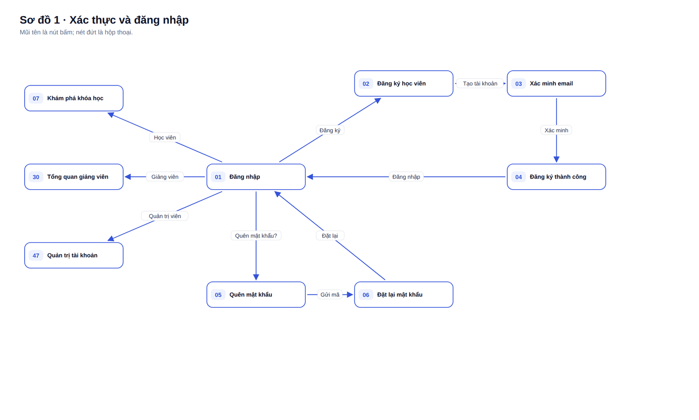

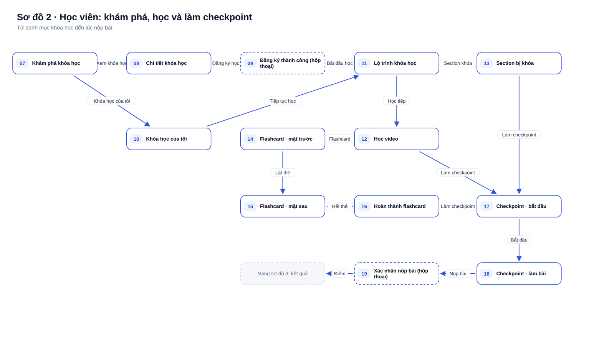

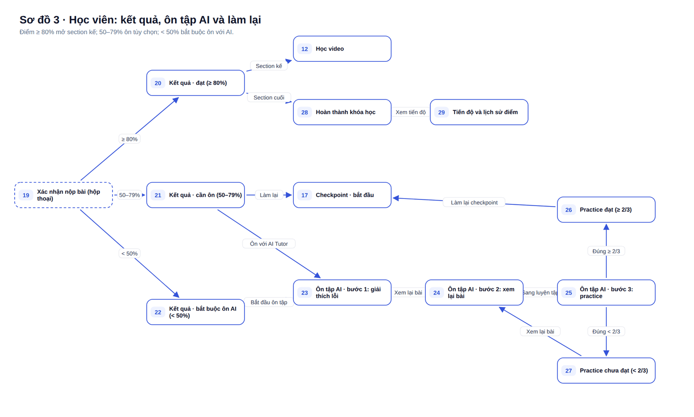

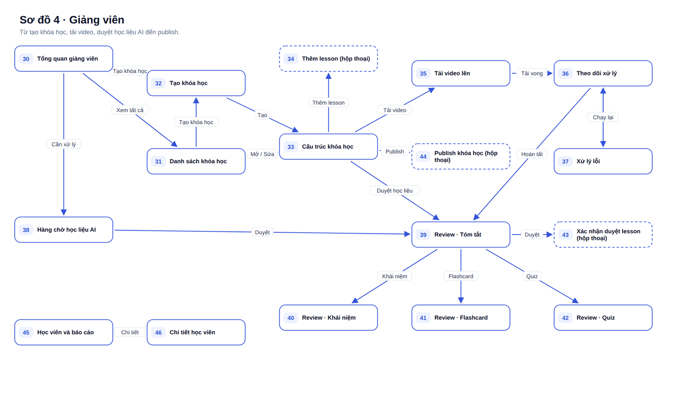

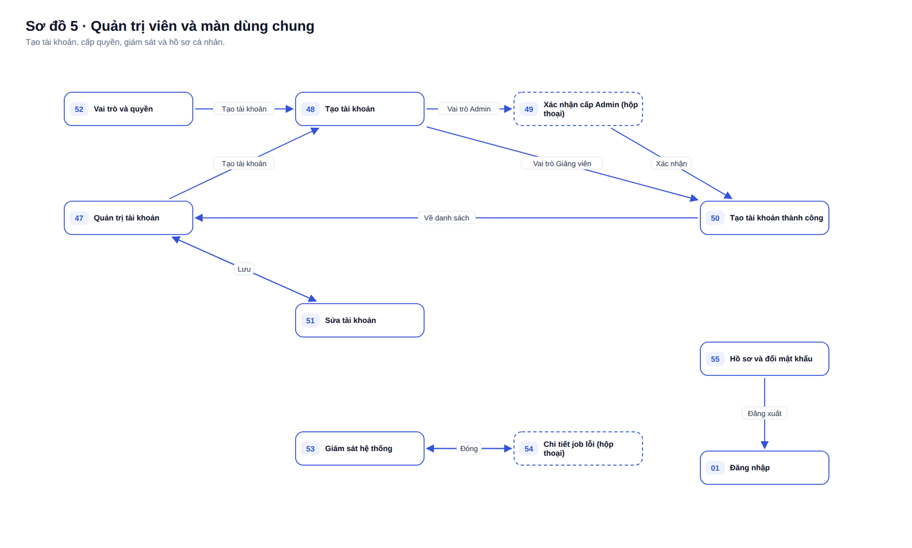

# 4. Chi tiết từng màn hình

**CHUNG**

## 01  Đăng nhập

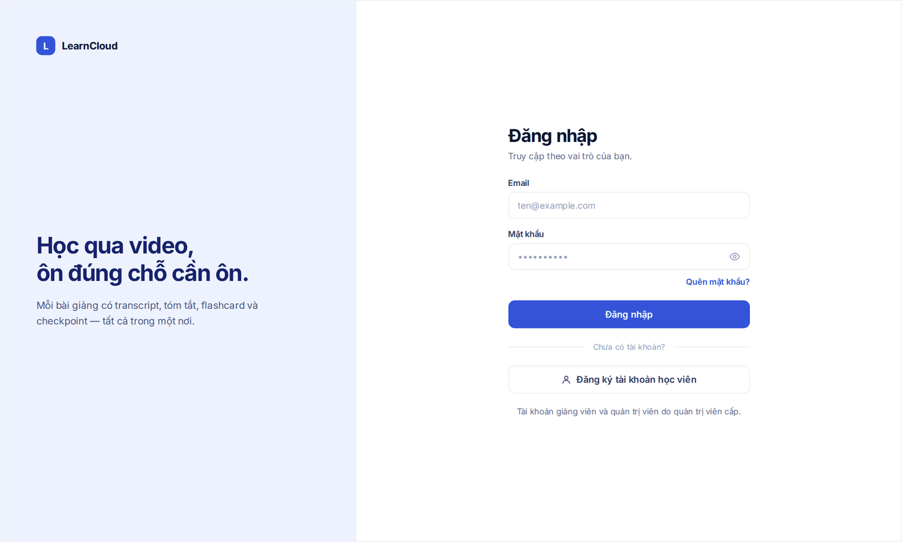  
*Ảnh mẫu giao diện: screens/01.png. Làm đúng bố cục, màu, chữ như ảnh.*

|  | **ĐẾN TỪ** ← Mở ứng dụng ← 04 · 06 · Đăng xuất **BẤM NÚT → ĐẾN** **Đăng nhập (học viên)** **→ 07** · Khám phá khóa học **Đăng nhập (giảng viên)** **→ 30** · Tổng quan giảng viên **Đăng nhập (quản trị viên)** **→ 47** · Quản trị tài khoản **Quên mật khẩu?** **→ 05** · Quên mật khẩu **Đăng ký tài khoản học viên** **→ 02** · Đăng ký học viên **Điều kiện: **Sai email hoặc mật khẩu: báo lỗi đỏ ngay trên ô nhập. Tài khoản bị khóa: hiện banner “Tài khoản đã bị khóa”. |
| --- | --- |

**CHUNG**

## 02  Đăng ký học viên

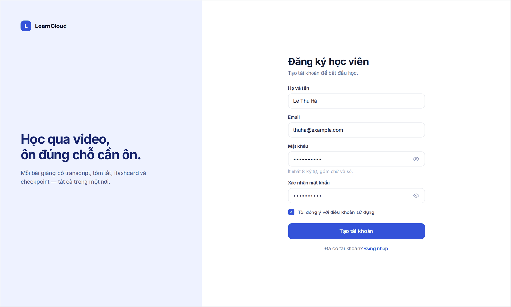  
*Ảnh mẫu giao diện: screens/02.png. Làm đúng bố cục, màu, chữ như ảnh.*

|  | **ĐẾN TỪ** ← 01 · Đăng nhập **BẤM NÚT → ĐẾN** **Tạo tài khoản** **→ 03** · Xác minh email **Đăng nhập (liên kết dưới)** **→ 01** · Đăng nhập **Điều kiện: **Chỉ dành cho học viên. Giảng viên và quản trị viên do Admin cấp. Lỗi (email trùng, mật khẩu yếu) hiện dưới từng ô. |
| --- | --- |

**CHUNG**

## 03  Xác minh email

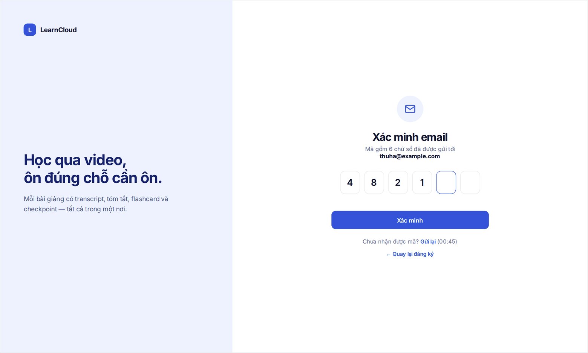  
*Ảnh mẫu giao diện: screens/03.png. Làm đúng bố cục, màu, chữ như ảnh.*

|  | **ĐẾN TỪ** ← 02 · Đăng ký học viên **BẤM NÚT → ĐẾN** **Xác minh** **→ 04** · Đăng ký thành công **Gửi lại mã** *→ ở lại màn này* **← Quay lại đăng ký** **→ 02** · Đăng ký học viên **Điều kiện: **Mã sai hoặc hết hạn: báo lỗi dưới ô mã. Nút Gửi lại có đếm ngược. |
| --- | --- |

**CHUNG**

## 04  Đăng ký thành công

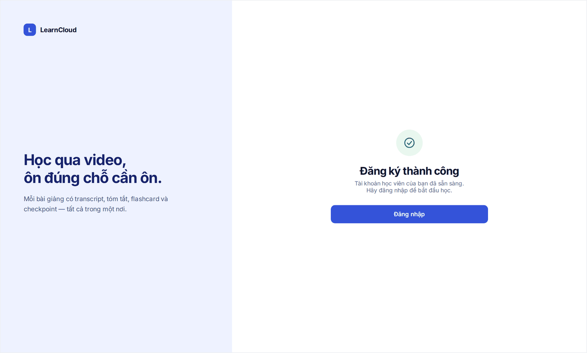  
*Ảnh mẫu giao diện: screens/04.png. Làm đúng bố cục, màu, chữ như ảnh.*

|  | **ĐẾN TỪ** ← 03 · Xác minh email **BẤM NÚT → ĐẾN** **Đăng nhập** **→ 01** · Đăng nhập |
| --- | --- |

**CHUNG**

## 05  Quên mật khẩu

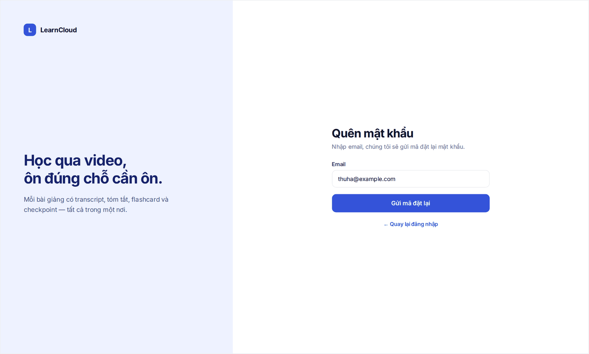  
*Ảnh mẫu giao diện: screens/05.png. Làm đúng bố cục, màu, chữ như ảnh.*

|  | **ĐẾN TỪ** ← 01 · Đăng nhập **BẤM NÚT → ĐẾN** **Gửi mã đặt lại** **→ 06** · Đặt lại mật khẩu **← Quay lại đăng nhập** **→ 01** · Đăng nhập **Điều kiện: **Email chưa đăng ký vẫn hiện thông báo chung để không lộ tài khoản. |
| --- | --- |

**CHUNG**

## 06  Đặt lại mật khẩu

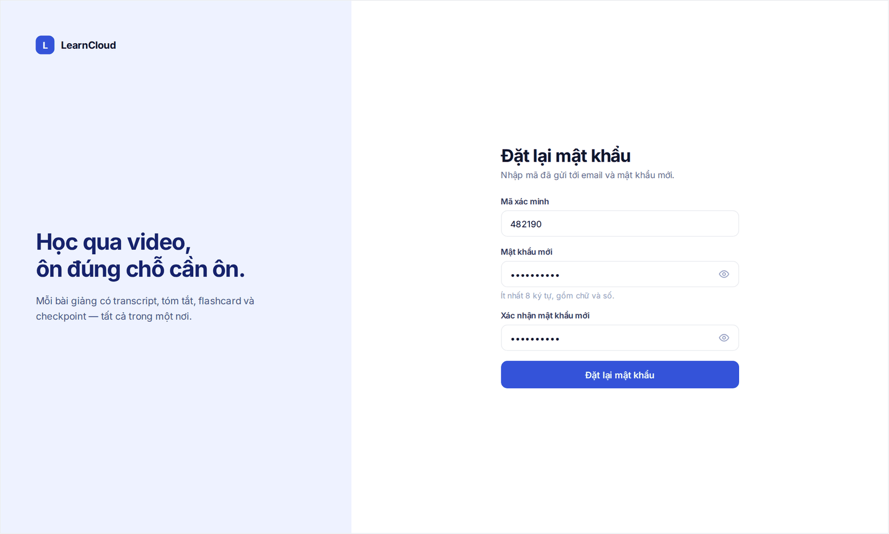  
*Ảnh mẫu giao diện: screens/06.png. Làm đúng bố cục, màu, chữ như ảnh.*

|  | **ĐẾN TỪ** ← 05 · Quên mật khẩu **BẤM NÚT → ĐẾN** **Đặt lại mật khẩu** **→ 01** · Đăng nhập **Điều kiện: **Thành công: về màn Đăng nhập kèm thông báo xanh “Đã đặt lại mật khẩu”. |
| --- | --- |

**HỌC VIÊN**

## 07  Khám phá khóa học

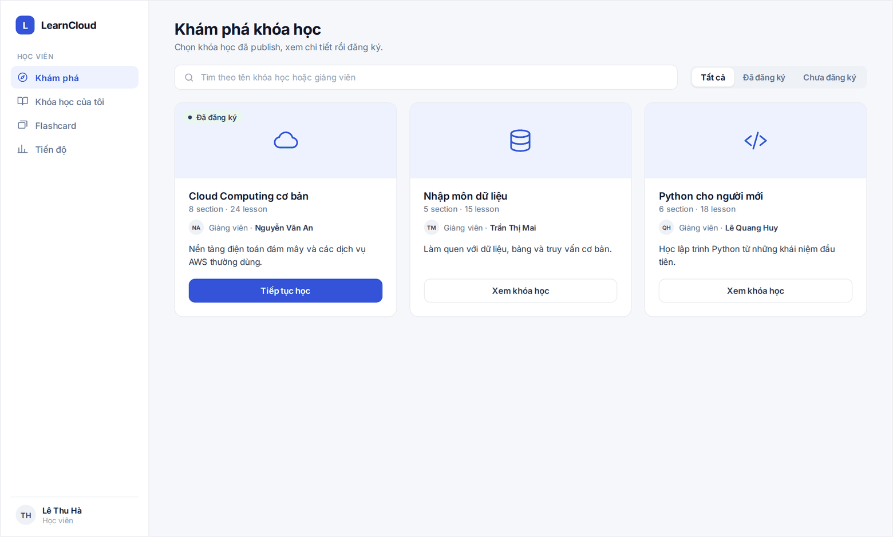  
*Ảnh mẫu giao diện: screens/07.png. Làm đúng bố cục, màu, chữ như ảnh.*

|  | **ĐẾN TỪ** ← 01 · Đăng nhập ← Thanh bên: Khám phá ← 28 · Hoàn thành khóa học **BẤM NÚT → ĐẾN** **Xem khóa học** **→ 08** · Chi tiết khóa học **Tiếp tục học (khóa đã đăng ký)** **→ 11** · Lộ trình khóa học **Ô tìm kiếm và bộ lọc** *→ ở lại màn này* **Điều kiện: **Khóa đã đăng ký có nhãn xanh “Đã đăng ký”. Tên giảng viên hiển thị trên mỗi thẻ. |
| --- | --- |

**HỌC VIÊN**

## 08  Chi tiết khóa học

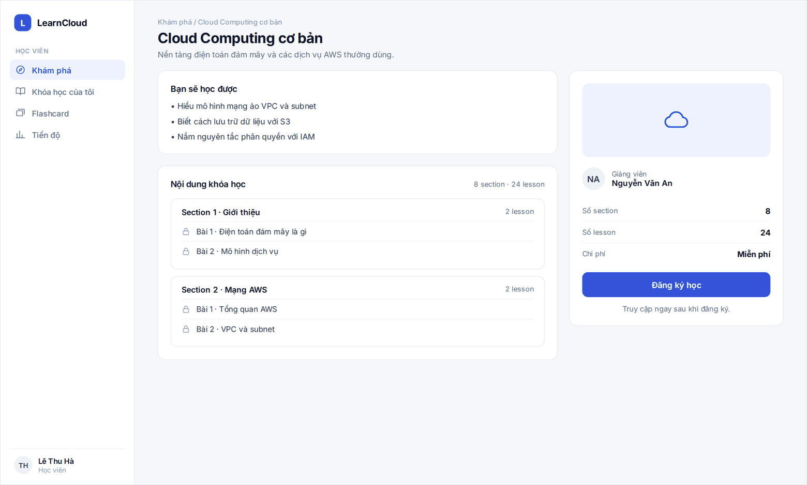  
*Ảnh mẫu giao diện: screens/08.png. Làm đúng bố cục, màu, chữ như ảnh.*

|  | **ĐẾN TỪ** ← 07 · Khám phá khóa học **BẤM NÚT → ĐẾN** **Đăng ký học** **→ 09** · Đăng ký thành công (hộp thoại) **Dòng lesson (đang khóa)** *→ Không bấm được* **Breadcrumb “Khám phá”** **→ 07** · Khám phá khóa học **Điều kiện: **Nếu đã đăng ký, nút đổi thành “Vào học” và dẫn tới màn 11. |
| --- | --- |

**HỌC VIÊN**

## 09  Đăng ký thành công (hộp thoại)

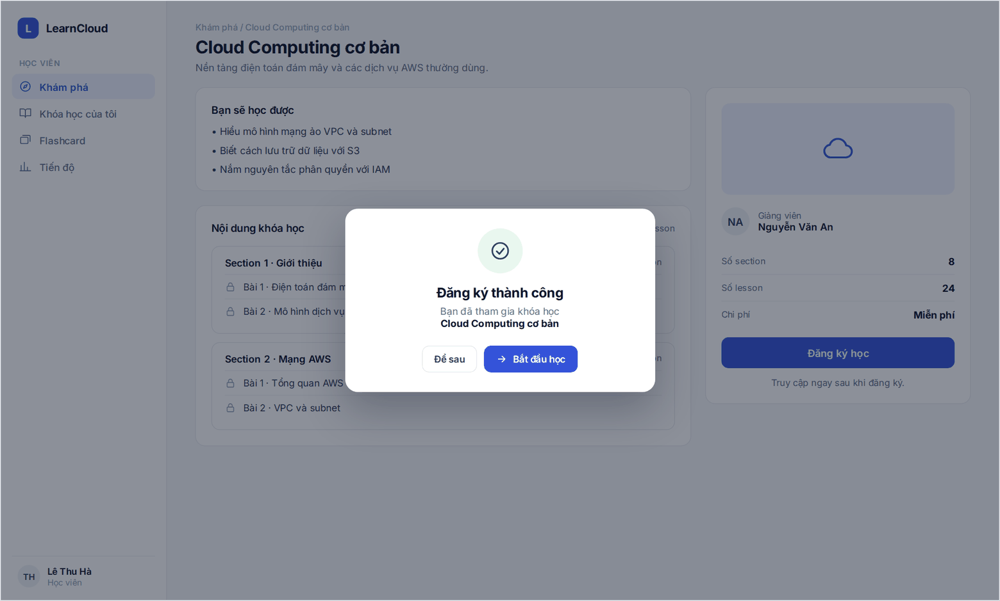  
*Ảnh mẫu giao diện: screens/09.png. Làm đúng bố cục, màu, chữ như ảnh.*

|  | **ĐẾN TỪ** ← 08 · Chi tiết khóa học **BẤM NÚT → ĐẾN** **Bắt đầu học** **→ 11** · Lộ trình khóa học **Để sau** **→ 08** · Chi tiết khóa học |
| --- | --- |

**HỌC VIÊN**

## 10  Khóa học của tôi

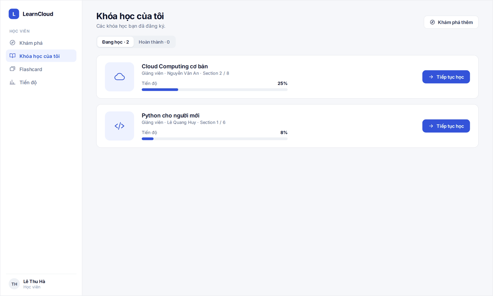  
*Ảnh mẫu giao diện: screens/10.png. Làm đúng bố cục, màu, chữ như ảnh.*

|  | **ĐẾN TỪ** ← Thanh bên: Khóa học của tôi ← 09 · Đăng ký thành công (hộp thoại) **BẤM NÚT → ĐẾN** **Tiếp tục học** **→ 11** · Lộ trình khóa học **Khám phá thêm** **→ 07** · Khám phá khóa học **Điều kiện: **Tab Hoàn thành liệt kê khóa đã xong và dẫn tới màn 28. |
| --- | --- |

**HỌC VIÊN**

## 11  Lộ trình khóa học

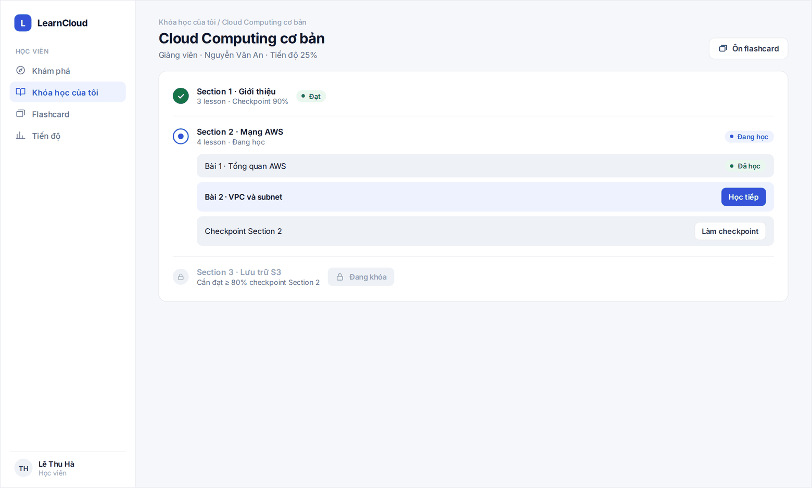  
*Ảnh mẫu giao diện: screens/11.png. Làm đúng bố cục, màu, chữ như ảnh.*

|  | **ĐẾN TỪ** ← 09 · Đăng ký thành công (hộp thoại) ← 10 · Khóa học của tôi ← 20 · Kết quả · đạt (≥ 80%) ← 26 · Practice đạt (≥ 2/3) ← 16 · Hoàn thành flashcard **BẤM NÚT → ĐẾN** **Học tiếp / chọn lesson** **→ 12** · Học video **Làm checkpoint** **→ 17** · Checkpoint · bắt đầu **Section đang khóa** **→ 13** · Section bị khóa **Ôn flashcard** **→ 14** · Flashcard · mặt trước **Điều kiện: **Section khóa chỉ mở khi checkpoint section trước đạt ≥ 80%. |
| --- | --- |

**HỌC VIÊN**

## 12  Học video

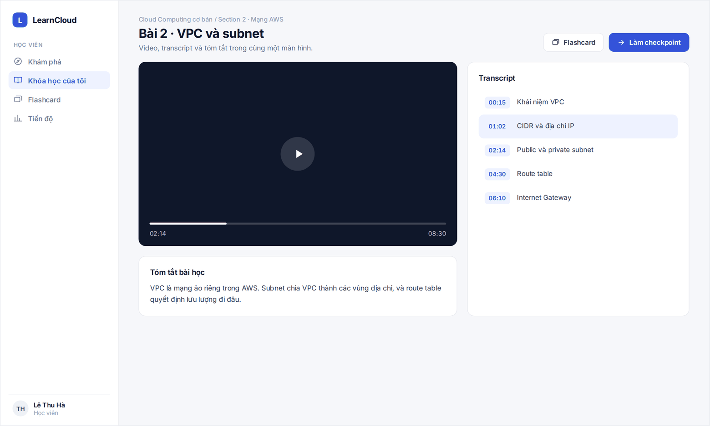  
*Ảnh mẫu giao diện: screens/12.png. Làm đúng bố cục, màu, chữ như ảnh.*

|  | **ĐẾN TỪ** ← 11 · Lộ trình khóa học ← 20 · Kết quả · đạt (≥ 80%) **BẤM NÚT → ĐẾN** **Flashcard** **→ 14** · Flashcard · mặt trước **Làm checkpoint** **→ 17** · Checkpoint · bắt đầu **Chọn mốc transcript** *→ Tua video đến đúng thời điểm* **Breadcrumb Section** **→ 11** · Lộ trình khóa học **Điều kiện: **Nút Làm checkpoint chỉ dẫn tới checkpoint của section hiện tại. |
| --- | --- |

**HỌC VIÊN**

## 13  Section bị khóa

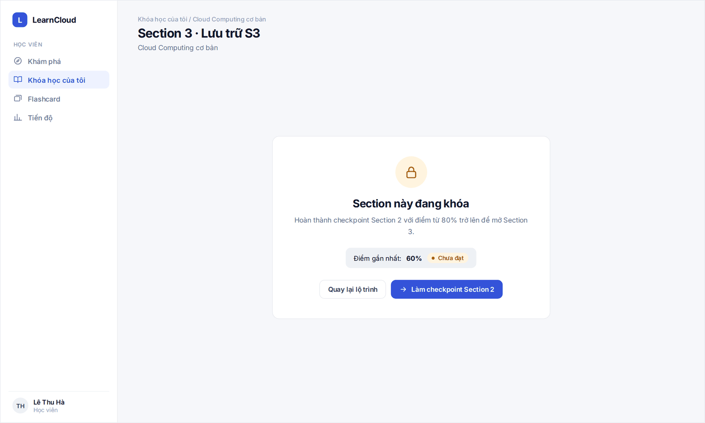  
*Ảnh mẫu giao diện: screens/13.png. Làm đúng bố cục, màu, chữ như ảnh.*

|  | **ĐẾN TỪ** ← 11 · Lộ trình khóa học **BẤM NÚT → ĐẾN** **Làm checkpoint Section 2** **→ 17** · Checkpoint · bắt đầu **Quay lại lộ trình** **→ 11** · Lộ trình khóa học **Điều kiện: **Hiển thị khi học viên mở section chưa được phép. |
| --- | --- |

**HỌC VIÊN**

## 14  Flashcard · mặt trước

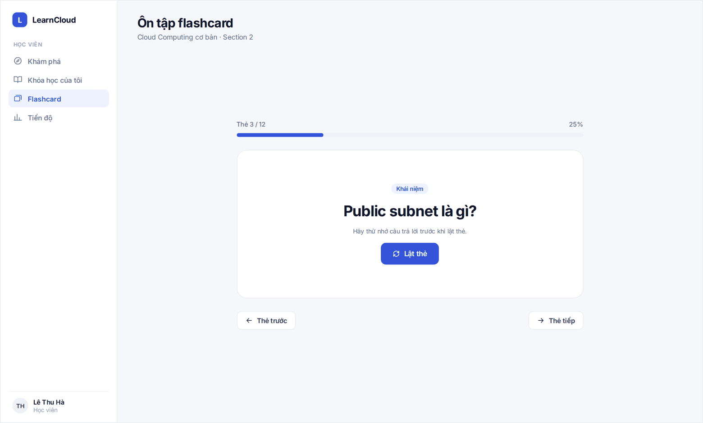  
*Ảnh mẫu giao diện: screens/14.png. Làm đúng bố cục, màu, chữ như ảnh.*

|  | **ĐẾN TỪ** ← 12 · Học video ← 11 · Lộ trình khóa học ← 16 · Hoàn thành flashcard ← 24 · Ôn tập AI · bước 2: xem lại bài ← Thanh bên: Flashcard **BẤM NÚT → ĐẾN** **Lật thẻ** **→ 15** · Flashcard · mặt sau **Thẻ trước / Thẻ tiếp** *→ ở lại màn này* |
| --- | --- |

**HỌC VIÊN**

## 15  Flashcard · mặt sau

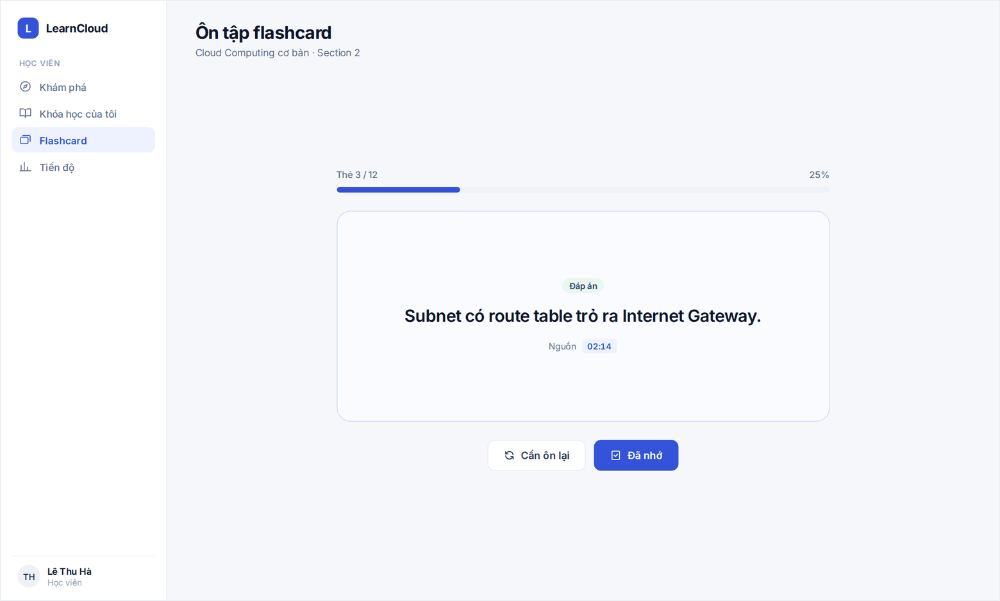  
*Ảnh mẫu giao diện: screens/15.png. Làm đúng bố cục, màu, chữ như ảnh.*

|  | **ĐẾN TỪ** ← 14 · Flashcard · mặt trước **BẤM NÚT → ĐẾN** **Đã nhớ / Cần ôn lại (thẻ kế tiếp)** **→ 14** · Flashcard · mặt trước **Hết thẻ** **→ 16** · Hoàn thành flashcard |
| --- | --- |

**HỌC VIÊN**

## 16  Hoàn thành flashcard

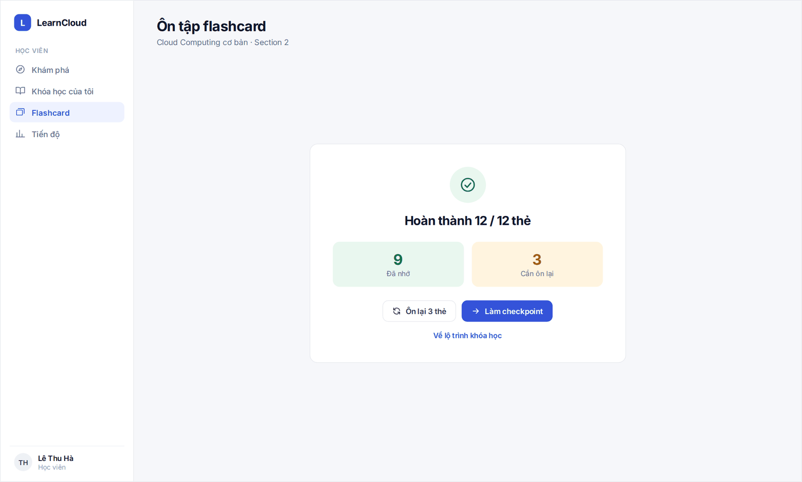  
*Ảnh mẫu giao diện: screens/16.png. Làm đúng bố cục, màu, chữ như ảnh.*

|  | **ĐẾN TỪ** ← 15 · Flashcard · mặt sau **BẤM NÚT → ĐẾN** **Ôn lại thẻ cần ôn** **→ 14** · Flashcard · mặt trước **Làm checkpoint** **→ 17** · Checkpoint · bắt đầu **Về lộ trình khóa học** **→ 11** · Lộ trình khóa học |
| --- | --- |

**HỌC VIÊN**

## 17  Checkpoint · bắt đầu

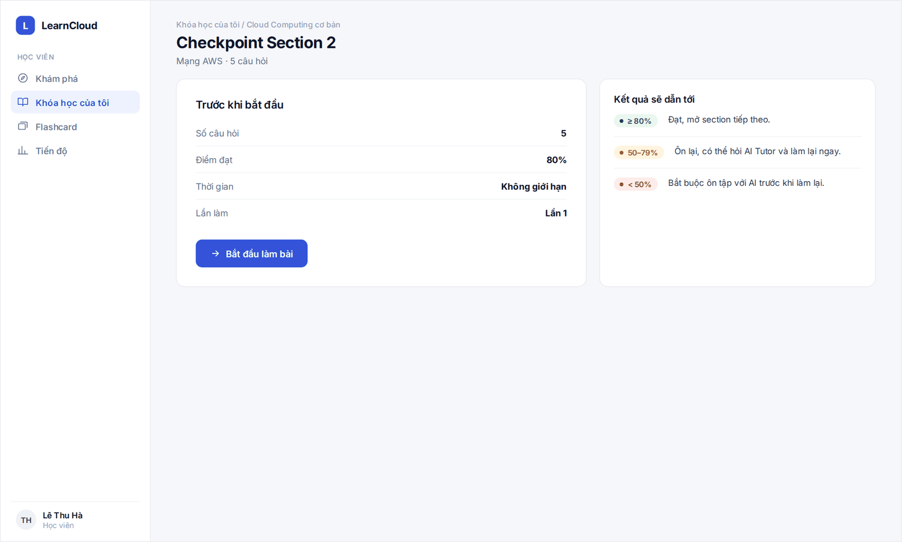  
*Ảnh mẫu giao diện: screens/17.png. Làm đúng bố cục, màu, chữ như ảnh.*

|  | **ĐẾN TỪ** ← 12 · Học video ← 11 · Lộ trình khóa học ← 13 · Section bị khóa ← 16 · Hoàn thành flashcard ← 26 · Practice đạt (≥ 2/3) **BẤM NÚT → ĐẾN** **Bắt đầu làm bài** **→ 18** · Checkpoint · làm bài **Quay lại** **→ 11** · Lộ trình khóa học **Điều kiện: **Lần làm sau hiển thị số lần và điểm cũ. Nếu còn nợ ôn tập bắt buộc (điểm < 50%), nút Bắt đầu bị khóa và dẫn về màn 22. |
| --- | --- |

**HỌC VIÊN**

## 18  Checkpoint · làm bài

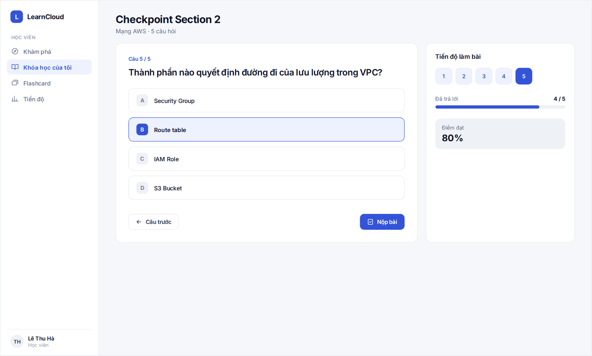  
*Ảnh mẫu giao diện: screens/18.png. Làm đúng bố cục, màu, chữ như ảnh.*

|  | **ĐẾN TỪ** ← 17 · Checkpoint · bắt đầu **BẤM NÚT → ĐẾN** **Câu trước / Câu tiếp** *→ ở lại màn này* **Chọn số câu ở khung tiến độ** *→ ở lại màn này* **Nộp bài (ở câu cuối)** **→ 19** · Xác nhận nộp bài (hộp thoại) **Điều kiện: **Chọn đáp án được lưu ngay; điểm chỉ do backend chấm. |
| --- | --- |

**HỌC VIÊN**

## 19  Xác nhận nộp bài (hộp thoại)

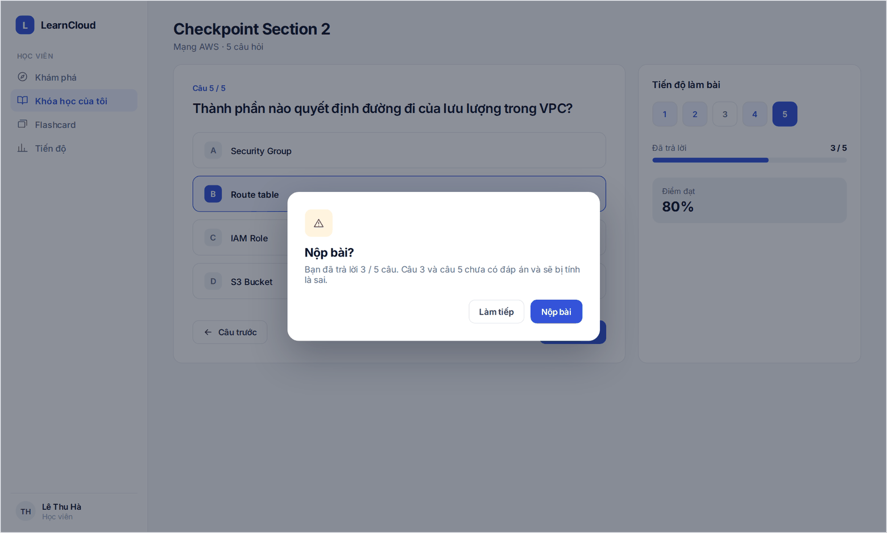  
*Ảnh mẫu giao diện: screens/19.png. Làm đúng bố cục, màu, chữ như ảnh.*

|  | **ĐẾN TỪ** ← 18 · Checkpoint · làm bài **BẤM NÚT → ĐẾN** **Làm tiếp** **→ 18** · Checkpoint · làm bài **Nộp bài · điểm ≥ 80%** **→ 20** · Kết quả · đạt (≥ 80%) **Nộp bài · điểm 50–79%** **→ 21** · Kết quả · cần ôn (50–79%) **Nộp bài · điểm ****<**** 50%** **→ 22** · Kết quả · bắt buộc ôn AI (< 50%) **Điều kiện: **Câu chưa trả lời bị tính là sai. |
| --- | --- |

**HỌC VIÊN**

## 20  Kết quả · đạt (≥ 80%)

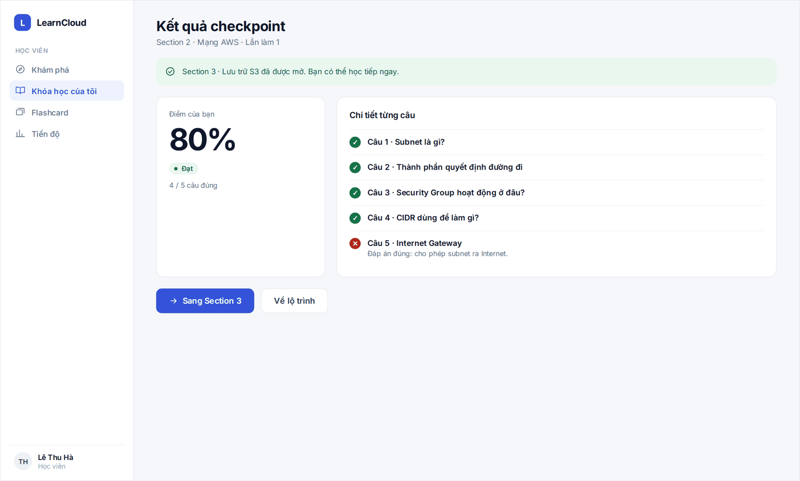  
*Ảnh mẫu giao diện: screens/20.png. Làm đúng bố cục, màu, chữ như ảnh.*

|  | **ĐẾN TỪ** ← 19 · Xác nhận nộp bài (hộp thoại) **BẤM NÚT → ĐẾN** **Sang Section kế tiếp** **→ 12** · Học video **Hoàn thành section cuối** **→ 28** · Hoàn thành khóa học **Về lộ trình** **→ 11** · Lộ trình khóa học **Điều kiện: **Section kế tiếp được mở. Hiển thị từng câu đúng/sai kèm giải thích. |
| --- | --- |

**HỌC VIÊN**

## 21  Kết quả · cần ôn (50–79%)

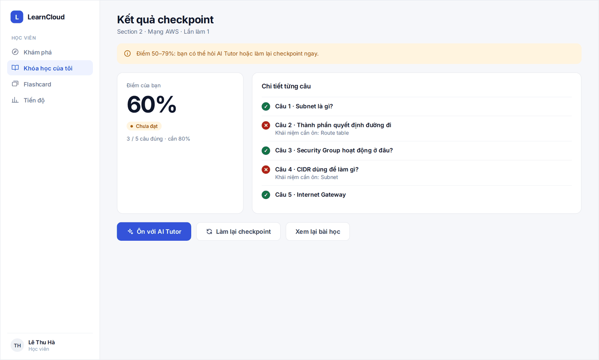  
*Ảnh mẫu giao diện: screens/21.png. Làm đúng bố cục, màu, chữ như ảnh.*

|  | **ĐẾN TỪ** ← 19 · Xác nhận nộp bài (hộp thoại) **BẤM NÚT → ĐẾN** **Ôn với AI Tutor** **→ 23** · Ôn tập AI · bước 1: giải thích lỗi **Làm lại checkpoint** **→ 17** · Checkpoint · bắt đầu **Xem lại bài học** **→ 12** · Học video **Điều kiện: **Ôn tập không bắt buộc, học viên có thể làm lại ngay. |
| --- | --- |

**HỌC VIÊN**

## 22  Kết quả · bắt buộc ôn AI (< 50%)

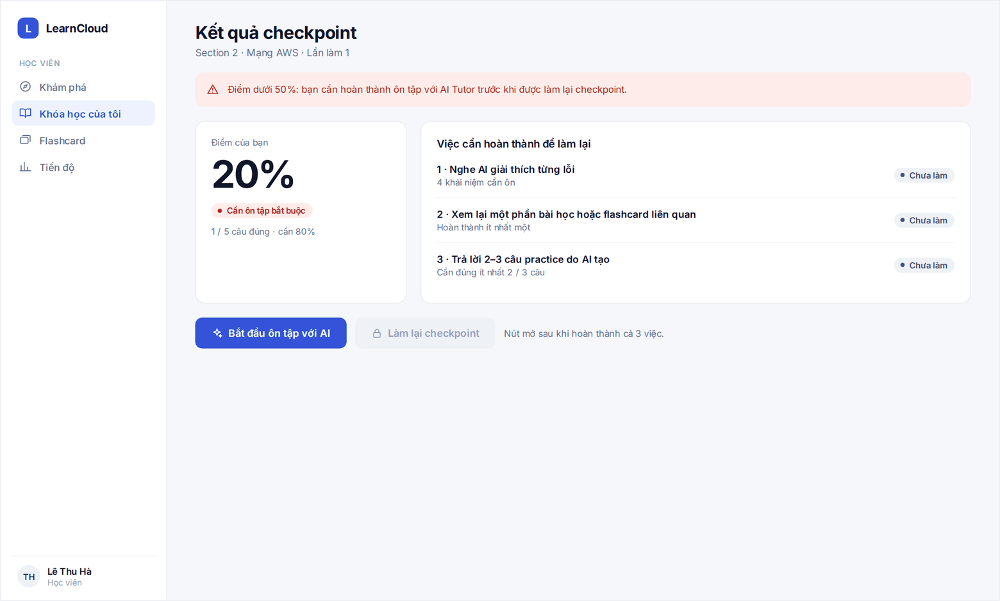  
*Ảnh mẫu giao diện: screens/22.png. Làm đúng bố cục, màu, chữ như ảnh.*

|  | **ĐẾN TỪ** ← 19 · Xác nhận nộp bài (hộp thoại) ← 17 · Checkpoint · bắt đầu **BẤM NÚT → ĐẾN** **Bắt đầu ôn tập với AI** **→ 23** · Ôn tập AI · bước 1: giải thích lỗi **Làm lại checkpoint** *→ Khóa cho đến khi xong cả 3 việc* **Điều kiện: **Bắt buộc: nghe AI giải thích lỗi, xem lại bài hoặc flashcard liên quan, làm 2–3 câu practice và đúng ít nhất 2/3. |
| --- | --- |

**HỌC VIÊN**

## 23  Ôn tập AI · bước 1: giải thích lỗi

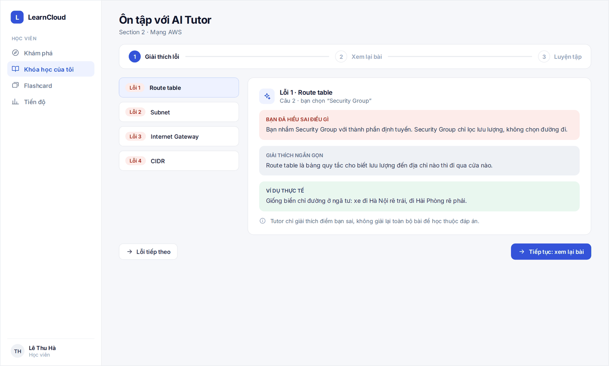  
*Ảnh mẫu giao diện: screens/23.png. Làm đúng bố cục, màu, chữ như ảnh.*

|  | **ĐẾN TỪ** ← 22 · Kết quả · bắt buộc ôn AI (< 50%) ← 21 · Kết quả · cần ôn (50–79%) **BẤM NÚT → ĐẾN** **Lỗi 1, Lỗi 2… (cột trái)** *→ ở lại màn này* **Lỗi tiếp theo** *→ ở lại màn này* **Tiếp tục: xem lại bài** **→ 24** · Ôn tập AI · bước 2: xem lại bài **Điều kiện: **Mỗi lỗi giải thích theo 4 phần: hiểu sai gì, giải thích ngắn, ví dụ thực tế, không giải lại cả bài. |
| --- | --- |

**HỌC VIÊN**

## 24  Ôn tập AI · bước 2: xem lại bài

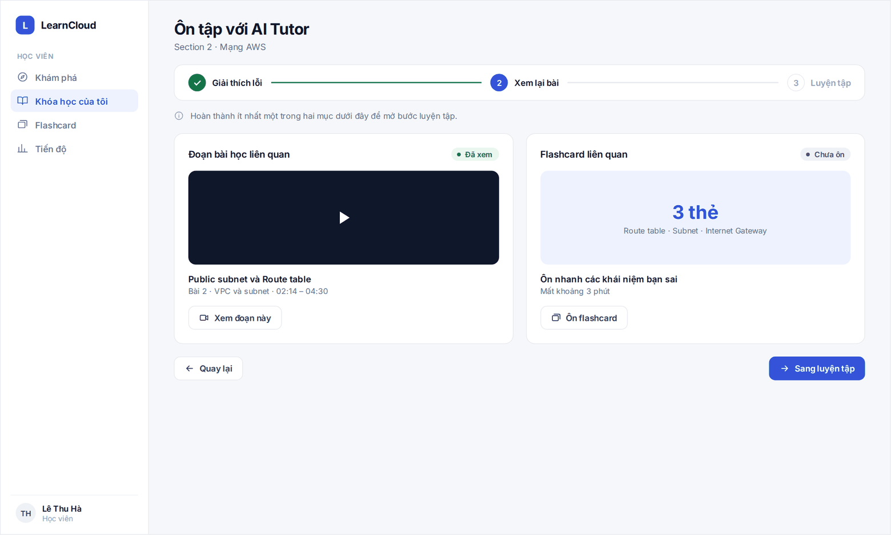  
*Ảnh mẫu giao diện: screens/24.png. Làm đúng bố cục, màu, chữ như ảnh.*

|  | **ĐẾN TỪ** ← 23 · Ôn tập AI · bước 1: giải thích lỗi **BẤM NÚT → ĐẾN** **Xem đoạn này** **→ 12** · Học video **Ôn flashcard** **→ 14** · Flashcard · mặt trước **Sang luyện tập** **→ 25** · Ôn tập AI · bước 3: practice **Quay lại** **→ 23** · Ôn tập AI · bước 1: giải thích lỗi **Điều kiện: **Cần hoàn thành ít nhất một trong hai mục (đoạn bài hoặc flashcard) thì nút Sang luyện tập mới bật. Sau khi xem, quay lại màn này. |
| --- | --- |

**HỌC VIÊN**

## 25  Ôn tập AI · bước 3: practice

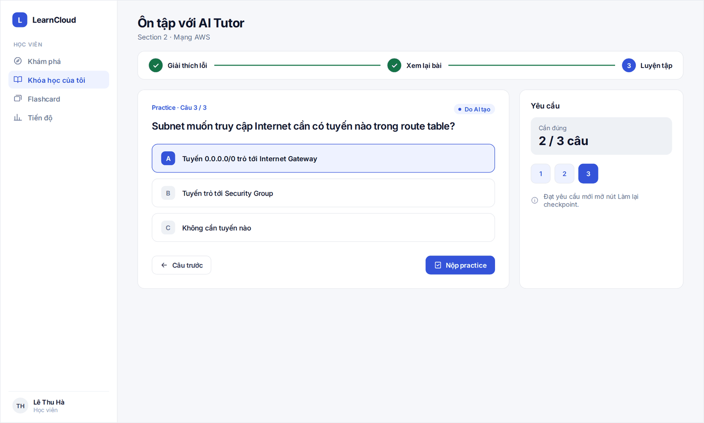  
*Ảnh mẫu giao diện: screens/25.png. Làm đúng bố cục, màu, chữ như ảnh.*

|  | **ĐẾN TỪ** ← 24 · Ôn tập AI · bước 2: xem lại bài ← 27 · Practice chưa đạt (< 2/3) **BẤM NÚT → ĐẾN** **Câu trước / Câu tiếp** *→ ở lại màn này* **Nộp practice · đúng ≥ 2/3** **→ 26** · Practice đạt (≥ 2/3) **Nộp practice · đúng ****<**** 2/3** **→ 27** · Practice chưa đạt (< 2/3) **Điều kiện: **Practice gồm 2–3 câu do AI tạo từ đúng khái niệm đã sai. |
| --- | --- |

**HỌC VIÊN**

## 26  Practice đạt (≥ 2/3)

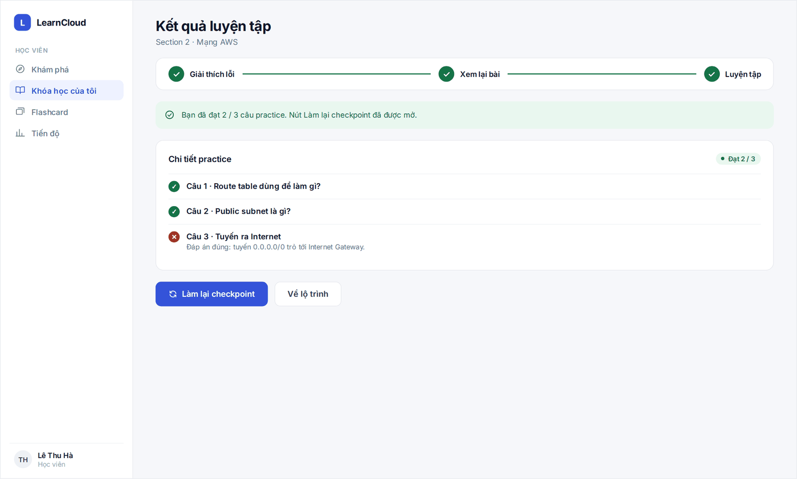  
*Ảnh mẫu giao diện: screens/26.png. Làm đúng bố cục, màu, chữ như ảnh.*

|  | **ĐẾN TỪ** ← 25 · Ôn tập AI · bước 3: practice **BẤM NÚT → ĐẾN** **Làm lại checkpoint** **→ 17** · Checkpoint · bắt đầu **Về lộ trình** **→ 11** · Lộ trình khóa học **Điều kiện: **Nút Làm lại checkpoint được mở sau màn này. |
| --- | --- |

**HỌC VIÊN**

## 27  Practice chưa đạt (< 2/3)

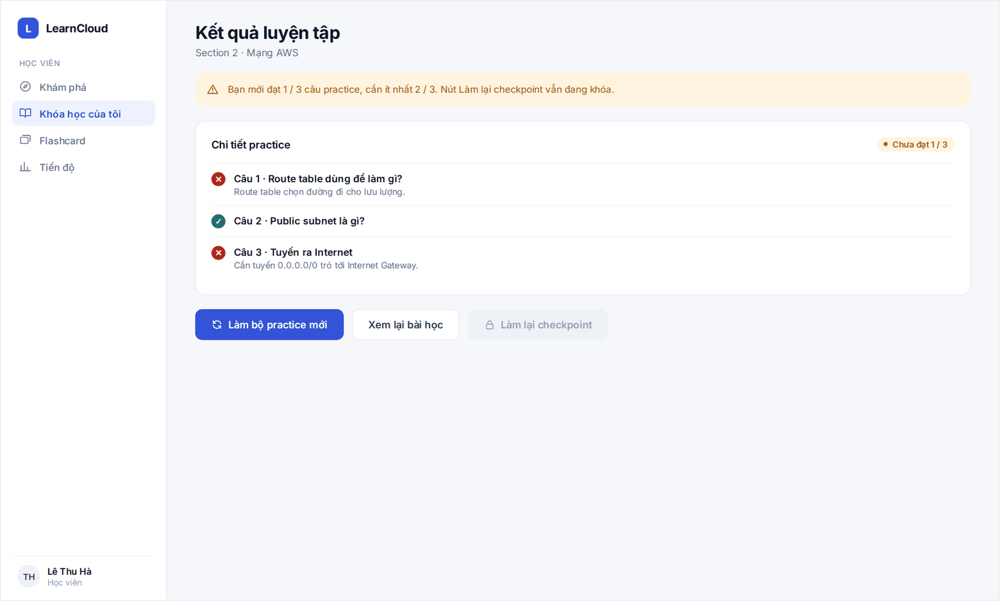  
*Ảnh mẫu giao diện: screens/27.png. Làm đúng bố cục, màu, chữ như ảnh.*

|  | **ĐẾN TỪ** ← 25 · Ôn tập AI · bước 3: practice **BẤM NÚT → ĐẾN** **Làm bộ practice mới** **→ 25** · Ôn tập AI · bước 3: practice **Xem lại bài học** **→ 24** · Ôn tập AI · bước 2: xem lại bài **Làm lại checkpoint** *→ Vẫn khóa* |
| --- | --- |

**HỌC VIÊN**

## 28  Hoàn thành khóa học

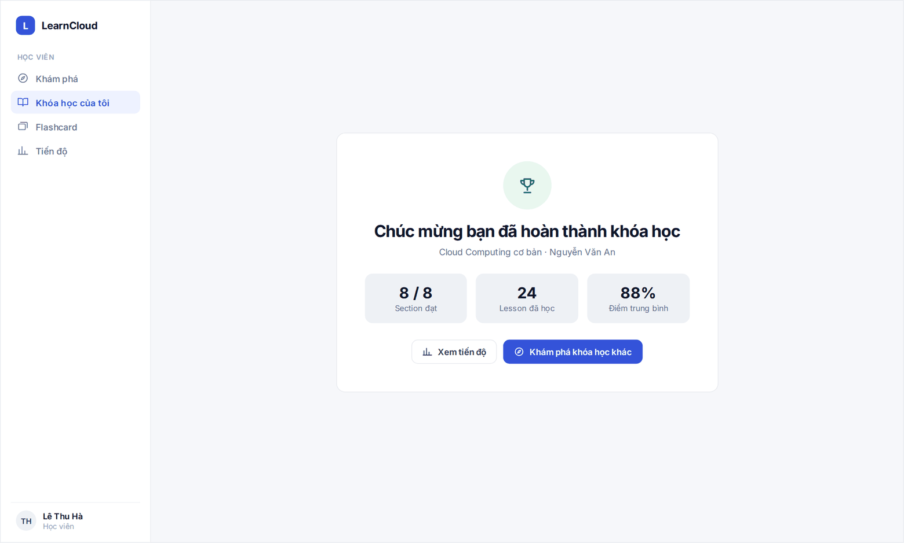  
*Ảnh mẫu giao diện: screens/28.png. Làm đúng bố cục, màu, chữ như ảnh.*

|  | **ĐẾN TỪ** ← 20 · Kết quả · đạt (≥ 80%) ← 10 · Khóa học của tôi **BẤM NÚT → ĐẾN** **Xem tiến độ** **→ 29** · Tiến độ và lịch sử điểm **Khám phá khóa học khác** **→ 07** · Khám phá khóa học |
| --- | --- |

**HỌC VIÊN**

## 29  Tiến độ và lịch sử điểm

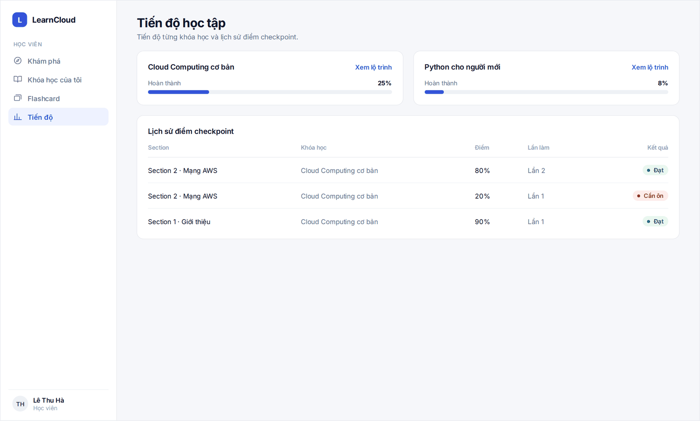  
*Ảnh mẫu giao diện: screens/29.png. Làm đúng bố cục, màu, chữ như ảnh.*

|  | **ĐẾN TỪ** ← Thanh bên: Tiến độ ← 28 · Hoàn thành khóa học **BẤM NÚT → ĐẾN** **Xem lộ trình** **→ 11** · Lộ trình khóa học **Chọn khóa học** **→ 11** · Lộ trình khóa học |
| --- | --- |

**GIẢNG VIÊN**

## 30  Tổng quan giảng viên

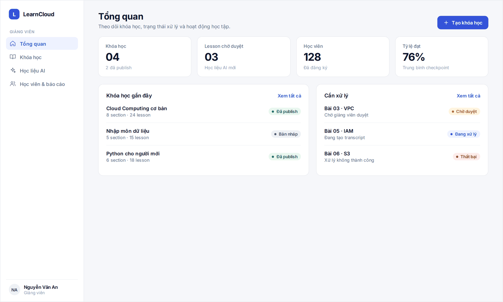  
*Ảnh mẫu giao diện: screens/30.png. Làm đúng bố cục, màu, chữ như ảnh.*

|  | **ĐẾN TỪ** ← 01 · Đăng nhập **BẤM NÚT → ĐẾN** **Tạo khóa học** **→ 32** · Tạo khóa học **Xem tất cả (khóa học)** **→ 31** · Danh sách khóa học **Bài chờ duyệt** **→ 39** · Review · Tóm tắt **Bài thất bại** **→ 37** · Xử lý lỗi **Xem tất cả (cần xử lý)** **→ 38** · Hàng chờ học liệu AI |
| --- | --- |

**GIẢNG VIÊN**

## 31  Danh sách khóa học

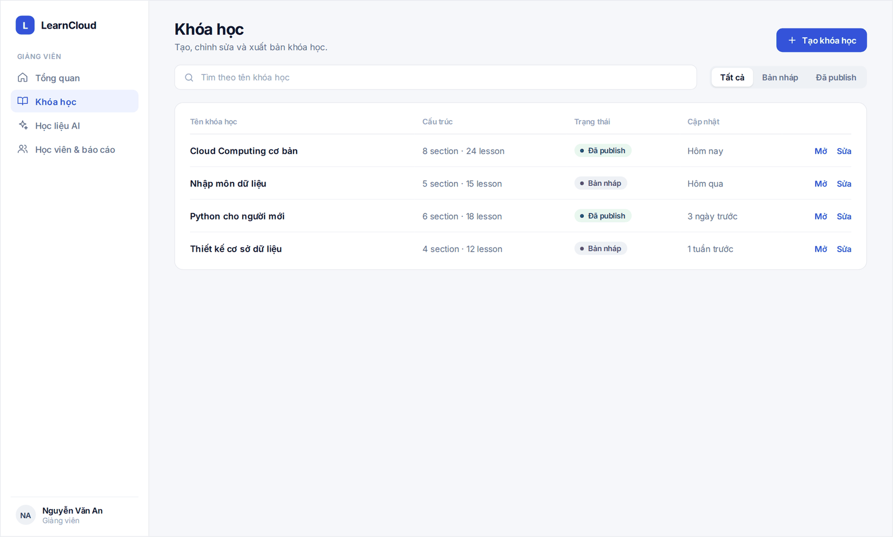  
*Ảnh mẫu giao diện: screens/31.png. Làm đúng bố cục, màu, chữ như ảnh.*

|  | **ĐẾN TỪ** ← 30 · Tổng quan giảng viên ← Thanh bên: Khóa học **BẤM NÚT → ĐẾN** **Tạo khóa học** **→ 32** · Tạo khóa học **Mở / Sửa** **→ 33** · Cấu trúc khóa học **Tìm kiếm và lọc** *→ ở lại màn này* |
| --- | --- |

**GIẢNG VIÊN**

## 32  Tạo khóa học

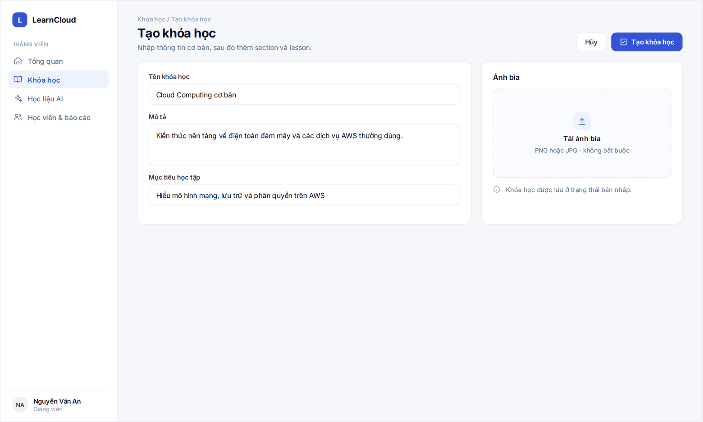  
*Ảnh mẫu giao diện: screens/32.png. Làm đúng bố cục, màu, chữ như ảnh.*

|  | **ĐẾN TỪ** ← 31 · Danh sách khóa học ← 30 · Tổng quan giảng viên **BẤM NÚT → ĐẾN** **Tạo khóa học** **→ 33** · Cấu trúc khóa học **Hủy** **→ 31** · Danh sách khóa học **Điều kiện: **Khóa học mới ở trạng thái bản nháp. |
| --- | --- |

**GIẢNG VIÊN**

## 33  Cấu trúc khóa học

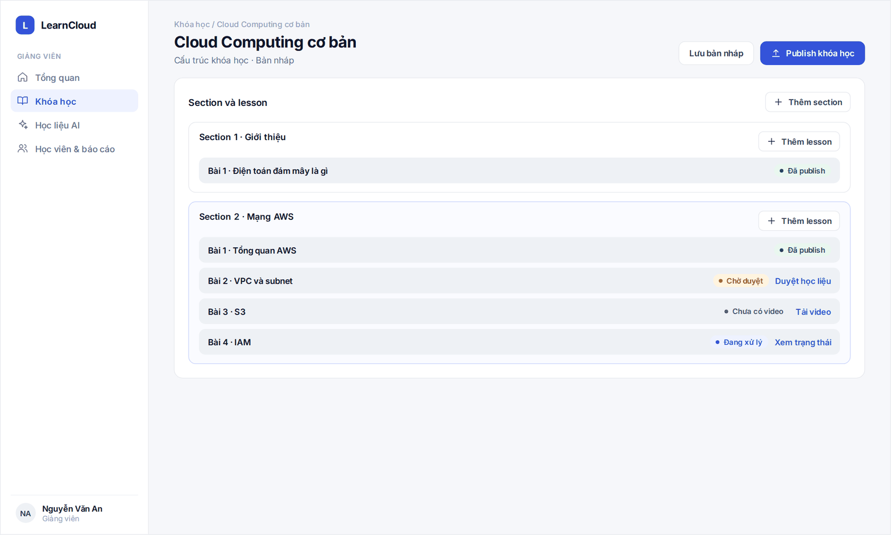  
*Ảnh mẫu giao diện: screens/33.png. Làm đúng bố cục, màu, chữ như ảnh.*

|  | **ĐẾN TỪ** ← 32 · Tạo khóa học ← 31 · Danh sách khóa học ← 34 · Thêm lesson (hộp thoại) ← 36 · Theo dõi xử lý **BẤM NÚT → ĐẾN** **Thêm section / Thêm lesson** **→ 34** · Thêm lesson (hộp thoại) **Tải video** **→ 35** · Tải video lên **Xem trạng thái** **→ 36** · Theo dõi xử lý **Duyệt học liệu** **→ 39** · Review · Tóm tắt **Publish khóa học** **→ 44** · Publish khóa học (hộp thoại) **Breadcrumb Khóa học** **→ 31** · Danh sách khóa học |
| --- | --- |

**GIẢNG VIÊN**

## 34  Thêm lesson (hộp thoại)

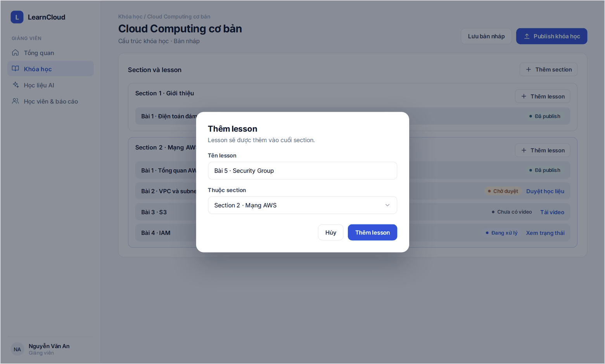  
*Ảnh mẫu giao diện: screens/34.png. Làm đúng bố cục, màu, chữ như ảnh.*

|  | **ĐẾN TỪ** ← 33 · Cấu trúc khóa học **BẤM NÚT → ĐẾN** **Thêm lesson** **→ 33** · Cấu trúc khóa học **Hủy** **→ 33** · Cấu trúc khóa học |
| --- | --- |

**GIẢNG VIÊN**

## 35  Tải video lên

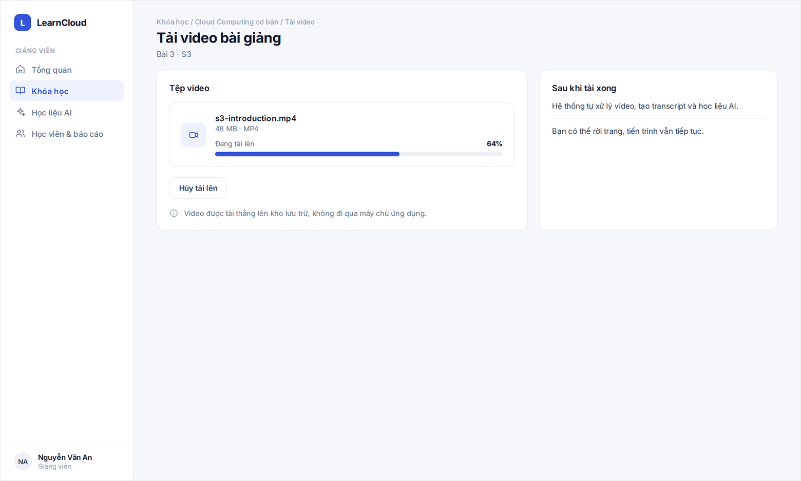  
*Ảnh mẫu giao diện: screens/35.png. Làm đúng bố cục, màu, chữ như ảnh.*

|  | **ĐẾN TỪ** ← 33 · Cấu trúc khóa học **BẤM NÚT → ĐẾN** **Tải lên xong** **→ 36** · Theo dõi xử lý **Hủy tải lên** **→ 33** · Cấu trúc khóa học **Điều kiện: **Có thể rời trang sau khi tải xong. |
| --- | --- |

**GIẢNG VIÊN**

## 36  Theo dõi xử lý

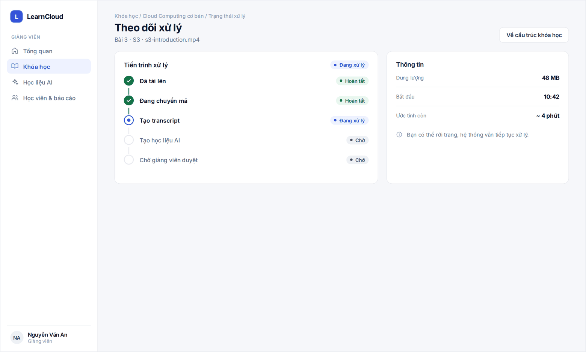  
*Ảnh mẫu giao diện: screens/36.png. Làm đúng bố cục, màu, chữ như ảnh.*

|  | **ĐẾN TỪ** ← 35 · Tải video lên ← 33 · Cấu trúc khóa học **BẤM NÚT → ĐẾN** **Có lỗi** **→ 37** · Xử lý lỗi **Hoàn tất → Duyệt học liệu** **→ 39** · Review · Tóm tắt **Về cấu trúc khóa học** **→ 33** · Cấu trúc khóa học **Điều kiện: **Tự cập nhật trạng thái mỗi vài giây. |
| --- | --- |

**GIẢNG VIÊN**

## 37  Xử lý lỗi

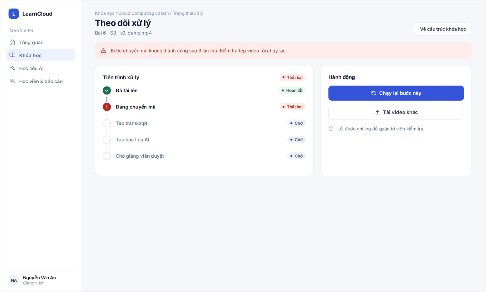  
*Ảnh mẫu giao diện: screens/37.png. Làm đúng bố cục, màu, chữ như ảnh.*

|  | **ĐẾN TỪ** ← 36 · Theo dõi xử lý ← 30 · Tổng quan giảng viên **BẤM NÚT → ĐẾN** **Chạy lại bước này** **→ 36** · Theo dõi xử lý **Tải video khác** **→ 35** · Tải video lên **Về cấu trúc khóa học** **→ 33** · Cấu trúc khóa học |
| --- | --- |

**GIẢNG VIÊN**

## 38  Hàng chờ học liệu AI

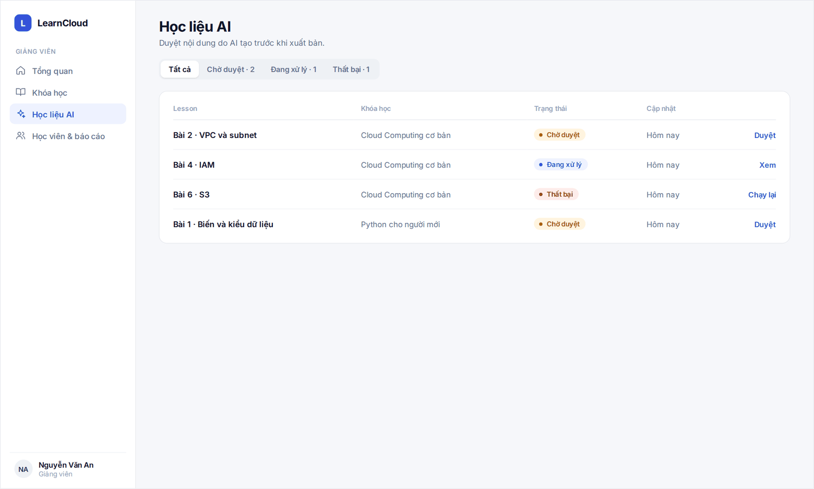  
*Ảnh mẫu giao diện: screens/38.png. Làm đúng bố cục, màu, chữ như ảnh.*

|  | **ĐẾN TỪ** ← Thanh bên: Học liệu AI ← 30 · Tổng quan giảng viên **BẤM NÚT → ĐẾN** **Duyệt** **→ 39** · Review · Tóm tắt **Chạy lại** **→ 37** · Xử lý lỗi **Xem (đang xử lý)** **→ 36** · Theo dõi xử lý |
| --- | --- |

**GIẢNG VIÊN**

## 39  Review · Tóm tắt

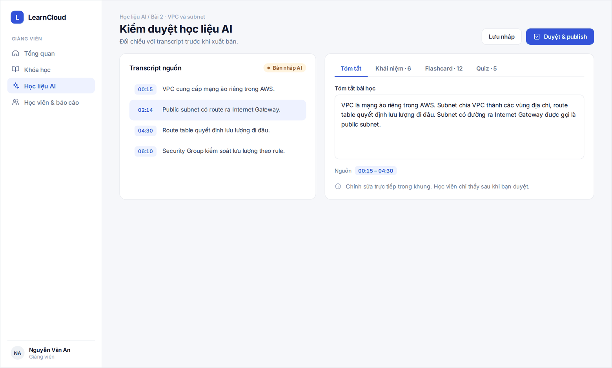  
*Ảnh mẫu giao diện: screens/39.png. Làm đúng bố cục, màu, chữ như ảnh.*

|  | **ĐẾN TỪ** ← 38 · Hàng chờ học liệu AI ← 33 · Cấu trúc khóa học ← 36 · Theo dõi xử lý ← 40 · Review · Khái niệm ← 41 · Review · Flashcard ← 42 · Review · Quiz **BẤM NÚT → ĐẾN** **Tab Khái niệm** **→ 40** · Review · Khái niệm **Tab Flashcard** **→ 41** · Review · Flashcard **Tab Quiz** **→ 42** · Review · Quiz **Lưu nháp** *→ ở lại màn này* **Duyệt và publish** **→ 43** · Xác nhận duyệt lesson (hộp thoại) **Điều kiện: **Mọi nội dung là bản nháp cho đến khi giảng viên duyệt. |
| --- | --- |

**GIẢNG VIÊN**

## 40  Review · Khái niệm

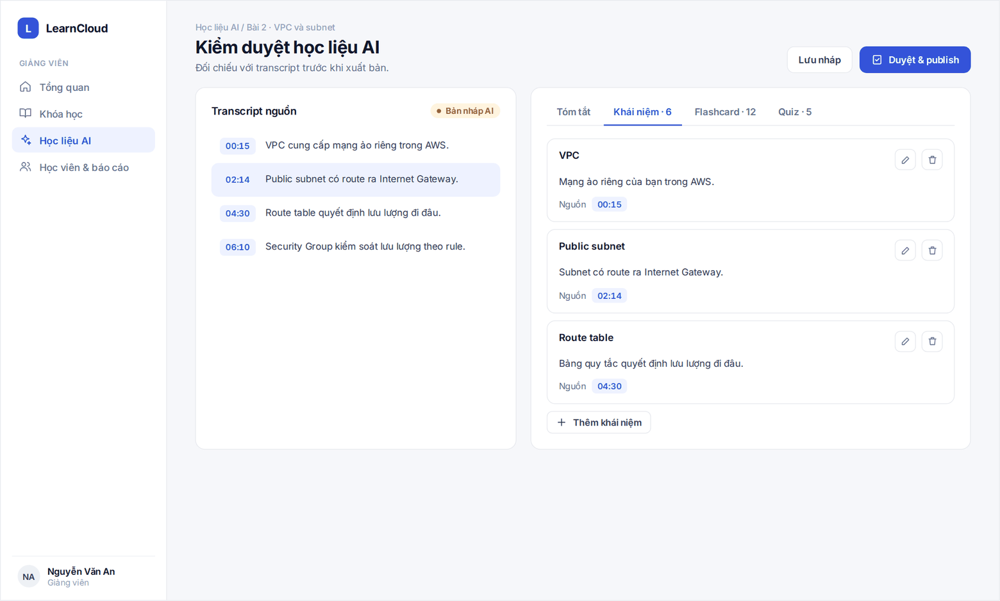  
*Ảnh mẫu giao diện: screens/40.png. Làm đúng bố cục, màu, chữ như ảnh.*

|  | **ĐẾN TỪ** ← 39 · Review · Tóm tắt **BẤM NÚT → ĐẾN** **Tab Tóm tắt** **→ 39** · Review · Tóm tắt **Tab Flashcard** **→ 41** · Review · Flashcard **Tab Quiz** **→ 42** · Review · Quiz **Thêm khái niệm** *→ Thêm dòng mới* **Duyệt và publish** **→ 43** · Xác nhận duyệt lesson (hộp thoại) |
| --- | --- |

**GIẢNG VIÊN**

## 41  Review · Flashcard

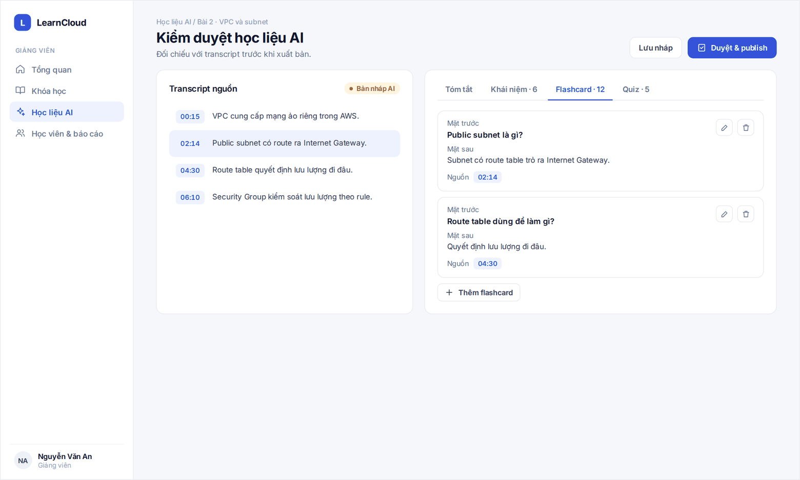  
*Ảnh mẫu giao diện: screens/41.png. Làm đúng bố cục, màu, chữ như ảnh.*

|  | **ĐẾN TỪ** ← 39 · Review · Tóm tắt **BẤM NÚT → ĐẾN** **Tab Tóm tắt** **→ 39** · Review · Tóm tắt **Tab Khái niệm** **→ 40** · Review · Khái niệm **Tab Quiz** **→ 42** · Review · Quiz **Thêm flashcard** *→ Thêm thẻ mới* **Duyệt và publish** **→ 43** · Xác nhận duyệt lesson (hộp thoại) |
| --- | --- |

**GIẢNG VIÊN**

## 42  Review · Quiz

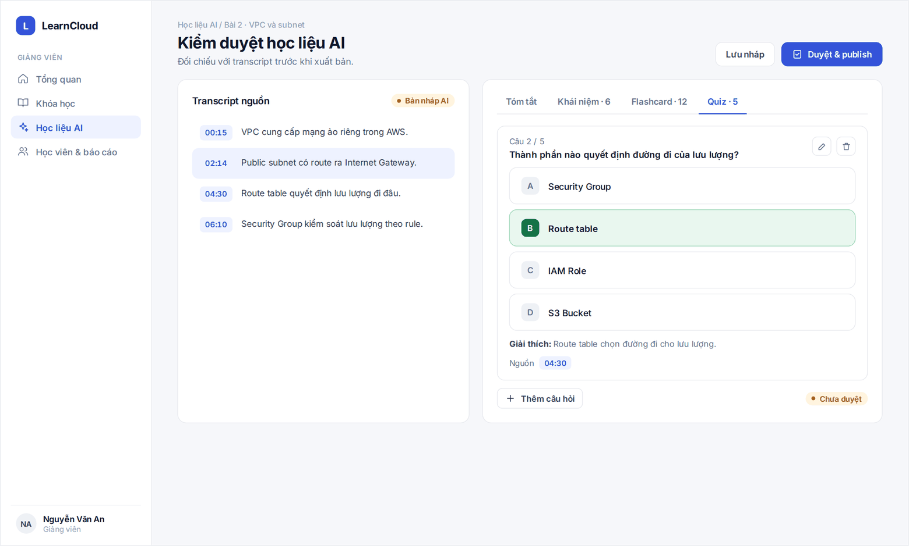  
*Ảnh mẫu giao diện: screens/42.png. Làm đúng bố cục, màu, chữ như ảnh.*

|  | **ĐẾN TỪ** ← 39 · Review · Tóm tắt **BẤM NÚT → ĐẾN** **Tab Tóm tắt** **→ 39** · Review · Tóm tắt **Tab Khái niệm** **→ 40** · Review · Khái niệm **Tab Flashcard** **→ 41** · Review · Flashcard **Thêm câu hỏi** *→ Thêm câu mới* **Duyệt và publish** **→ 43** · Xác nhận duyệt lesson (hộp thoại) **Điều kiện: **Mỗi câu hỏi có đáp án đúng, giải thích và mốc thời gian nguồn. |
| --- | --- |

**GIẢNG VIÊN**

## 43  Xác nhận duyệt lesson (hộp thoại)

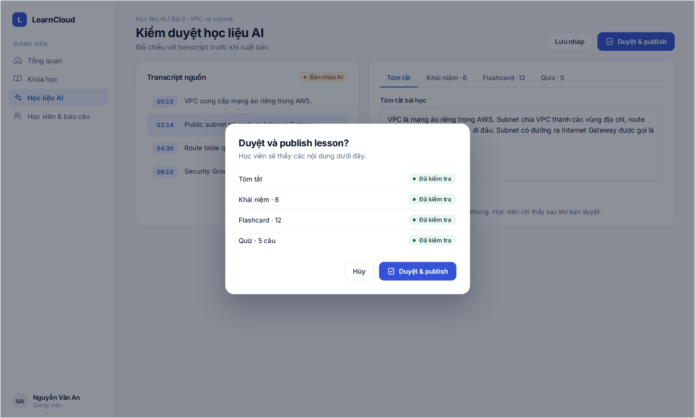  
*Ảnh mẫu giao diện: screens/43.png. Làm đúng bố cục, màu, chữ như ảnh.*

|  | **ĐẾN TỪ** ← 39 · Review · Tóm tắt ← 40 · Review · Khái niệm ← 41 · Review · Flashcard ← 42 · Review · Quiz **BẤM NÚT → ĐẾN** **Duyệt và publish** **→ 38** · Hàng chờ học liệu AI **Hủy** **→ 39** · Review · Tóm tắt **Điều kiện: **Sau khi duyệt, lesson có trạng thái Đã publish. |
| --- | --- |

**GIẢNG VIÊN**

## 44  Publish khóa học (hộp thoại)

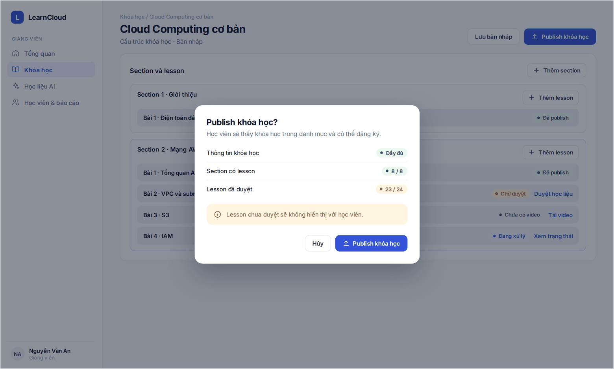  
*Ảnh mẫu giao diện: screens/44.png. Làm đúng bố cục, màu, chữ như ảnh.*

|  | **ĐẾN TỪ** ← 33 · Cấu trúc khóa học **BẤM NÚT → ĐẾN** **Publish khóa học** **→ 31** · Danh sách khóa học **Hủy** **→ 33** · Cấu trúc khóa học **Điều kiện: **Lesson chưa duyệt không hiển thị với học viên. |
| --- | --- |

**GIẢNG VIÊN**

## 45  Học viên và báo cáo

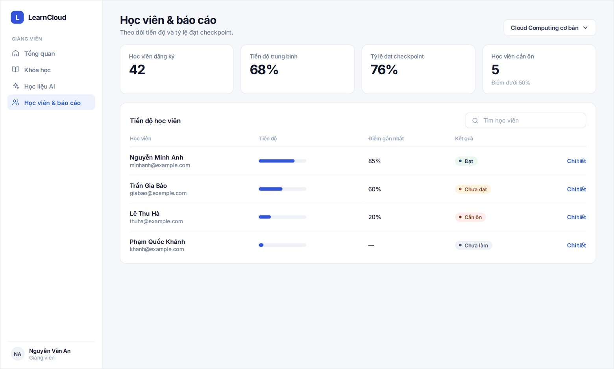  
*Ảnh mẫu giao diện: screens/45.png. Làm đúng bố cục, màu, chữ như ảnh.*

|  | **ĐẾN TỪ** ← Thanh bên: Học viên và báo cáo **BẤM NÚT → ĐẾN** **Chọn khóa học (menu)** *→ ở lại màn này* **Chi tiết** **→ 46** · Chi tiết học viên |
| --- | --- |

**GIẢNG VIÊN**

## 46  Chi tiết học viên

  
*Ảnh mẫu giao diện: screens/46.png. Làm đúng bố cục, màu, chữ như ảnh.*

|  | **ĐẾN TỪ** ← 45 · Học viên và báo cáo **BẤM NÚT → ĐẾN** **Quay lại danh sách** **→ 45** · Học viên và báo cáo |
| --- | --- |

**QUẢN TRỊ VIÊN**

## 47  Quản trị tài khoản

  
*Ảnh mẫu giao diện: screens/47.png. Làm đúng bố cục, màu, chữ như ảnh.*

|  | **ĐẾN TỪ** ← Thanh bên: Tài khoản ← 01 · Đăng nhập ← 50 · Tạo tài khoản thành công ← 51 · Sửa tài khoản **BẤM NÚT → ĐẾN** **Tạo tài khoản** **→ 48** · Tạo tài khoản **Sửa** **→ 51** · Sửa tài khoản **Tìm kiếm và lọc vai trò** *→ ở lại màn này* |
| --- | --- |

**QUẢN TRỊ VIÊN**

## 48  Tạo tài khoản

  
*Ảnh mẫu giao diện: screens/48.png. Làm đúng bố cục, màu, chữ như ảnh.*

|  | **ĐẾN TỪ** ← 47 · Quản trị tài khoản ← 52 · Vai trò và quyền **BẤM NÚT → ĐẾN** **Tạo tài khoản · vai trò Giảng viên** **→ 50** · Tạo tài khoản thành công **Tạo tài khoản · vai trò Quản trị viên** **→ 49** · Xác nhận cấp Admin (hộp thoại) **Tạo ngẫu nhiên** *→ ở lại màn này* **Hủy** **→ 47** · Quản trị tài khoản **Điều kiện: **Học viên không tạo ở đây: họ tự đăng ký ở màn 02. |
| --- | --- |

**QUẢN TRỊ VIÊN**

## 49  Xác nhận cấp Admin (hộp thoại)

  
*Ảnh mẫu giao diện: screens/49.png. Làm đúng bố cục, màu, chữ như ảnh.*

|  | **ĐẾN TỪ** ← 48 · Tạo tài khoản **BẤM NÚT → ĐẾN** **Xác nhận cấp quyền** **→ 50** · Tạo tài khoản thành công **Hủy** **→ 48** · Tạo tài khoản **Điều kiện: **Chỉ Admin hiện hữu mới cấp được vai trò Admin. |
| --- | --- |

**QUẢN TRỊ VIÊN**

## 50  Tạo tài khoản thành công

  
*Ảnh mẫu giao diện: screens/50.png. Làm đúng bố cục, màu, chữ như ảnh.*

|  | **ĐẾN TỪ** ← 48 · Tạo tài khoản ← 49 · Xác nhận cấp Admin (hộp thoại) **BẤM NÚT → ĐẾN** **Về danh sách** **→ 47** · Quản trị tài khoản **Tạo tài khoản khác** **→ 48** · Tạo tài khoản |
| --- | --- |

**QUẢN TRỊ VIÊN**

## 51  Sửa tài khoản

  
*Ảnh mẫu giao diện: screens/51.png. Làm đúng bố cục, màu, chữ như ảnh.*

|  | **ĐẾN TỪ** ← 47 · Quản trị tài khoản **BẤM NÚT → ĐẾN** **Lưu thay đổi** **→ 47** · Quản trị tài khoản **Đặt lại mật khẩu** *→ ở lại màn này* **Khóa tài khoản** **→ 47** · Quản trị tài khoản **Hủy** **→ 47** · Quản trị tài khoản |
| --- | --- |

**QUẢN TRỊ VIÊN**

## 52  Vai trò và quyền

  
*Ảnh mẫu giao diện: screens/52.png. Làm đúng bố cục, màu, chữ như ảnh.*

|  | **ĐẾN TỪ** ← Thanh bên: Vai trò và quyền **BẤM NÚT → ĐẾN** **Tạo tài khoản** **→ 48** · Tạo tài khoản **Điều kiện: **Chỉ xem, vai trò cố định theo hệ thống. |
| --- | --- |

**QUẢN TRỊ VIÊN**

## 53  Giám sát hệ thống

  
*Ảnh mẫu giao diện: screens/53.png. Làm đúng bố cục, màu, chữ như ảnh.*

|  | **ĐẾN TỪ** ← Thanh bên: Giám sát hệ thống **BẤM NÚT → ĐẾN** **Xem (job lỗi)** **→ 54** · Chi tiết job lỗi (hộp thoại) **Điều kiện: **Dữ liệu minh họa; bản triển khai lấy từ CloudWatch. |
| --- | --- |

**QUẢN TRỊ VIÊN**

## 54  Chi tiết job lỗi (hộp thoại)

  
*Ảnh mẫu giao diện: screens/54.png. Làm đúng bố cục, màu, chữ như ảnh.*

|  | **ĐẾN TỪ** ← 53 · Giám sát hệ thống **BẤM NÚT → ĐẾN** **Chạy lại** **→ 53** · Giám sát hệ thống **Mở CloudWatch** *→ Mở trang ngoài* **Đóng** **→ 53** · Giám sát hệ thống |
| --- | --- |

**CHUNG**

## 55  Hồ sơ và đổi mật khẩu

  
*Ảnh mẫu giao diện: screens/55.png. Làm đúng bố cục, màu, chữ như ảnh.*

|  | **ĐẾN TỪ** ← Bấm thẻ người dùng cuối thanh bên (mọi vai trò) **BẤM NÚT → ĐẾN** **Lưu thay đổi** *→ ở lại màn này* **Đổi mật khẩu** *→ ở lại màn này* **Đăng xuất** **→ 01** · Đăng nhập |
| --- | --- |

**CHUNG**

## 56  Không có quyền truy cập

  
*Ảnh mẫu giao diện: screens/56.png. Làm đúng bố cục, màu, chữ như ảnh.*

|  | **ĐẾN TỪ** ← Mở địa chỉ không đủ quyền **BẤM NÚT → ĐẾN** **Về trang chính (học viên)** **→ 07** · Khám phá khóa học **Về trang chính (giảng viên)** **→ 30** · Tổng quan giảng viên **Về trang chính (quản trị viên)** **→ 47** · Quản trị tài khoản |
| --- | --- |

	LearnCloud  ·  Bộ giao diện và luồng thao tác	4

	LearnCloud  ·  Bộ giao diện và luồng thao tác	2

	LearnCloud  ·  Bộ giao diện và luồng thao tác	9